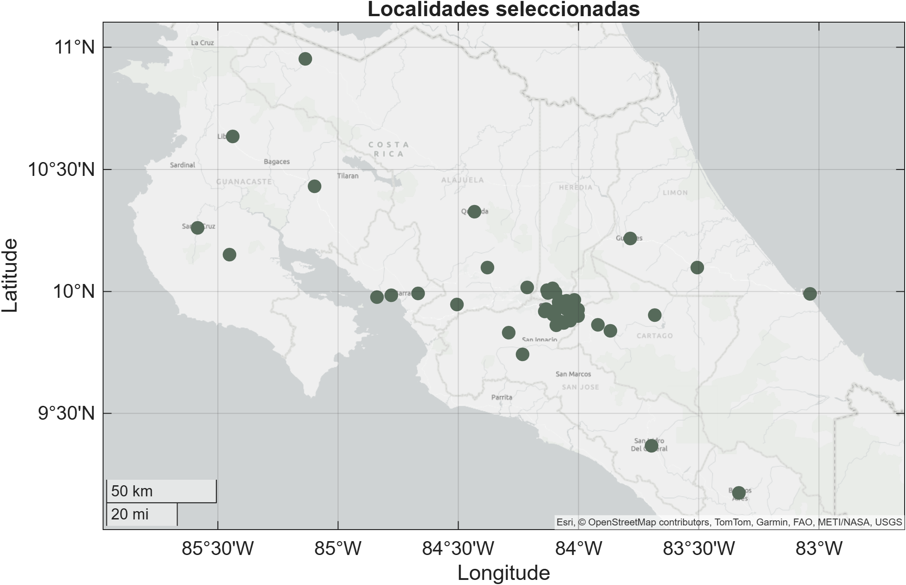
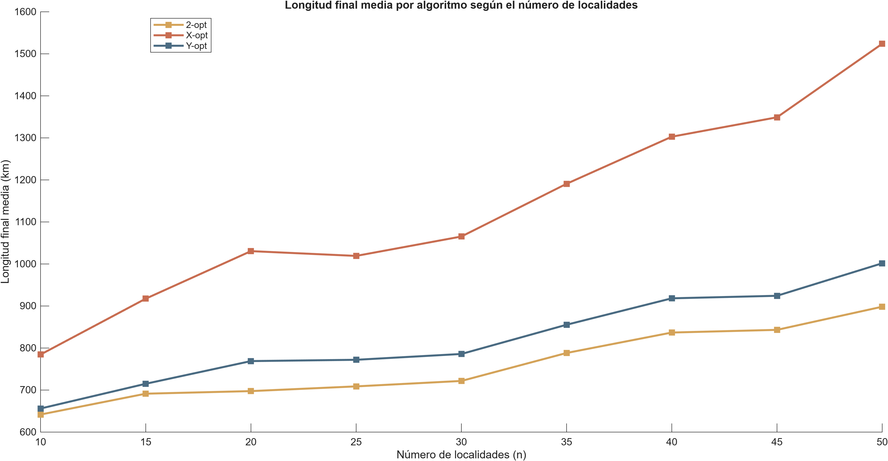
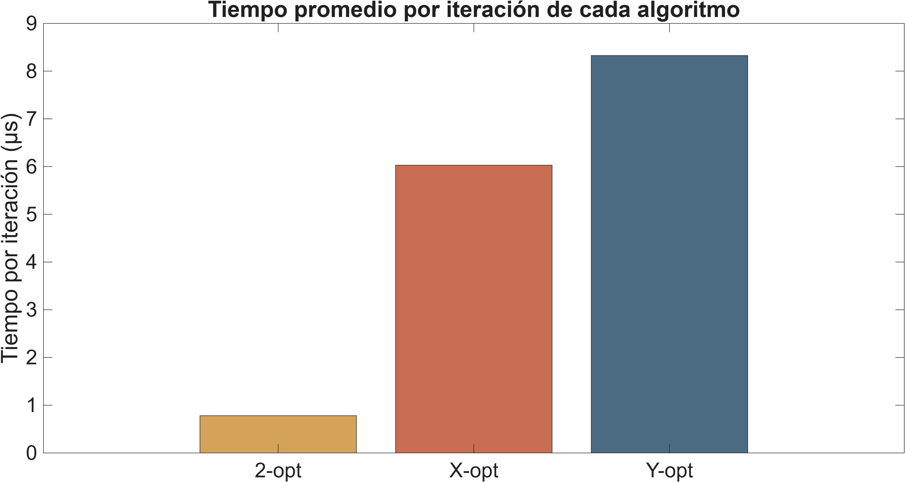

```{=latex}
\begin{center}
```

```{=latex}
{\fontsize{13pt}{14pt}\selectfont\textbf{Comparación de los algoritmos X-opt, Y-opt y 2-opt para optimizar rutas en localidades de Costa Rica}}
```

```{=latex}
{\fontsize{11pt}{14pt}\selectfont Alexandra González, Estefanía Mora, Daniela Prado y José Miguel Rodríguez}
```

```{=latex}
{\fontsize{9pt}{14pt}\selectfont ALEXANDRA.GONZALEZBERMUDEZ@ucr.ac.cr, EMILY.MORACONTRERAS@ucr.ac.cr, DANIELA.PRADOVARGAS@ucr.ac.cr, JOSE.RODRIGUEZGOMEZ@ucr.ac.cr}
```

```{=latex}
\end{center}
```

```{=latex}
\begin{center}
```

```{=latex}
{\fontsize{12pt}{14pt}\selectfont\textbf{RESUMEN}}
```

```{=latex}
\end{center}
```


El presente trabajo compara el desempeño de los algoritmos X-opt, Y-opt y 2-opt bajo el problema del viajero en un conjunto de 50 localidades de Costa Rica. Los métodos se implementaron en Python y se evaluaron sobre las mismas 100 rutas iniciales aleatorias, utilizando una matriz de distancias euclidianas calculada a partir de coordenadas planas. Se analizaron las longitudes finales, los porcentajes de mejora, el número de iteraciones totales y los tiempos de ejecución. Además, se exploraron tanto la aplicación repetida de un mismo algoritmo como la aplicación de las distintas secuencias de los tres métodos. En lo que respecta a los algoritmos individuales, 2-opt obtuvo la menor longitud media, con 898,31 km, frente a 1001,64 km de Y-opt y 1523,92 km de X-opt. Su reducción media respecto a las rutas iniciales fue del 71,28 %. En las pruebas de aplicación repetida, las rutas permanecieron sin cambios al ejecutar nuevamente el mismo algoritmo. Por su parte, la secuencia X-opt → Y-opt → 2-opt produjo recorridos más cortos que 2-opt directo en 38 de las 100 comparaciones, pero presentó una mayor longitud media y un mayor tiempo medio de ejecución. Los resultados indican que, bajo los datos y las implementaciones estudiadas, 2-opt directo ofreció el mejor desempeño promedio entre las estrategias evaluadas. Finalmente, los resultados de los algoritmos se contrastaron con los de una búsqueda exhaustiva, evidenciando que las soluciones de los mismos logran aproximarse con alta precisión a la distancia mínima global en un tiempo muy reducido.

**PALABRAS CLAVE**: Traveling Salesman Problem (TSP), búsqueda local, 2-opt, X-opt, Y-opt, optimización de rutas.


```{=latex}
\begin{center}
```

```{=latex}
{\fontsize{12pt}{14pt}\selectfont\textbf{INTRODUCCIÓN}}
```

```{=latex}
\end{center}
```

El problema del viajante consiste en encontrar un recorrido de longitud mínima que visite un conjunto de localidades exactamente una vez y regrese al punto de partida. El crecimiento del número de recorridos posibles conforme aumenta la cantidad de localidades dificulta su resolución mediante la exploración exhaustiva, ya que este número crece de forma factorial. Por ello, se emplean métodos heurísticos que permiten obtener soluciones aproximadas sin examinar todos los recorridos posibles [@flood1956].

El proyecto posee el objetivo de comparar el desempeño de los algoritmos X-opt, Y-opt y 2-opt en un conjunto delimitado de localidades de Costa Rica, tomando como referencia el estudio de @manthey2025performance. Estos métodos modifican una ruta inicial mediante distintos criterios de selección de intercambios. Además de estudiar su desempeño individual, se explora el efecto de aplicar repetidamente un mismo algoritmo y de combinar los tres métodos en distintos órdenes, con el propósito de examinar cómo estas estrategias influyen en la longitud de los recorridos y en el esfuerzo computacional requerido.

El estudio considera un conjunto de 50 localidades seleccionadas del archivo `CR.txt` [@geonames], según los criterios descritos en la sección de datos. Sus coordenadas geográficas se convierten a coordenadas planas expresadas en kilómetros, a partir de las cuales se construye una matriz de distancias euclidianas. Estas distancias constituyen una aproximación geométrica y no incorporan la red vial, las condiciones del tránsito, los tiempos de traslado ni las restricciones de acceso; además, se asume que la distancia entre un punto y otro es la misma de ida y vuelta.

Los algoritmos se implementan en Python y la comparación utiliza 100 rutas iniciales aleatorias sobre el conjunto de localidades seleccionado. Su desempeño se evalúa mediante la longitud final de los recorridos, el número de intercambios y el tiempo de ejecución. Asimismo, el análisis se complementa con gráficos elaborados en MATLAB y visualizaciones que permiten examinar las modificaciones de las rutas durante el proceso de mejora. Adicionalmente, con el propósito de validar la calidad de las soluciones obtenidas a partir de la aplicación de los algoritmos, se implementa un algoritmo de búsqueda exhaustiva sobre un subconjunto reducido de localidades, lo que permite comparar los óptimos locales obtenidos por X-opt, Y-opt y 2-opt con el óptimo global.

El análisis tiene un carácter experimental y busca contrastar los resultados obtenidos con el comportamiento descrito en el artículo de referencia, considerando las características y las limitaciones del conjunto de localidades seleccionado. Sus conclusiones se restringen a los datos, las implementaciones y los escenarios estudiados, sin constituir una reproducción de las demostraciones teóricas del artículo.

```{=latex}
\begin{center}
```

```{=latex}
{\fontsize{12pt}{14pt}\selectfont\textbf{METODOLOGÍA}}
```

```{=latex}
\end{center}
```

El punto de partida de la metodología consistió en identificar que el problema del viajero constituye un problema NP-hard, de manera que no se conoce un algoritmo que encuentre una solución óptima en un tiempo razonable cuando el tamaño del problema crece. Dicho aspecto hizo necesaria una combinación de métodos indagatorios, descriptivos y comparativos, para satisfacer tres objetivos objetivos principales: definir una base de datos utilizable bajo el contexto del problema, disponer de la información requerida para desarrollar de forma coherente los algoritmos en la implementación y tanto analizar como comparar los resultados obtenidos a partir de dicha implementación.


```{=latex}
\begin{center}
```

```{=latex}
{\fontsize{11pt}{14pt}\selectfont\textbf{DATOS}}
```

```{=latex}
\end{center}
```

Los datos provienen del *gazetteer* de GeoNames, en el archivo `CR.txt`, que corresponde al extracto de Costa Rica y se distribuye bajo la licencia Creative Commons Attribution 4.0 [@geonames]. El archivo está en texto delimitado por tabulaciones, con codificación UTF-8 y sin fila de encabezado, y contiene 21 426 registros y 19 variables. Cada registro describe un rasgo geográfico y no necesariamente un poblado: los rasgos se clasifican en nueve clases, entre las que predominan los cuerpos de agua (6 801 registros) y los lugares poblados, clase `P`, con 5 900 registros, que es la clase de interés para este proyecto.

De las 19 variables se utilizaron siete: el identificador del registro (`geonameid`), el nombre, la latitud y la longitud en grados decimales (WGS84), la clase y el código del tipo de rasgo (por ejemplo, `PPL`, `PPLA` o `PPLC`), la división administrativa de primer nivel (`admin1`), que se tradujo al nombre de la provincia con el archivo `admin1CodesASCII.txt` de GeoNames, y la población reportada. Las coordenadas son la base para construir las coordenadas planas y la matriz de distancias, y la población se emplea como criterio de selección. Las variables restantes no intervienen en los algoritmos; además, `elevacion` está vacía en el 99,6 % de los registros (21 349 de 21 426) y `admin4` está vacía en prácticamente todos.

Se conservaron los registros de clase P, excluyendo poblados abandonados, destruidos o históricos (PPLQ, PPLW y PPLH), y aquellos con población igual a cero, que representan el 97,8 % del archivo. También se eliminaron las coordenadas coincidentes al redondear a tres decimales, conservando en cada caso el registro de mayor población. Esto permite cumplir el supuesto de posiciones distintas usado por X-opt para detectar cruces de aristas (@manthey2025performance). De las 128 localidades resultantes se eligieron las 50 más pobladas, ordenadas de mayor a menor y numeradas del 0 al 49 para representar las rutas.

Las coordenadas geográficas se convirtieron a coordenadas planas en kilómetros mediante la proyección equirectangular (cilíndrica equidistante) para la esfera [@snyder1987, pp. 90-91], con $x = R\cos(\varphi_1)(\lambda-\lambda_0)$ y $y = R(\varphi-\varphi_0)$, donde $R = 6371$ km es el radio medio terrestre, $\varphi_1$ es el paralelo estándar, $(\varphi_0,\lambda_0)$ es el origen del plano y los ángulos se expresan en radianes. Se tomó como origen el promedio de las latitudes y de las longitudes de las 50 localidades, y el paralelo estándar se fijó en esa misma latitud, es decir, $\varphi_1=\varphi_0$; restar $\varphi_0$ en $y$ solo traslada el origen. Esto es necesario porque X-opt requiere determinar si dos aristas se cruzan en el plano [@manthey2025performance]. A partir de estas coordenadas se construyó la matriz de distancias euclidianas de tamaño $50 \times 50$, que es simétrica y tiene ceros en la diagonal.

La población de las 50 localidades varía entre 11 680 y 335 007 habitantes, con mediana de 25 198 y media de 31 050; el valor máximo corresponde a San José. La distribución espacial se concentra en esa provincia, que reúne 24 localidades, y 30 de las 50 se ubican a 20 km o menos del centro de la capital (@fig-localidades). Esta concentración difiere de la distribución uniforme utilizada por @manthey2025performance y se considerará al comparar los resultados.

{#fig-localidades width=60%}

El conjunto de 50 localidades presenta tres limitaciones. En primer lugar, la selección se basa en la población registrada por GeoNames, aunque el 97,8 % de los lugares poblados del archivo tiene un valor de cero. Por ello, solo el 2,2 % restante puede entrar en la selección. Además, las cifras no provienen de un censo oficial, por lo que no constituye una medida precisa de su tamaño.

En segundo lugar, seis localidades, entre ellas San Francisco e Ipís, tienen el código `PPLX`, que identifica secciones de un lugar poblado y no poblados independientes. También hay dos localidades llamadas «San José» (índices 0 y 10). Son lugares distintos, con coordenadas diferentes, por lo que se distinguen mediante sus índices.

Por último, el criterio de escoger las localidades más pobladas concentra el conjunto en el área metropolitana de San José (@fig-localidades). Esta distribución limita la representatividad territorial y debe considerarse al interpretar los resultados.

```{=latex}
\begin{center}
```

```{=latex}
{\fontsize{11pt}{14pt}\selectfont\textbf{FORMULACIÓN DE LOS MÉTODOS}}
```

```{=latex}
\end{center}
```


La metodología se organizó en cuatro métodos complementarios: la construcción de la fundamentación teórica que sostiene al proyecto, la definición de las métricas de interés para el análisis, la implementación de los diversos algoritmos en el lenguaje de programación Python y la valoración del desempeño de los algoritmos en base a las métricas definidas y algunas prueba adicionales. Esta organización permitió avanzar desde una interiorización del fundamento teórico hacia un análisis más específico en torno al desempeño mostrado por cada algoritmo. A continuación, se detalla a mayor profundidad los métodos mencionados. 
 

```{=latex}
\begin{center}
```

```{=latex}
{\fontsize{11pt}{14pt}\selectfont\textbf{CONSTRUCCIÓN DE LA FUNDAMENTACIÓN TEÓRICA}}
```

```{=latex}
\end{center}
```

En la construcción de la fundamentación teórica que sostiene al proyecto, se abordaron cuatro temas: el problema del viajante, el algoritmo 2-opt, el algoritmo X-opt y el algoritmo Y-opt. Previo a adentrarse en tales elementos, se debe destacar que el presente estudio toma como referencia el artículo de @manthey2025performance, titulado *Performance of efficient variants of the 2-Opt heuristic for the traveling salesperson problem*, en el cual los autores analizan la relación entre la calidad de las soluciones y las garantías sobre el tiempo de ejecución de los algoritmos detallados. 


En primer lugar, se tiene que el problema del viajero consiste en encontrar un recorrido cerrado de longitud mínima que visite cada localidad exactamente una vez y regrese al punto de partida. Su versión de optimización se clasifica como NP-hard, incluso cuando las distancias son euclidianas [@manthey2025performance]. Esta clasificación indica que el problema es, al menos, tan difícil como cualquier problema de la clase NP. Actualmente, no se conoce un algoritmo que garantice obtener una solución óptima en tiempo polinomial para todas sus instancias. 

Ante esta dificultad, se utilizan métodos heurísticos que buscan obtener recorridos de buena calidad con un esfuerzo computacional manejable. Entre ellos se encuentran las heurísticas de búsqueda local, que parten de una ruta inicial y la modifican sucesivamente mediante movimientos que reducen su longitud. El criterio utilizado para aceptar estos movimientos determina tanto las mejoras disponibles como la condición de terminación del procedimiento. Cuando ningún movimiento permitido reduce la longitud, se alcanza un óptimo local respecto a ese conjunto de movimientos. Sin embargo, esta condición no garantiza que el recorrido sea el más corto entre todos los posibles. Esta distinción resulta fundamental para interpretar las soluciones obtenidas mediante X-opt, Y-opt y 2-opt.

En segundo lugar, se profundiza en el algoritmo 2-opt. El algoritmo 2-opt es una heurística de búsqueda local que mejora una ruta mediante el intercambio de dos aristas no adyacentes. En cada paso, estas aristas se eliminan y se sustituyen por otras dos, conservando un único recorrido cerrado que visite cada localidad exactamente una vez. El intercambio se acepta únicamente cuando reduce la longitud total de la ruta [@manthey2025performance].

Sea $T$ una ruta y considere las aristas $e_1=(a,b)$ y $f_1=(c,d)$, cuyos extremos aparecen en ese orden en el recorrido. El movimiento 2-opt sustituye estas aristas por $e_2=(a,c)$ y $f_2=(b,d)$, lo cual requiere invertir el orden del segmento comprendido entre $b$ y $c$. Si $\ell(e)$ representa la longitud de una arista $e$, el criterio de aceptación es $\ell(e_2)+\ell(f_2)<\ell(e_1)+\ell(f_1).$

Como las distancias utilizadas en este proyecto son simétricas, invertir el segmento intermedio no modifica la suma de sus distancias internas. Por tanto, basta con comparar las dos aristas eliminadas con las dos nuevas. La longitud de la ruta modificada $T'$ satisface $\ell(T')=\ell(T)-\ell(e_1)-\ell(f_1)+\ell(e_2)+\ell(f_2).$ En consecuencia, el criterio de aceptación garantiza que $\ell(T')<\ell(T)$.

La terminación se justifica porque existe una cantidad finita de recorridos y cada intercambio aceptado disminuye estrictamente la longitud. Por ello, el algoritmo no puede regresar a una ruta anteriormente visitada. Al finalizar, se obtiene un óptimo local respecto de los movimientos 2-opt, es decir, una ruta que no puede acortarse mediante ninguno de estos intercambios. Esta condición no garantiza que se haya encontrado el óptimo global.

Para analizar el esfuerzo computacional, una ruta cerrada de $n$ localidades tiene $n$ aristas. De las parejas posibles, se excluyen las $n$ parejas de aristas adyacentes, por lo que una exploración completa considera $\binom{n}{2} - n=\frac{n(n-1)}{2}-n=\frac{n(n-3)}{2}$ parejas válidas. 

Este valor corresponde al número de parejas examinadas en una pasada completa, no al número total de evaluaciones durante toda la ejecución. Al aceptar una mejora, la búsqueda se reinicia y puede volver a examinar parejas sobre la ruta modificada. Aunque cada pasada requiere un número de evaluaciones de orden $O(n^2)$, esto no implica que la ejecución completa tenga un costo cuadrático. También debe considerarse la cantidad de intercambios y de reinicios necesarios para alcanzar un óptimo local; 2-opt puede requerir un número exponencial de pasos en casos desfavorables [@manthey2025performance], por lo tanto, los tiempos reducidos observados en los experimentos describen su comportamiento en las instancias estudiadas, sin establecer una garantía general de tiempo polinomial.


En tercer lugar, de acuerdo con @manthey2025performance, el algoritmo X-opt corresponde a una variante del algoritmo 2-opt, en la que el reemplazo de dos aristas solo está permitido si dichas aristas se cruzan entre sí. Lo anterior solo está bien definido para distancias euclidianas en $\mathbb{R}^{2}$. Considere $L(x, y)$ como el segmento de recta entre $x$ y $y$, en vías de facilitar la notación si $e = \{x, y\}$ con $x \neq y$, entonces se escribe $L(e) = L(x, y)$. Se dice que un conjunto $T$ de aristas presenta cruces si existen $e, f \in T$ que no comparten ningún extremo y que cumplen $L(e) \cap L(f) \neq \emptyset$. Por el contrario, $T$ no presenta cruces si para todo par de aristas no adyacentes $e, f \in T$, se cumple que $L(e) \cap L(f) = \emptyset$. Bajo X-opt un óptimo local es precisamente un recorrido sin cruces entre sus aristas, donde se entiende a un óptimo local como un recorrido que no puede mejorarse mediante ninguna de las modificaciones permitidas por el algoritmo. Por otro lado, con el objetivo de evitar contradicciones en lo que concierne a la definición de cruce, se asume que no es posible que más de un punto se sitúe en una misma posición.

De manera general, sea $T$ un recorrido a través de un conjunto de puntos $\mathcal{X} ⊆ \mathbb{R}^{2}$. Si $T$ presenta cruces, el modo de operación del algoritmo radica en identificar dos aristas no adyacentes $e, f \in T$ que se intersecten, y sustituirlas por nuevas aristas que permitan obtener un recorrido válido con una menor longitud total. Este procedimiento se repite mientras existan cruces en el recorrido, hasta obtener uno sin intersecciones entre aristas no adyacentes.

Para comprender el mecanismo de optimización, es necesario considerar que el intercambio de aristas corresponde a una modificación de tipo 2-opt. Sean $e=\{a,b\}$ y $f=\{c,d\}$ dos aristas no adyacentes que se intersectan. El procedimiento consiste en eliminar dichas aristas y reconectar sus extremos mediante dos nuevas aristas, de manera que se conserve la validez del recorrido. Debido a que las aristas originales presentan un cruce, la nueva conexión permite sustituir dos segmentos que se intersectan por otros dos que no presentan dicha intersección. En consecuencia, si $T$ representa el recorrido original y $T'$ el recorrido después de efectuar el intercambio, se cumple que $\ell(T') < \ell(T),$ puesto que constituye un intercambio del tipo 2-opt. Así, cada intercambio constituye una mejora respecto a la configuración anterior. El algoritmo continúa aplicando este procedimiento sobre el recorrido resultante, hasta que no sea posible identificar otro par de aristas no adyacentes que se intersecten.

En relación con la cantidad de iteraciones, @manthey2025performance establecen que la heurística X-opt siempre termina en $O(n^3)$ iteraciones, donde $n$ representa la cantidad de puntos del conjunto considerado. Esta expresión corresponde a una cota del número de iteraciones, lo que significa que el crecimiento de estas se encuentra acotado por un orden cúbico respecto al tamaño de la instancia. Sin embargo, no representa una cantidad exacta de iteraciones, puesto que el número efectivamente realizado depende del recorrido inicial y de los pares de aristas seleccionados durante la ejecución. Por consiguiente, el criterio de terminación no consiste en alcanzar una cantidad predeterminada de iteraciones, sino en obtener un recorrido que no presente cruces entre sus aristas no adyacentes. De acuerdo con la definición de X-opt, esta condición caracteriza precisamente un óptimo local. 


En cuarto lugar, se detalla el algoritmo Y-opt. El algoritmo Y-opt es una variante del algoritmo 2-opt. Como se vio anteriormente, el algoritmo 2-opt acepta un intercambio de aristas si la suma de las longitudes de las dos aristas nuevas es menor que la suma de las dos aristas viejas; esto se hace comparando únicamente las aristas que se modificaron, ya que el resto de la ruta permanece igual. Por otro lado, el algoritmo Y-opt impone una condición de cambio más estricta, donde, para aceptar un cambio en la ruta, la arista más larga de las nuevas debe ser más corta que la arista más larga de las viejas, y, además, la arista más corta de las nuevas debe ser más corta que la arista más corta de las viejas. Esto hace que el algoritmo Y-opt sea más restrictivo en su condición de aceptación de nuevas rutas, ya que no solo compara la suma total, sino el tamaño individual de cada arista.

La principal ventaja del algoritmo Y-opt es que el número de iteraciones para una ruta de $n$ vértices y $m$ aristas está acotado por $(m-1)n$ [@manthey2025performance], resultando en un tiempo de ejecución polinomial. A pesar de que el algoritmo Y-opt sea más estricto, los resultados teóricos muestran que este algoritmo tiene resultados similares a los del 2-opt, llegando a rutas ligeramente más largas pero en un tiempo de ejecución acotado [@manthey2025performance].

Matemáticamente, se tiene una ruta $T$ en un grafo completo de $n$ vértices, lo que quiere decir que una vez llegado al último vértice $n$, se debe devolver al primero, y se definen a la vez dos aristas no adyacentes $e_1$ y $f_1$ de la ruta $T$. Bajo el algoritmo 2-opt tradicional, para aceptar un intercambio de aristas debe cumplirse que la suma de las distancias entre las dos aristas antiguas sea mayor que la distancia entre las dos aristas nuevas, es decir $\ell(e_1) + \ell(f_1) > \ell(e_2) + \ell(f_2)$ donde $\ell(e_2)$ y $\ell(f_2)$ representan dos aristas nuevas. Sin embargo, el algoritmo Y-opt propuesto por @manthey2025performance, impone una condición más estricta para realizar el intercambio entre aristas. Si se asume que $\ell(e_1)$ es mayor o igual que $\ell(f_1)$ y que $\ell(e_2)$ es mayor o igual que $\ell(f_2)$, el intercambio se acepta solamente si $\ell(e_1) \geq \ell(e_2)$ y $\ell(f_1) \geq \ell(f_2)$ simultáneamente y donde al menos una de las desigualdades debe ser estricta, lo cual quiere decir, como se mencionó anteriormente, un intercambio solo se acepta cuando se cumplen dos cosas: primero, que la longitud de la arista antigua más grande sea mayor o igual que la longitud de la arista nueva más grande y segundo, que la longitud de la arista antigua más pequeña sea mayor o igual que la longitud de la arista nueva más pequeña. 

En cuanto a la optimización, el algoritmo Y-opt utiliza una estrategia de búsqueda local llamada búsqueda de la primera mejora, ya que, conforme el algoritmo realiza las comparaciones entre los pares de aristas, en el momento en que encuentra dos pares que cumplen la condición, realiza el intercambio de aristas y vuelve a empezar con la búsqueda desde el inicio de la ruta $T$; esto ahorra numerosas iteraciones debido a que no siempre realizará todas las combinaciones posibles. A pesar de que se llega a un óptimo local, la implementación de este algoritmo disminuye en gran medida tanto el tiempo de ejecución como el número de iteraciones totales, ya que matemáticamente garantiza un tiempo de ejecución polinómico. Según el *Teorema 5* de @manthey2025performance, el número de iteraciones máximas para alcanzar una ruta Y-óptima en un grafo de $n$ vértices y $m$ aristas (el total de posibles aristas) es de $(m-1)n$.

Para este proyecto, se utilizaron 50 localidades de Costa Rica, con un grafo completo, por lo que, el número de aristas sería:
$$m = \frac{n(n-1)}{2} = \frac{50(50-1)}{2}= 1225$$
Donde, aplicando el *Teorema 5* mencionado antes, se obtendría un máximo teórico de iteraciones de $(1225-1)50 = 61200$.


```{=latex}
\begin{center}
```

```{=latex}
{\fontsize{11pt}{14pt}\selectfont\textbf{DEFINICIÓN DE LAS MÉTRICAS DE INTERÉS PARA EL ANÁLISIS}}
```

```{=latex}
\end{center}
```


Para evaluar y comparar el rendimiento de los tres algoritmos: 2-opt, X-opt y Y-opt, se utilizarán las medidas detalladas a continuación.

La primera medida a recopilar consiste en la longitud de la ruta optimizada, la cual corresponde a la longitud final medida en kilómetros de cada ruta optimizada según el algoritmo; esta medida incluye todo el recorrido realizado y el regreso desde el punto final hasta el punto de partida inicial. De esta forma, es posible comparar qué tan grande o qué tan pequeña es la ruta de un algoritmo con respecto a las demás.

Después, se define como medida de interés al tiempo de ejecución, que es el tiempo medido en segundos de la duración de cada algoritmo en encontrar su solución respectiva. Lo anterior permitirá comparar la rapidez de cada algoritmo para encontrar el recorrido óptimo local.

El número de iteraciones totales se considera también una medida de interés. Representa el número total de operaciones computacionales que realiza cada algoritmo durante su ejecución, incluyendo las vueltas de los ciclos y las parejas de aristas evaluadas; esta medida permitirá analizar el esfuerzo computacional requerido por cada algoritmo.

Por otro lado, se recopilará la ruta final obtenida, una lista que contiene a los índices que representan el orden en que se visitó cada ciudad. Con dicho recurso se realizarán los gráficos y se compararán las rutas creadas por cada algoritmo.

Finalmente, se obtendrá el porcentaje de mejora con respecto a la ruta inicial, que se calculará como: 

$$\frac{\text{longitud inicial} - \text{longitud final}} {\text{longitud inicial}} \times 100. $$

Tal medida permitirá evaluar cuánto mejoró la solución de cada algoritmo con respecto a la ruta inicial creada aleatoriamente.

La finalidad de obtener las métricas antes mencionadas se centra en realizar comparaciones entre algoritmos. Es importante destacar que, con tal de que dichas comparaciones guarden una coherencia, los tres algoritmos utilizarán la misma ruta inicial y la misma matriz de distancias.

```{=latex}
\begin{center}
```

```{=latex}
{\fontsize{11pt}{14pt}\selectfont\textbf{IMPLEMENTACIÓN DE LOS ALGORITMOS EN PYTHON}}
```

```{=latex}
\end{center}
```

Los tres algoritmos que contempla el proyecto: 2-opt, X-opt y Y-opt fueron implementados en el lenguaje de programación Python, junto con la preparación de los datos y las pruebas. Se realizó un estudio computacional y experimental para compararlos sobre 50 localidades de Costa Rica, tomando como referencia a @manthey2025performance. 

Las localidades se seleccionaron del archivo `CR.txt`, según los criterios descritos en la sección de datos. Sus coordenadas geográficas se transformaron a coordenadas planas en kilómetros mediante una proyección equirectangular, a la vez que se construyó una matriz de distancias euclidianas. Cada ruta visitó todas las localidades exactamente una vez e incluyó el regreso al punto inicial.

Los algoritmos utilizaron una estrategia de búsqueda de la primera mejora, reiniciando la exploración después de cada intercambio aceptado y terminando cuando no se encontraron nuevas mejoras. Tras realizar pruebas preliminares con 15 localidades, se generaron 100 rutas iniciales aleatorias con una semilla fija de valor 2026. Los tres métodos recibieron las mismas rutas y utilizaron la misma matriz de distancias. Se registraron las longitudes finales, los porcentajes de mejora, el número de iteraciones totales y los tiempos de ejecución.

Como pruebas complementarias, se examinó si aplicar nuevamente un algoritmo sobre su propia solución producía cambios. También se evaluaron, sobre una ruta inicial, todas las secuencias de dos y tres algoritmos sin repetición. A partir de esta exploración, se seleccionó la secuencia X-opt → Y-opt → 2-opt para aplicarla a las 100 rutas y compararla con 2-opt de manera directa. Además de esto, para validar la calidad de las soluciones locales encontradas por los algoritmos, se implementó un algoritmo de búsqueda exhaustiva, el cual revisa todas las rutas posibles y encuentra la ruta de menor longitud globalmente. Sin embargo, debido a su complejidad factorial, se implementó el algoritmo en una ruta de 11 ciudades en la cual se evaluarán $11! = 39916800$ permutaciones; los resultados obtenidos se compararán con los resultados de los tres algoritmos una vez aplicados a una ruta aleatoria de 11 ciudades. Después, partiendo del hecho de que se conoce la ruta óptima de las 11 localidades, encontrada mediante el algoritmo de búsqueda exhaustiva, se evaluará la convergencia de los tres algoritmos a esta última, fijando progresivamente las localidades en el orden de la ruta óptima y estableciendo el máximo de fijaciones en tres. 

Por último, se adjunta la lógica subyacente a la programación de cada algoritmo. 

\begin{algorithm}[H]
\caption{Algoritmo 2-opt}
\label{alg:2opt}
\begin{algorithmic}[1]

\Require Ruta inicial $R$ y matriz de distancias $D$
\Ensure Ruta optimizada $R'$

\State $R' \gets R$
\State $mejorar \gets \text{Verdadero}$

\While{$mejorar$}
    \State $mejorar \gets \text{Falso}$
    \ForAll{las parejas de aristas no adyacentes $(a,b)$ y $(c,d)$ de $R'$}
        \If{$D[a,c]+D[b,d] < D[a,b]+D[c,d]$}
            \State Invertir el orden de las localidades ubicadas entre las dos aristas seleccionadas: $b$ y $c$
            \State $mejorar \gets \text{Verdadero}$
            \State Reiniciar la búsqueda
        \EndIf
    \EndFor
\EndWhile

\State \Return $R'$

\end{algorithmic}
\end{algorithm}

\begin{algorithm}[H]
\caption{Algoritmo X-opt}
\label{alg:xopt}
\begin{algorithmic}[1]

\Require Ruta inicial $R$, matriz de distancias $D$ y coordenadas $C$
\Ensure Ruta optimizada $R'$

\State $mejorar \gets \text{Verdadero}$

\While{$mejorar$}
    \State $mejorar \gets \text{Falso}$
    \ForAll{las parejas de aristas no adyacentes $(a,b)$ y $(c,d)$ de $R$}
        \If{las aristas se cruzan}
            \If{$D[a,c]+D[b,d] < D[a,b]+D[c,d]$}
                \State Invertir el orden de las localidades ubicadas entre las dos aristas seleccionadas: $b$ y $c$
                \State $mejorar \gets \text{Verdadero}$
                \State Reiniciar la búsqueda
            \EndIf
        \EndIf
    \EndFor
\EndWhile

\State \Return $R'$

\end{algorithmic}
\end{algorithm}

\begin{algorithm}[H]
\caption{Algoritmo Y-opt}
\label{alg:yopt}
\begin{algorithmic}[1]

\Require Ruta inicial $ruta\_inicial$ y matriz de distancias $D$
\Ensure Ruta mejorada $ruta\_copia$ y número de parejas examinadas $iteraciones$

\State $ruta\_copia \gets ruta\_inicial$
\State $n \gets$ cantidad de localidades de la ruta
\State $iteraciones \gets 0$
\State $mejorada \gets \text{Verdadero}$

\While{$mejorada$}
    \State $mejorada \gets \text{Falso}$
    \For{$i \gets 0$ hasta $n-2$}
        \For{$j \gets i+2$ hasta $n-1$}
            \If{$i=0$ y $j=n-1$}
                \State Continuar con la siguiente pareja
            \EndIf
            \State Identificar las aristas $(a,b)$ y $(c,d)$
            \State $iteraciones \gets iteraciones + 1$
            \State $viejas \gets (D[a,b],D[c,d])$
            \State $nuevas \gets (D[a,c],D[b,d])$
            \If{$\max(nuevas)<\max(viejas)$ y $\min(nuevas)<\min(viejas)$}
                \State Invertir el segmento entre $b$ y $c$ en $ruta\_copia$
                \State $mejorada \gets \text{Verdadero}$
                \State Salir de ambos ciclos \textbf{para} y reiniciar la búsqueda
            \EndIf
        \EndFor
    \EndFor
\EndWhile

\State \Return $ruta\_copia$, $iteraciones$

\end{algorithmic}
\end{algorithm}


```{=latex}
\begin{center}
```

```{=latex}
{\fontsize{11pt}{14pt}\selectfont\textbf{VALORACIÓN DEL DESEMPEÑO DE LOS ALGORITMOS EN BASE A LAS MÉTRICAS DEFINIDAS}}
```

```{=latex}
\end{center}
```

Para valorar el desempeño de los algoritmos 2-opt, X-opt y Y-opt, se realizará un análisis comparativo a partir de las métricas recopiladas durante las ejecuciones. El análisis considerará tanto la longitud de las rutas obtenidas como el esfuerzo computacional requerido por cada algoritmo, con el propósito de contrastar sus resultados.

En primera instancia, se compararán las longitudes finales de las rutas obtenidas por cada algoritmo, considerando las mismas rutas iniciales. Esto permitirá determinar cuál de los métodos consigue recorridos de menor longitud. Asimismo, se analizarán los porcentajes de mejora respecto a las rutas iniciales, con el fin de comparar la capacidad que posee cada algoritmo para reducir la distancia total del recorrido.

Posteriormente, se examinarán los tiempos de ejecución en vías de examinar el costo computacional de cada método. Esta comparación permitirá identificar cuál de los algoritmos requiere menos tiempo para alcanzar su solución y analizar si una mayor reducción en la longitud de la ruta implica también un mayor esfuerzo computacional. Se considerarán las diferencias entre los tiempos registrados en las distintas ejecuciones, así como su comportamiento general a través de la media.

A partir de estas comparaciones, se buscará identificar las ventajas y las limitaciones de cada algoritmo en términos de reducción de distancias, tiempo de ejecución y comportamiento durante la búsqueda local. Asimismo, el análisis de la aplicación de un algoritmo sobre su ruta optimizada, la comparación con el mecanismo de búsqueda exhaustiva y el estudio de la convergencia de los tres algoritmos hacia la ruta óptima encontrada con este último al fijar posiciones iniciales; en conjunto brindará una mayor comprensión en torno al comportamiento que 2-opt, X-opt y Y-opt presentan. 


```{=latex}
\begin{center}
```

```{=latex}
{\fontsize{12pt}{14pt}\selectfont\textbf{RESULTADOS}}
```

```{=latex}
\end{center}
```

```{=latex}
\begin{center}
```

```{=latex}
{\fontsize{11pt}{14pt}\selectfont\textbf{VALORACIÓN DEL DESEMPEÑO DE LOS ALGORITMOS CON BASE EN LAS MÉTRICAS DEFINIDAS}}
```

```{=latex}
\end{center}
```

En primer lugar, el algortimo 2-opt, en las 100 rutas iniciales de 50 localidades redujo la longitud de todos los recorridos. La longitud final media fue de 898,311 km y la mediana de 897,133 km, mientras que el porcentaje medio de reducción respecto de las rutas iniciales fue del 71,285 %. El tiempo medio de ejecución registrado fue de 0,064491 segundos.

Estos resultados describen el desempeño de 2-opt en las condiciones del estudio. Dado que las rutas iniciales se generaron aleatoriamente y se desconoce la longitud óptima para las 50 localidades, el porcentaje de reducción no permite determinar qué tan cerca están las soluciones del óptimo global.

En segundo lugar, en relación con la ejecución del algoritmo X-opt sobre las rutas generadas, se encontró que este redujo la longitud de la totalidad de los recorridos. Asimismo, el estudio de las medidas de interés permitió determinar que bajo el presente algoritmo la longitud final media fue de 1523,920 km y la mediana de la longitud final adoptó un valor de 1497,804 km; el porcentaje medio de mejora frente a las rutas iniciales fue del 51,321 %. Después, el tiempo medio de ejecución registrado fue de 0,580721 segundos. 

Por otro lado, X-opt se limita a intercambios entre aristas que se cruzan geométricamente. Por ello, puede detenerse cuando ya no hay cruces, aunque la ruta todavía pueda acortarse mediante otros intercambios. Como señalan @manthey2025performance, la ausencia de cruces no garantiza cercanía al óptimo global; en este estudio tampoco se conoce la longitud óptima para medir esa diferencia.

En tercer lugar, el algoritmo Y-opt redujo la longitud de los recorridos de las 100 rutas de 50 localidades. La longitud media de la ruta obtenida a partir de la aplicación del algoritmo fue de 1001.643 km y la mediana fue de 999.794; por otro lado, en promedio la reducción de longitud respecto a la ruta inicial fue de 67.991% y el tiempo medio de ejecución del algoritmo fue de 0.96091 segundos. 

Un aspecto a remarcar es la cercanía entre la longitud final media (1001,643 km) y la mediana (999,794 km), las cuales distan por 1,849 km, esto indica que el algoritmo Y-opt no depende en gran medida de la calidad de la ruta inicial generada aleatoriamente, brindando resultados bastante homogéneos. Aunque Y-opt tiene la condición de aceptación más estricta, redujo la longitud de las 100 rutas iniciales. La reducción media fue del 67,991 %.

De forma agregada, al comparar los tres algoritmos sobre las mismas 100 rutas iniciales, 2-opt obtuvo la menor longitud final en 98 casos y Y-opt en los dos restantes. En promedio, las rutas finales de Y-opt fueron un 11,503 % más largas que las de 2-opt, mientras que las de X-opt fueron un 69,643 % más largas. A manera de complemento, el siguiente gráfico ilustra el comportamiento de las longitudes finales medias obtenidas a partir de cada algoritmo conforme se incrementa el número de localidades. 

{#fig-longitud-media width=80% height=300px}

Los tres algoritmos mejoraron todas las rutas iniciales, aunque en distinta medida. La reducción media fue del 71,285 % para 2-opt, del 67,991 % para Y-opt y del 51,321 % para X-opt. El menor porcentaje de X-opt podría relacionarse con su criterio de intercambio, que se limita a aristas que se cruzan geométricamente y, por tanto, restringe los movimientos disponibles.

En cuanto al tiempo medio de ejecución, 2-opt fue el más rápido, con 0,064491 segundos, seguido de X-opt, con 0,580721 segundos, y Y-opt, con 0,96091 segundos. Así, X-opt requirió más tiempo que 2-opt pese a lograr una menor reducción media. La condición de aceptación más estricta de Y-opt podría influir en su tiempo de ejecución, pero no es posible afirmar que realizó más iteraciones sin medirlas. Estos tiempos corresponden a las localidades, implementaciones y condiciones de ejecución del estudio; en particular, el tiempo observado para 2-opt no implica una garantía de tiempo polinomial, pues en casos desfavorables puede requerir un número exponencial de intercambios (@manthey2025performance). El gráfico a continuación representa el tiempo promedio de ejecución de los algoritmos por cada iteración. 

{#fig-tiempo-promedio-iteracion width=70% fig-pos="H"}


```{=latex}
\begin{center}
```

```{=latex}
{\fontsize{11pt}{14pt}\selectfont\textbf{ESTABILIDAD DE LAS SOLUCIONES Y EFECTO DEL ORDEN DE APLICACIÓN}}
```

```{=latex}
\end{center}
```

Primero se examinó qué ocurre al aplicar cada algoritmo sobre su propia solución, utilizando la primera ruta inicial de 50 localidades. La segunda ejecución conservó tanto el orden de las localidades como la longitud obtenida en la primera: 899,555 km para 2-opt, 1517,873 km para X-opt y 986,319 km para Y-opt. Esto concuerda con la condición de terminación de los métodos, pues cada primera ejecución ya había concluido sin encontrar nuevos movimientos aceptables.

Aun sin modificar las rutas, cada segunda ejecución evaluó las 1175 parejas de aristas no adyacentes correspondientes a una exploración completa de 50 localidades $\frac{50(50-3)}{2}=1175.$

Los tres algoritmos examinaron la misma cantidad de parejas, aunque aplicaron distintos criterios de aceptación. Por tanto, repetir un algoritmo bajo las mismas condiciones añade el costo de comprobar nuevamente la ruta, pero no mejora una solución que ya es localmente óptima para ese método.

A partir de este resultado, se exploró si cambiar de algoritmo podía producir una ruta más corta. Sobre la misma ruta inicial se probaron las aplicaciones individuales y todas las secuencias de dos y tres algoritmos sin repetición. La menor longitud, de 896,280 km, se obtuvo con X-opt → Y-opt → 2-opt, frente a los 899,555 km de aplicar 2-opt directamente. También X-opt → 2-opt alcanzó una longitud menor, de 898,734 km; añadir Y-opt al final no la modificó. En cambio, Y-opt → 2-opt y Y-opt → X-opt → 2-opt terminaron con 903,360 km y 902,822 km, respectivamente, ambas por encima del resultado de 2-opt directo.

El orden también influyó en las secuencias que no terminaron con 2-opt: Y-opt → X-opt produjo una ruta de 945,881 km, mientras que X-opt → Y-opt terminó en 952,680 km. Por otra parte, ninguna secuencia que comenzó con 2-opt mejoró sus 899,555 km. Esto es consistente con que los movimientos aceptados por X-opt y Y-opt son más restrictivos que los movimientos de mejora de 2-opt: una vez que este último termina, los otros métodos no encuentran un intercambio aceptable. En conjunto, la prueba exploratoria muestra que las etapas previas pueden cambiar la ruta desde la cual 2-opt inicia su búsqueda y conducirlo a distintos óptimos locales; añadir algoritmos no garantiza una mejora.

Para evaluar si la ventaja de X-opt → Y-opt → 2-opt se mantenía más allá de la primera ruta, se aplicó esa secuencia a las 100 rutas iniciales y se comparó con 2-opt directo (@tbl-comparacion-secuencia).

| Medida | 2-opt directo | X-opt → Y-opt → 2-opt |
|:--|--:|--:|
| Longitud final media (km) | 898,311 | 902,788 |
| Longitud final mediana (km) | 897,133 | 902,311 |
| Reducción media respecto de la ruta inicial (%) | 71,285 | 71,142 |
| Tiempo medio de ejecución (s) | 0,064491 | 0,303707 |
| Tiempo mediano de ejecución (s) | 0,063011 | 0,292660 |

: Comparación de 2-opt directo con la secuencia sobre las mismas 100 rutas iniciales. {#tbl-comparacion-secuencia}

La secuencia obtuvo rutas más cortas en 38 casos y más largas en 62, sin empates dentro de la tolerancia utilizada. Su longitud final media superó en 4,477 km a la de 2-opt directo, una diferencia aproximada del 0,498 %. Además, su tiempo medio fue 0,239216 segundos mayor, equivalente a unas 4,71 veces el tiempo de 2-opt. Así, aunque la secuencia mejoró algunos recorridos, la ventaja observada en la primera ruta no se mantuvo en promedio al evaluar las 100: 2-opt directo obtuvo menores longitudes media y mediana con menos tiempo de ejecución.

Esta comparación se limita a la secuencia seleccionada y a las implementaciones utilizadas. Todas las secuencias se exploraron sobre una sola ruta, pero únicamente X-opt → Y-opt → 2-opt se evaluó sobre las 100 rutas. Además, estas corresponden a distintos recorridos iniciales sobre las mismas 50 localidades, no a 100 configuraciones geográficas independientes.

```{=latex}
\begin{center}
```

```{=latex}
{\fontsize{11pt}{14pt}\selectfont\textbf{COMPARACIÓN CON EL ÓPTIMO GLOBAL Y EFECTO DE FIJAR LOCALIDADES}}
```

```{=latex}
\end{center}
```

Para realizar la comparación entre la búsqueda exhaustiva y los tres algoritmos desarrollados a lo largo del proyecto, se utilizó una ruta de 11 ciudades debido a que para encontrar la solución global realizando todas las permutaciones posibles para 11 ciudades se necesita realizar $11! = 39916800$ iteraciones. Por otro lado, para realizar la ejecución de los algoritmos se utilizó una ruta inicial aleatoria de 11 ciudades, la cual se utilizó en los tres algoritmos. Los resultados obtenidos se muestran en la @tbl-comparativa-exhaustiva.

| Algoritmo | Longitud final (km) | Tiempo de ejecución (s) | Número de iteraciones |
|:--|--:|--:|--:|
| Búsqueda exhaustiva | 673,374 | 256,367 | 39916800 |
| 2-opt | 686,199 | 0,001 | 451 |
| X-opt | 790,132 | 0,003 | 193 |
| Y-opt | 694,766 | 0,004 | 214 |

: Comparación entre búsqueda exhaustiva y  2-opt, X-opt y Y-opt para 11 ciudades {#tbl-comparativa-exhaustiva}

Como puede observarse en la @tbl-comparativa-exhaustiva, la búsqueda exhaustiva encontró que la ruta con menor longitud mide 673,374 km, sin embargo, le tomó 39916800 iteraciones y tardó 256,367 segundos en ejecutarse, lo cual corresponde aproximadamente a 4 minutos y 16,367 segundos. Por otro lado, el algoritmo 2-opt obtuvo una ruta con una longitud mínima local de 686,199 km representando una diferencia de 12,825 km con respecto a la solución global, para encontrar dicha ruta necesitó 0,001 segundos y 451 iteraciones Mientras que el X-opt obtuvo una ruta de longitud de 790,132, obteniendo una diferencia de 116,758 km con respecto a la solución global y por último el Y-opt obtuvo una ruta de 694,766 km obteniendo una diferencia de 21,392 km con respecto a la solución global. 

Puede verse que a pesar de que los algoritmos no encuentren la solución global, encuentran una solución que se aproxima bastante, necesitando un tiempo muy reducido en comparación al tiempo requerido para encontrar la solución global con la búsqueda exhaustiva; por lo que podría optarse por agregar algunas condiciones iniciales a los algoritmos de forma que logren aproximarse más a la solución global sin necesitar un tiempo e iteraciones tan elevado como en la búsqueda exhaustiva, para esto, en el proyecto se optó por fijar cierto número de ciudades que se sabe que forman parte de la solución global, y dejar otra parte que se forme aleatoriamente para ver cuántas ciudades se necesitan fijar para que los algoritmos brinden la solución global.

Con la ruta óptima conocida, se realizó una segunda prueba para examinar si fijar parte de ella ayudaba a los algoritmos a encontrarla. Se conservaron progresivamente sus primeras localidades, en el orden $[1,10,4,\ldots]$, y el resto de cada ruta inicial se ordenó aleatoriamente. Los algoritmos se adaptaron para mantener fijas esas posiciones durante los intercambios.

Al fijar una localidad, las longitudes finales fueron de 687,756 km para 2-opt, 802,066 km para X-opt y 692,489 km para Y-opt. Con dos localidades fijas, 2-opt alcanzó la longitud óptima de 673,374 km, mientras que X-opt obtuvo 885,210 km y Y-opt 716,504 km. Al fijar tres, 2-opt volvió a alcanzar el óptimo y Y-opt también lo obtuvo; X-opt terminó con 826,066 km y no alcanzó el óptimo en ninguna de las tres pruebas.

Las longitudes de X-opt y Y-opt no disminuyeron de forma continua al aumentar las posiciones fijas. En cada prueba se generó una nueva disposición aleatoria de las localidades restantes y se restringieron los intercambios permitidos, por lo que las diferencias no pueden atribuirse únicamente a la cantidad de localidades fijadas. Además, se utilizó información de la ruta óptima obtenida previamente mediante búsqueda exhaustiva y solo se evaluó una ruta inicial por cada cantidad de posiciones fijas. Por ello, estos resultados no establecen cuántas localidades habría que fijar para garantizar el óptimo en otros casos.

```{=latex}
\begin{center}
```

```{=latex}
{\fontsize{12pt}{14pt}\selectfont\textbf{CONCLUSIONES}}
```

```{=latex}
\end{center}
```

En las 100 rutas iniciales sobre las 50 localidades seleccionadas, 2-opt mostró un desempeño favorable, al reducir la longitud de todos los recorridos y alcanzar la menor longitud entre los tres algoritmos individuales en 98 comparaciones. La reducción media respecto de las rutas iniciales fue del 71,285 %. Tales resultados respaldan su utilidad para mejorar recorridos aleatorios en el conjunto estudiado, aunque no permiten determinar su cercanía al óptimo global. Seguidamente, X-opt también logró reducir la longitud de las 100 rutas iniciales, con una reducción media del 51,321 %. Sin embargo, presentó el menor porcentaje de mejora entre los tres algoritmos individuales y un tiempo medio de ejecución de 0,580721 segundos, superior al registrado por 2-opt y menor al presentado por Y-opt. Este comportamiento podría estar relacionado con su naturaleza más restrictiva, debido a que limita los intercambios a las aristas que se intersectan geométricamente. El algoritmo Y-opt constituyó un punto medio entre el algoritmo 2-opt y el algoritmo X-opt, puesto que arrojó resultados intermedios en las medidas de longitud final media, longitud final mediana y en la reducción media respecto de la ruta inicial. Sin embargo, fue el algoritmo que mayor tiempo de ejecución media tomó debido a que es el algoritmo con condición de aceptación más estricta. Finalmente, es importante mencionar que los tres algoritmos obtuvieron una mejora en la longitud en cada una de las 100 rutas con 50 localidades.

La aplicación repetida de cada algoritmo sobre su propia solución no produjo modificaciones adicionales. Este comportamiento concuerda con la condición de terminación de las implementaciones, pues la primera ejecución ya había alcanzado una ruta sin mejoras admisibles bajo su respectivo criterio. La segunda ejecución únicamente añadió evaluaciones para comprobar esa condición. El orden de aplicación de los algoritmos influyó en las soluciones obtenidas. Sin embargo, la ventaja de la secuencia X-opt → Y-opt → 2-opt en la prueba exploratoria no se mantuvo en promedio sobre las 100 rutas. Aunque produjo recorridos más cortos que 2-opt directo en 38 casos, presentó una mayor longitud media y un mayor tiempo medio de ejecución. Por tanto, añadir etapas de búsqueda no garantizó una mejora que compensara su costo computacional.

Por otro lado, es importante destacar que los resultados del presente proyecto deben interpretarse considerando algunas limitaciones relacionadas con los datos utilizados y las condiciones en las que se realizaron los experimentos. Las distancias se calcularon utilizando la distancia euclidiana sobre coordenadas planas obtenidas mediante la proyección equirectangular. Por lo tanto, representan distancias en línea recta y no consideran elementos como carreteras y caminos disponibles, el tránsito o las restricciones de acceso. Lo anterior implica que las longitudes obtenidas no necesariamente corresponden a los recorridos reales entre las localidades, aunque permiten comparar los algoritmos bajo las mismas condiciones. Por otra parte, todos los experimentos se realizaron con las 50 localidades más pobladas de `CR.txt`, las cuales se concentran principalmente en el área metropolitana de San José. Esta distribución geográfica difiere de la distribución uniforme utilizada por @manthey2025performance, por lo que los resultados podrían variar al trabajar con localidades de otras regiones o con una configuración espacial diferente. Otra limitación corresponde a las rutas iniciales utilizadas. Se trabajó con una muestra de 100 rutas aleatorias generadas a partir de una semilla fija. Aunque esto permite reproducir los experimentos y mantener condiciones comparables, los resultados dependen de las rutas generadas. Por tanto, al utilizar otra semilla o una muestra más amplia, podrían obtenerse resultados diferentes. Por último, los tiempos de ejecución dependen de las características del equipo, la implementación en Python y la carga del sistema durante cada ejecución. Debido a lo dicho antes, deben interpretarse como una referencia para comparar los algoritmos bajo las condiciones de este estudio y no como una medida absoluta de su rendimiento computacional. A manera de continuación del estudio, sería pertinente evaluar todas las secuencias sobre una muestra más amplia y considerar diferentes configuraciones geográficas para examinar la estabilidad de los resultados.

```{=latex}
\begin{center}
```

```{=latex}
{\fontsize{12pt}{14pt}\selectfont\textbf{REFERENCIAS}}
```

```{=latex}
\end{center}
```