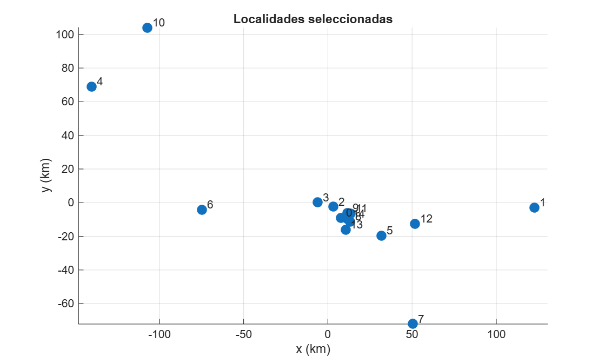

# Título del proyecto

**Comparación de los algoritmos X-opt, Y-opt y 2-opt para optimizar rutas en localidades de Costa Rica: análisis de su estabilidad ante perturbaciones**

# Introducción

El problema del viajero consiste en encontrar un recorrido de longitud mínima que visite un conjunto de localidades exactamente una vez y regrese al punto de partida. Debido al crecimiento del número de recorridos posibles conforme aumenta la cantidad de localidades, se utilizan métodos heurísticos que permiten obtener soluciones aproximadas (Flood, 1956).

El presente proyecto tomará como referencia el trabajo de Manthey y van Rhijn (2025) para comparar los algoritmos X-opt, Y-opt y 2-opt en un conjunto delimitado de localidades de Costa Rica. Estos métodos realizan modificaciones sobre una ruta inicial, utilizando distintos criterios para seleccionar los intercambios. Su aplicación permitirá examinar las diferencias en la longitud de las rutas obtenidas, así como en el esfuerzo computacional requerido.

Para ello, se implementarán los tres algoritmos en Python y se ejecutarán a partir de las mismas rutas iniciales aleatorias. Posteriormente se realizarán gráficos en MATLAB. Asimismo, se compararán las longitudes finales, el número de intercambios y los tiempos de ejecución. Finalmente, se introducirán pequeñas perturbaciones en las coordenadas para estudiar cómo estos cambios afectan los recorridos y sus longitudes. De esta manera, se explorará el comportamiento de los métodos en una configuración geográfica basada en localidades reales.

# Objetivos

## Objetivo general

Comparar el desempeño de los algoritmos X-opt, Y-opt y 2-opt en un conjunto delimitado de localidades de Costa Rica y analizar cómo pequeñas perturbaciones en las coordenadas afectan las rutas obtenidas y sus longitudes.

## Objetivos específicos

1.  Preparar un conjunto de localidades de Costa Rica mediante la selección de registros, la conversión de sus coordenadas geográficas a coordenadas planas y la construcción de una matriz de distancias euclidianas.

2.  Implementar en Python los algoritmos X-opt, Y-opt y 2-opt, de acuerdo con los criterios descritos en el artículo de referencia, y verificar su funcionamiento mediante pruebas pequeñas.

3.  Comparar la longitud final de las rutas, el número de intercambios y el tiempo de ejecución de los tres algoritmos, utilizando las mismas rutas iniciales aleatorias en cada comparación.

4.  Evaluar los cambios en los recorridos y sus longitudes al introducir distintos niveles de perturbación en las coordenadas de las localidades.

5.  Contrastar los resultados experimentales con el comportamiento descrito en el artículo de referencia, considerando las características y limitaciones del conjunto de localidades seleccionado.

# Delimitación del estudio

El estudio se realizará sobre un subconjunto de localidades de Costa Rica seleccionadas a partir del archivo `CR.txt`. Los criterios de selección se describen en la sección de datos. Para los experimentos se utilizará un conjunto de 15 localidades, número limitado por el costo computacional.

Las coordenadas geográficas se convertirán a coordenadas planas expresadas en kilómetros, a partir de las cuales se calcularán distancias euclidianas. El problema se formulará como la búsqueda de un recorrido cerrado que visite cada localidad exactamente una vez. Estas distancias representarán una aproximación geométrica y no incorporarán la red vial, las condiciones del tránsito, los tiempos de traslado ni las restricciones de acceso.

La comparación se limitará a los algoritmos X-opt, Y-opt y 2-opt implementados en Python. En cada ejecución, los tres métodos partirán de la misma ruta inicial aleatoria y utilizarán los mismos datos. Su desempeño se evaluará mediante la longitud final del recorrido, el número de intercambios y el tiempo de ejecución. No se incluirá la búsqueda exacta del óptimo global como parte del alcance del proyecto.

El análisis de estabilidad se basará en perturbaciones controladas de las coordenadas, manteniendo fijo el conjunto de localidades. Se examinarán los cambios en las rutas y sus longitudes para los niveles de perturbación considerados. Los resultados tendrán un carácter experimental y sus conclusiones se limitarán a los datos, las implementaciones y los escenarios estudiados; no constituirán una reproducción de las demostraciones teóricas del artículo.

# Fundamento teórico

## Artículo de referencia

El presente proyecto toma como referencia el trabajo de @manthey2025performance, titulado *Performance of efficient variants of the 2-Opt heuristic for the traveling salesperson problem*. A modo de resumen, los autores estudian variantes de la heurística 2-opt para el problema del viajero, con el propósito de analizar la relación entre las garantías sobre su tiempo de ejecución y la calidad de las rutas obtenidas.

Por un lado, el algoritmo 2-opt mejora un recorrido mediante el intercambio de dos conexiones, siempre que la modificación reduzca su longitud total. Aunque suele presentar buenos resultados en la práctica, puede requerir un número exponencial de iteraciones en casos desfavorables. Ante esta limitación, el artículo analiza dos variantes que restringen los intercambios permitidos y cuentan con garantías de terminación en un número polinomial de iteraciones.

La primera variante, X-opt, únicamente permite intercambios que eliminan cruces entre las conexiones de una ruta en el plano. Los autores demuestran que la ausencia de cruces no garantiza que un recorrido tenga una longitud cercana a la óptima. La segunda variante, Y-opt, tras ordenar de mayor a menor las longitudes de las dos conexiones anteriores y de las dos nuevas, exige que ninguna de las longitudes correspondientes aumente y al menos una disminuya. Esta condición es más restrictiva que exigir únicamente una reducción de la suma de las distancias.

Además del análisis teórico, el artículo presenta una comparación numérica de X-opt, Y-opt y 2-opt sobre conjuntos de puntos generados uniformemente en el cuadrado unitario, utilizando rutas iniciales aleatorias. Los resultados muestran que Y-opt obtiene longitudes cercanas a las de 2-opt y que el comportamiento experimental de X-opt es más favorable de lo que podría sugerir el análisis de sus peores soluciones locales.

## Algoritmo 2-opt

Según @manthey2025performance, 2-opt es una heurística de búsqueda local que mejora un recorrido mediante la sustitución de dos aristas no adyacentes. El intercambio elimina estas aristas y reconecta sus extremos de manera que se conserve un único recorrido cerrado que visite cada localidad exactamente una vez. Esta modificación implica invertir el orden de un segmento de la ruta.

Considere las aristas $(a,b)$ y $(c,d)$, cuyos extremos aparecen en ese orden en el recorrido. El intercambio las sustituye por $(a,c)$ y $(b,d)$. Si $d(i,j)$ representa la distancia entre las localidades $i$ y $j$, el criterio de aceptación es

$$
d(a,c)+d(b,d)<d(a,b)+d(c,d).
$$

Por tanto, el intercambio se acepta únicamente cuando la suma de las longitudes de las nuevas aristas es estrictamente menor que la de las aristas eliminadas. En el caso de distancias simétricas, invertir el segmento intermedio no modifica su longitud, por lo que esta condición garantiza una reducción de la longitud total del recorrido.

El procedimiento se repite hasta que no existen intercambios 2-opt que reduzcan la longitud. La ruta resultante es un óptimo local respecto de estos movimientos, aunque no necesariamente es un óptimo global [@manthey2025performance].

## Algoritmo X-opt

De acuerdo con @manthey2025performance, el algoritmo X-opt corresponde a una variante del algoritmo 2-opt, en la que el reemplazo de dos aristas solo está permitido si dichas aristas se cruzan entre sí. Lo anterior solo está bien definido para distancias euclidianas en $\mathbb{R}^{2}$. Considere $L(x, y)$ como el segmento de recta entre $x$ y $y$, en vías de facilitar la notación si $e = \{x, y\}$ con $x \neq y$, entonces se escribe $L(e) = L(x, y)$. Se dice que un conjunto $T$ de aristas presenta cruces si existen $e, f \in T$ que no comparten ningún extremo y que cumplen $L(e) \cap L(f) \neq \emptyset$. Por el contrario, $T$ no presenta cruces si para todo par de aristas no adyacentes $e, f \in T$, se cumple que $L(e) \cap L(f) = \emptyset$. Bajo X-opt un óptimo local es precisamente un recorrido sin cruces entre sus aristas, donde se entiende a un óptimo local como un recorrido que no puede mejorarse mediante ninguna de las modificaciones permitidas por el algoritmo. Por otro lado, con el objetivo de evitar contradicciones en lo que concierne a la definición de cruce, se asume que no es posible que más de un punto se sitúe en una misma posición.

De manera general, sea $T$ un recorrido a través de un conjunto de puntos $\mathcal{X} ⊆ \mathbb{R}^{2}$. Si $T$ presenta cruces, el modo de operación del algoritmo radica en identificar dos aristas no adyacentes $e, f \in T$ que se intersecten, y sustituirlas por nuevas aristas que permitan obtener un recorrido válido con una menor longitud total. Este procedimiento se repite mientras existan cruces en el recorrido, hasta obtener uno sin intersecciones entre aristas no adyacentes.

## Algoritmo Y-opt

El algoritmo Y-opt es una variante del algoritmo 2-opt. Como se vio anteriormente, el algoritmo 2-opt acepta un intercambio de aristas si la suma de las longitudes de las dos aristas nuevas es menor que la suma de las dos aristas viejas; esto se hace comparando únicamente las aristas que se modificaron, ya que el resto de la ruta permanece igual. Por otro lado, el algoritmo Y-opt impone una condición de cambio más estricta, donde, para aceptar un cambio en la ruta, la arista más larga de las nuevas debe ser más corta que la arista más larga de las viejas, y, además, la arista más corta de las nuevas debe ser más corta que la arista más corta de las viejas. Esto hace que el algoritmo Y-opt sea más restrictivo en su condición de aceptación de nuevas rutas, ya que no solo compara la suma total, sino el tamaño individual de cada arista.

La principal ventaja del algoritmo Y-opt es que el número de iteraciones para una ruta de $n$ vértices y $m$ aristas está acotado por $(m-1)n$ [@manthey2025performance], resultando en un tiempo de ejecución polinomial. En comparación, el algoritmo 2-opt puede necesitar un tiempo exponencial en los peores casos; de esta forma, el algoritmo Y-opt compensa su condición de aceptación con el tiempo que necesitará para ejecutarse. A pesar de que el algoritmo Y-opt sea más estricto, los resultados teóricos muestran que este algoritmo tiene resultados similares a los del 2-opt, donde se llega a rutas ligeramente más largas con el algoritmo Y-opt pero en un tiempo de ejecución acotado en comparación al 2-opt [@manthey2025performance].

## Medidas a recopilar en los experimentos

Para evaluar y poder comparar el rendimiento de los tres algoritmos: 2-opt, X-opt y Y-opt, se utilizarán las medidas que se detallan a continuación.

**Longitud de la ruta optimizada:** corresponde a la longitud final medida en kilómetros de cada ruta optimizada según el algoritmo; esta medida incluye todo el recorrido realizado y el regreso desde el punto final hasta el punto de partida inicial. De esta forma, se puede comparar qué tan grande o qué tan pequeña es la ruta de un algoritmo con respecto a las demás.

**Tiempo de ejecución:** es el tiempo medido en segundos de la duración de cada algoritmo en encontrar su solución. Esto permitirá comparar la rapidez de cada algoritmo para encontrar el recorrido óptimo.

**Número de intercambios aceptados:** representa el número de veces que cada algoritmo aceptó algún cambio en la ruta. Esta medida permitirá ver qué tanto aceptó o rechazó cambios un algoritmo, permitiendo así, ver qué tan estricto es cada algoritmo con la aceptación de un cambio.

**Ruta final obtenida:** es una lista que contiene a los índices que representan el orden en que se visitó cada ciudad. Lo anterior permitirá realizar los gráficos y comparar las rutas creadas por cada algoritmo.

**Porcentaje de mejora con respecto a la ruta inicial:** esta medida se calculará como: $$((\text{longitud inicial} - \text{longitud final}) / \text{longitud inicial}) \times 100. $$Tal medida permitirá ver cuánto mejoró la solución de cada algoritmo con respecto a la ruta inicial creada aleatoriamente.

Las métricas antes mencionadas permitirán realizar la comparación entre algoritmos, además de la visualización de cada ruta creada. Es importante destacar que, para lograr realizar esta comparación, los tres algoritmos utilizarán la misma ruta inicial y la misma matriz de distancias.

# Datos

## Fuente y estructura

Los datos provienen del *gazetteer* de GeoNames, en el archivo `CR.txt`, que corresponde al extracto de Costa Rica y se distribuye bajo la licencia Creative Commons Attribution 4.0 [@geonames]. El archivo está en texto delimitado por tabulaciones, con codificación UTF-8 y sin fila de encabezado. Contiene 21 426 registros y 19 variables.

Cada registro describe un rasgo geográfico, no necesariamente un poblado. Los rasgos se clasifican en nueve clases (@tbl-clases); la clase `P` (lugares poblados) es la de interés para este proyecto.

| Clase | Descripción                         | Registros |
|:-----:|:------------------------------------|----------:|
|   H   | Ríos, lagos y otros cuerpos de agua |     6 801 |
|   P   | Ciudades, pueblos y caseríos        |     5 900 |
|   S   | Sitios, edificaciones y fincas      |     4 401 |
|   T   | Montañas, colinas y rocas           |     2 908 |
|   L   | Parques y áreas                     |       798 |
|   A   | Divisiones administrativas          |       565 |
|   V   | Bosques y vegetación                |        44 |
|   R   | Caminos y ferrocarriles             |         6 |
|   U   | Rasgos submarinos                   |         3 |

: Registros de `CR.txt` según clase de rasgo. {#tbl-clases}

## Variables utilizadas

De las 19 variables, el proyecto utilizará principalmente las que muestra la @tbl-variables:

| Variable | Descripción |
|:-----------------------------------|:-----------------------------------|
| `geonameid` | Identificador único del registro |
| `nombre` | Nombre del lugar |
| `latitud`, `longitud` | Coordenadas en grados decimales (WGS84) |
| `clase`, `codigo` | Clase y código del tipo de rasgo (por ejemplo, `PPL`, `PPLA`, `PPLC`) |
| `admin1` | Código de la división administrativa de primer nivel (provincia), traducido al nombre de la provincia con base en el archivo `admin1CodesASCII.txt` de GeoNames |
| `poblacion` | Población reportada |

: Variables principales de `CR.txt`. {#tbl-variables}

Las coordenadas son la base para construir las coordenadas planas y la matriz de distancias, y la población se usa como criterio de selección. El resto de las variables (nombres alternos, `cc2`, `admin2` a `admin4`, `elevacion`, `dem`, `zona_horaria` y `fecha_modificacion`) no intervienen en los algoritmos. Además, `elevacion` está vacía en el 99,6 % de los registros (21 349 de 21 426) y `admin4` está vacía en prácticamente todos.

## Criterios de selección de las localidades

El conjunto de localidades se obtuvo aplicando los siguientes filtros sobre `CR.txt`:

1.  **Solo lugares poblados.** Se conservaron los registros de clase `P`, es decir, 5 900 de los 21 426.
2.  **Exclusión de poblados destruidos o históricos.** Se descartaron los códigos `PPLQ` (poblado abandonado), `PPLW` (poblado destruido) y `PPLH` (poblado histórico).
3.  **Población reportada.** Se conservaron únicamente las localidades con población mayor que cero. Este filtro es necesario porque el 97,8 % de los lugares poblados reporta población igual a cero, de modo que no tienen información de población disponible.
4.  **Coordenadas únicas.** Se eliminaron los registros con coordenadas repetidas, considerando como repetidas las coordenadas que coinciden al redondear a tres decimales (aproximadamente 100 m); entre los registros repetidos se conservó el de mayor población. Este filtro es necesario porque @manthey2025performance suponen que no hay dos puntos en la misma posición, supuesto con el que X-opt puede decidir si dos aristas se cruzan.
5.  **Selección final.** Tras el filtrado, se seleccionaron las 15 localidades con mayor población.

El conjunto resultante consta de **15 localidades**, que se ordenaron por población decreciente y se numeraron de 0 a 14 para usarse como índices en las rutas.

## Coordenadas planas y distancias

Las coordenadas geográficas se convirtieron a coordenadas planas en kilómetros mediante la proyección equirectangular (cilíndrica equidistante) para la esfera [@snyder1987, pp. 90-91], con $x = R\cos(\varphi_1)(\lambda-\lambda_0)$ y $y = R(\varphi-\varphi_0)$, donde $R = 6371$ km es el radio medio terrestre, $\varphi_1$ es el paralelo estándar, $(\varphi_0,\lambda_0)$ es el origen del plano y los ángulos se expresan en radianes. Se tomó como origen el promedio de las latitudes y de las longitudes de las 15 localidades, y el paralelo estándar se fijó en esa misma latitud, es decir, $\varphi_1=\varphi_0$; restar $\varphi_0$ en $y$ solo traslada el origen. Esto es necesario porque X-opt requiere determinar si dos aristas se cruzan en el plano [@manthey2025performance]. A partir de estas coordenadas se construyó la matriz de distancias euclidianas de tamaño $15 \times 15$, que es simétrica y tiene ceros en la diagonal.

## Descripción de las localidades seleccionadas

La población de las 15 localidades tiene un mínimo de 27 477, una mediana de 34 877, una media de 58 191 y un máximo de 335 007 habitantes. La media supera ampliamente a la mediana, lo que indica la presencia de una distribución asimétrica a la derecha. Sus coordenadas están entre las latitudes 9,367° y 10,952° N y las longitudes −85,438° y −83,036° O. La @tbl-localidades presenta al conjunto y la @fig-localidades muestra su ubicación.

| Índice | Nombre        | Provincia  | Código | Población | Latitud | Longitud | x (km) | y (km) |
|-------:|:-------|:-------|:-------|-------:|-------:|-------:|-------:|-------:|
|      0 | San José      | San José   | PPLC   |    335007 |   9,934 |  -84,085 |    7,9 |   -9,1 |
|      1 | Limón         | Limón      | PPLA   |     63081 |   9,991 |  -83,036 |  122,7 |   -2,8 |
|      2 | San Francisco | Heredia    | PPLX   |     55923 |   9,994 |  -84,127 |    3,2 |   -2,5 |
|      3 | Alajuela      | Alajuela   | PPLA   |     47494 |  10,017 |  -84,213 |   -6,2 |    0,1 |
|      4 | Liberia       | Guanacaste | PPLA   |     45380 |  10,635 |  -85,438 | -140,3 |   68,8 |
|      5 | Paraíso       | Cartago    | PPL    |     39702 |   9,838 |  -83,867 |   31,8 |  -19,8 |
|      6 | Puntarenas    | Puntarenas | PPLA   |     35650 |   9,977 |  -84,838 |  -74,6 |   -4,4 |
|      7 | San Isidro    | San José   | PPLA3  |     34877 |   9,367 |  -83,697 |   50,3 |  -72,1 |
|      8 | Curridabat    | San José   | PPL    |     34586 |   9,914 |  -84,036 |   13,2 |  -11,4 |
|      9 | San Vicente   | San José   | PPL    |     34447 |   9,962 |  -84,049 |   11,7 |   -6,0 |
|     10 | San José      | Alajuela   | PPL    |     31430 |  10,952 |  -85,136 | -107,2 |  104,1 |
|     11 | Purral        | San José   | PPL    |     30034 |   9,957 |  -84,032 |   13,6 |   -6,6 |
|     12 | Turrialba     | Cartago    | PPL    |     28955 |   9,904 |  -83,684 |   51,8 |  -12,5 |
|     13 | San Miguel    | San José   | PPL    |     28827 |   9,871 |  -84,061 |   10,5 |  -16,1 |
|     14 | San Pedro     | San José   | PPLA2  |     27477 |   9,928 |  -84,051 |   11,6 |   -9,8 |

: Localidades seleccionadas. {#tbl-localidades}

{#fig-localidades}

Por provincia, siete localidades pertenecen a San José, dos localidades se sitúan en Alajuela, dos localidades se encuentran en Cartago y una localidad está en cada una de las siguientes provincias: Guanacaste, Heredia, Limón y Puntarenas. Según las coordenadas planas de la @tbl-localidades, ocho de las quince localidades (53%) están a menos de 20 km del centro de San José, mientras que Liberia, Limón y San José (Alajuela) quedan a más de 100 km. Esta concentración implica que la distribución espacial difiere de la uniforme utilizada por @manthey2025performance, lo cual se retomará al comparar resultados.

## Limitaciones de los datos

-   La población proviene de GeoNames y no de un censo oficial, por lo que sirve como criterio de selección, no como medida precisa.
-   Una de las localidades (San Francisco) tiene código `PPLX`, que corresponde a una sección de un lugar poblado, y queda a unos 8 km de San José.
-   Dos localidades comparten el nombre «San José» (índices 0 y 10); la segunda, en la provincia de Alajuela, queda a unos 160 km de la capital.
-   Al conservar solo las localidades más pobladas, el conjunto se concentra en el área metropolitana de San José y no representa de forma pareja el resto del territorio.

# Metodología e implementación en Python

Se realizará un estudio computacional y experimental en Python para comparar los algoritmos X-opt, Y-opt y 2-opt en localidades de Costa Rica, tomando como referencia a @manthey2025performance. El desarrollo detallado del código y sus pruebas se presentarán en el Jupyter Notebook titulado `codigo.ipynb`. Los gráficos se elaborarán en MATLAB (`graficos.m`) a partir de los datos exportados desde el notebook.

A partir del archivo `CR.txt` con las localidades de Costa Rica, se seleccionarán localidades pobladas, se excluirán registros históricos o abandonados y se eliminarán coordenadas duplicadas. Las coordenadas geográficas se convertirán a coordenadas planas en kilómetros para construir una matriz de distancias euclidianas. Cada ruta visitará todas las localidades seleccionadas una vez e incluirá el regreso al punto inicial.

Se realizarán múltiples ejecuciones y se compararán las longitudes finales, el número de intercambios y los tiempos de ejecución mediante tablas y gráficos. Finalmente, se introducirán pequeñas perturbaciones en las coordenadas y se repetirán los experimentos para estudiar los cambios en los recorridos y sus longitudes. Los resultados se contrastarán con los del artículo, considerando las diferencias entre las localidades reales y los puntos aleatorios utilizados por los autores.

# Referencias
