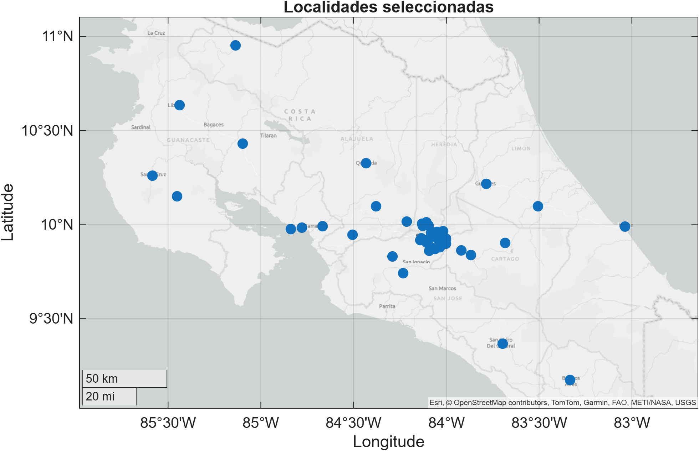

```{=latex}
\begin{center}
```

```{=latex}
{\fontsize{13pt}{14pt}\selectfont\textbf{Comparación de los algoritmos X-opt, Y-opt y 2-opt para optimizar rutas en localidades de Costa Rica}}
```

```{=latex}
{\fontsize{11pt}{14pt}\selectfont Alexandra González, Estefanía Mora, Daniela Prado y José Miguel Rodríguez}
```

```{=latex}
{\fontsize{9pt}{14pt}\selectfont ALEXANDRA.GONZALEZBERMUDEZ@ucr.ac.cr, EMILY.MORACONTRERAS@ucr.ac.cr, DANIELA.PRADOVARGAS@ucr.ac.cr, JOSE.RODRIGUEZGOMEZ@ucr.ac.cr}
```

```{=latex}
\end{center}
```

```{=latex}
\begin{center}
```

```{=latex}
{\fontsize{12pt}{14pt}\selectfont\textbf{RESUMEN}}
```

```{=latex}
\end{center}
```


Este trabajo compara el desempeño de los algoritmos X-opt, Y-opt y 2-opt para el problema del viajero en un conjunto de 50 localidades de Costa Rica. Los métodos se implementaron en Python y se evaluaron sobre las mismas 100 rutas iniciales aleatorias, utilizando una matriz de distancias euclidianas calculada a partir de coordenadas planas. Se analizaron las longitudes finales, los porcentajes de mejora, las parejas de aristas evaluadas y los tiempos de ejecución. Además, se exploraron la aplicación repetida de un mismo algoritmo y distintas secuencias de los tres métodos. Entre los algoritmos individuales, 2-opt obtuvo la menor longitud media, con 898,31 km, frente a 1001,64 km de Y-opt y 1523,92 km de X-opt. Su reducción media respecto de las rutas iniciales fue del 71,28 %. En las pruebas de aplicación repetida, las rutas permanecieron sin cambios al ejecutar nuevamente el mismo algoritmo. Por su parte, la secuencia X-opt → Y-opt → 2-opt produjo recorridos más cortos que 2-opt directo en 38 de las 100 comparaciones, pero presentó una mayor longitud media y un mayor tiempo medio de ejecución. Los resultados indican que, bajo los datos y las implementaciones estudiados, 2-opt directo ofreció el mejor desempeño promedio entre las estrategias evaluadas.

**PALABRAS CLAVE**: Traveling Salesman Problem (TSP), búsqueda local, 2-opt, X-opt, Y-opt, optimización de rutas.


```{=latex}
\begin{center}
```

```{=latex}
{\fontsize{12pt}{14pt}\selectfont\textbf{INTRODUCCIÓN}}
```

```{=latex}
\end{center}
```

El problema del viajero consiste en encontrar un recorrido de longitud mínima que visite un conjunto de localidades exactamente una vez y regrese al punto de partida. El crecimiento del número de recorridos posibles conforme aumenta la cantidad de localidades dificulta su resolución mediante la exploración exhaustiva. Por ello, se emplean métodos heurísticos que permiten obtener soluciones aproximadas sin examinar todos los recorridos posibles [@flood1956].

Este trabajo tiene como objetivo comparar el desempeño de los algoritmos X-opt, Y-opt y 2-opt en un conjunto delimitado de localidades de Costa Rica, tomando como referencia el estudio de @manthey2025performance. Estos métodos modifican una ruta inicial mediante distintos criterios de selección de intercambios. Además de estudiar su desempeño individual, se explora el efecto de aplicar repetidamente un mismo algoritmo y de combinar los tres métodos en distintos órdenes, con el propósito de examinar cómo estas estrategias influyen en la longitud de los recorridos y en el esfuerzo computacional requerido.

El estudio considera un conjunto de 50 localidades seleccionadas del archivo `CR.txt`, según los criterios descritos en la sección de datos. Sus coordenadas geográficas se convierten a coordenadas planas expresadas en kilómetros, a partir de las cuales se construye una matriz de distancias euclidianas. Estas distancias constituyen una aproximación geométrica y no incorporan la red vial, las condiciones del tránsito, los tiempos de traslado ni las restricciones de acceso.

Los algoritmos se implementan en Python y la comparación utiliza 100 rutas iniciales aleatorias sobre el conjunto de localidades seleccionado. Su desempeño se evalúa mediante la longitud final de los recorridos, el número de intercambios y el tiempo de ejecución. El análisis se complementa con gráficos elaborados en MATLAB y visualizaciones en Python que permiten examinar las modificaciones de las rutas durante el proceso de mejora.

El análisis tiene un carácter experimental y busca contrastar los resultados obtenidos con el comportamiento descrito en el artículo de referencia, considerando las características y limitaciones del conjunto de localidades seleccionado. Sus conclusiones se restringen a los datos, las implementaciones y los escenarios estudiados, sin constituir una reproducción de las demostraciones teóricas del artículo.

```{=latex}
\begin{center}
```

```{=latex}
{\fontsize{11pt}{14pt}\selectfont\textbf{FUNDAMENTO TEÓRICO}}
```

```{=latex}
\end{center}
```


```{=latex}
\begin{center}
```

```{=latex}
{\fontsize{11pt}{14pt}\selectfont\textbf{EL PROBLEMA DEL VIAJERO}}
```

```{=latex}
\end{center}
```

El problema del viajero consiste en encontrar un recorrido cerrado de longitud mínima que visite cada localidad exactamente una vez y regrese al punto de partida. Su versión de optimización se clasifica como NP-hard, incluso cuando las distancias son euclidianas [@manthey2025performance]. Esta clasificación indica que el problema es, al menos, tan difícil como cualquier problema de la clase NP. Actualmente, no se conoce un algoritmo que garantice obtener una solución óptima en tiempo polinomial para todas sus instancias.

Ante esta dificultad, se utilizan métodos heurísticos que buscan obtener recorridos de buena calidad con un esfuerzo computacional manejable. Entre ellos se encuentran las heurísticas de búsqueda local, que parten de una ruta inicial y la modifican sucesivamente mediante movimientos que reducen su longitud.

El criterio utilizado para aceptar estos movimientos determina tanto las mejoras disponibles como la condición de terminación del procedimiento. Cuando ningún movimiento permitido reduce la longitud, se alcanza un óptimo local respecto de ese conjunto de movimientos. Sin embargo, esta condición no garantiza que el recorrido sea el más corto entre todos los posibles. Esta distinción resulta fundamental para interpretar las soluciones obtenidas mediante X-opt, Y-opt y 2-opt.


```{=latex}
\begin{center}
```

```{=latex}
{\fontsize{11pt}{14pt}\selectfont\textbf{ARTÍCULO DE REFERENCIA}}
```

```{=latex}
\end{center}
```

Este estudio toma como referencia el artículo de @manthey2025performance, titulado *Performance of efficient variants of the 2-Opt heuristic for the traveling salesperson problem*. Los autores analizan la relación entre la calidad de las soluciones y las garantías sobre el tiempo de ejecución de dos variantes de la heurística 2-opt.

El punto de partida es que 2-opt, aunque suele ofrecer buenos resultados en la práctica, puede requerir un número exponencial de intercambios para alcanzar un óptimo local en casos desfavorables. Frente a esta limitación, el artículo estudia X-opt y propone Y-opt, dos variantes que restringen los movimientos de 2-opt y garantizan la terminación en un número polinomial de intercambios.

X-opt permite únicamente movimientos que eliminan cruces entre aristas de una ruta en el plano. Los autores demuestran que pueden existir recorridos sin cruces cuya longitud sea considerablemente mayor que la óptima. Por su parte, Y-opt restringe los intercambios mediante la comparación de las longitudes de las aristas y conserva varias de las garantías de aproximación de 2-opt.

El análisis teórico se complementa con experimentos sobre puntos distribuidos uniformemente en el cuadrado unitario y rutas iniciales aleatorias. En estas pruebas, Y-opt obtiene longitudes cercanas a las de 2-opt, mientras que X-opt presenta un comportamiento más favorable de lo que sugieren sus peores óptimos locales. Estos resultados muestran la importancia de distinguir las garantías teóricas del comportamiento experimental y sirven como base para la comparación sobre las localidades de Costa Rica seleccionadas en este trabajo.


```{=latex}
\begin{center}
```

```{=latex}
{\fontsize{11pt}{14pt}\selectfont\textbf{ALGORITMO 2-OPT}}
```

```{=latex}
\end{center}
```

El algoritmo 2-opt es una heurística de búsqueda local que mejora una ruta mediante el intercambio de dos aristas no adyacentes. En cada paso, estas aristas se eliminan y se sustituyen por otras dos, conservando un único recorrido cerrado que visite cada localidad exactamente una vez. El intercambio se acepta únicamente cuando reduce la longitud total de la ruta [@manthey2025performance].

Ahora, sea $T$ una ruta y considere las aristas $e_1=(a,b)$ y $f_1=(c,d)$, cuyos extremos aparecen en ese orden en el recorrido. El movimiento 2-opt sustituye estas aristas por $e_2=(a,c)$ y $f_2=(b,d)$, lo cual requiere invertir el orden del segmento comprendido entre $b$ y $c$. Si $\ell(e)$ representa la longitud de una arista $e$, el criterio de aceptación es

$$
\ell(e_2)+\ell(f_2)<\ell(e_1)+\ell(f_1).
$$

Como las distancias utilizadas en este proyecto son simétricas, invertir el segmento intermedio no modifica la suma de sus distancias internas. Por tanto, basta con comparar las dos aristas eliminadas con las dos nuevas. La longitud de la ruta modificada $T'$ satisface

$$
\ell(T')
=
\ell(T)-\ell(e_1)-\ell(f_1)+\ell(e_2)+\ell(f_2).
$$

En consecuencia, el criterio de aceptación garantiza que $\ell(T')<\ell(T)$. A diferencia de X-opt, no se exige que las aristas eliminadas se crucen; tampoco se requiere la reducción individual de las longitudes ordenadas que caracteriza a Y-opt [@manthey2025performance].

En la implementación desarrollada se utilizó la estrategia de búsqueda de la primera mejora. Los ciclos `for` recorren las parejas de aristas no adyacentes y, cuando encuentran un intercambio que reduce la longitud, modifican la ruta y detienen la búsqueda mediante las instrucciones `break`. Posteriormente, el ciclo `while` reinicia la exploración sobre la ruta actualizada. El procedimiento termina después de completar una pasada sin aceptar ningún intercambio.

La terminación se justifica porque existe una cantidad finita de recorridos y cada intercambio aceptado disminuye estrictamente la longitud. Por ello, el algoritmo no puede regresar a una ruta anteriormente visitada. Al finalizar, se obtiene un óptimo local respecto de los movimientos 2-opt, es decir, una ruta que no puede acortarse mediante ninguno de estos intercambios. Esta condición no garantiza que se haya encontrado el óptimo global.

Para analizar el esfuerzo computacional, una ruta cerrada de $n$ localidades tiene $n$ aristas. De las parejas posibles, se excluyen las $n$ parejas de aristas adyacentes, por lo que una exploración completa considera

$$
\frac{n(n-1)}{2}-n
=
\frac{n(n-3)}{2}
$$

parejas válidas. En este proyecto, para $n=50$, se obtiene

$$
\frac{50(50-3)}{2}=1175.
$$

Este valor corresponde al número de parejas examinadas en una pasada completa, no al número total de evaluaciones durante toda la ejecución. Al aceptar una mejora, la búsqueda se reinicia y puede volver a examinar parejas sobre la ruta modificada. Además, el contador utilizado en el código registra parejas evaluadas, independientemente de si producen un intercambio.

Aunque cada pasada requiere un número de evaluaciones de orden $O(n^2)$, esto no implica que la ejecución completa tenga un costo cuadrático. También debe considerarse la cantidad de intercambios y reinicios necesarios para alcanzar un óptimo local. A diferencia de Y-opt, 2-opt puede requerir un número exponencial de pasos en casos desfavorables [@manthey2025performance]. Por tanto, los tiempos reducidos observados en los experimentos describen su comportamiento en las instancias estudiadas, sin establecer una garantía general de tiempo polinomial.

```{=latex}
\begin{center}
```

```{=latex}
{\fontsize{11pt}{14pt}\selectfont\textbf{ALGORITMO X-OPT}}
```

```{=latex}
\end{center}
```

De acuerdo con @manthey2025performance, el algoritmo X-opt corresponde a una variante del algoritmo 2-opt, en la que el reemplazo de dos aristas solo está permitido si dichas aristas se cruzan entre sí. Lo anterior solo está bien definido para distancias euclidianas en $\mathbb{R}^{2}$. Considere $L(x, y)$ como el segmento de recta entre $x$ y $y$, en vías de facilitar la notación si $e = \{x, y\}$ con $x \neq y$, entonces se escribe $L(e) = L(x, y)$. Se dice que un conjunto $T$ de aristas presenta cruces si existen $e, f \in T$ que no comparten ningún extremo y que cumplen $L(e) \cap L(f) \neq \emptyset$. Por el contrario, $T$ no presenta cruces si para todo par de aristas no adyacentes $e, f \in T$, se cumple que $L(e) \cap L(f) = \emptyset$. Bajo X-opt un óptimo local es precisamente un recorrido sin cruces entre sus aristas, donde se entiende a un óptimo local como un recorrido que no puede mejorarse mediante ninguna de las modificaciones permitidas por el algoritmo. Por otro lado, con el objetivo de evitar contradicciones en lo que concierne a la definición de cruce, se asume que no es posible que más de un punto se sitúe en una misma posición.

De manera general, sea $T$ un recorrido a través de un conjunto de puntos $\mathcal{X} ⊆ \mathbb{R}^{2}$. Si $T$ presenta cruces, el modo de operación del algoritmo radica en identificar dos aristas no adyacentes $e, f \in T$ que se intersecten, y sustituirlas por nuevas aristas que permitan obtener un recorrido válido con una menor longitud total. Este procedimiento se repite mientras existan cruces en el recorrido, hasta obtener uno sin intersecciones entre aristas no adyacentes.

Para comprender el mecanismo de optimización, es necesario considerar que el intercambio de aristas corresponde a una modificación de tipo 2-opt. Sean $e=\{a,b\}$ y $f=\{c,d\}$ dos aristas no adyacentes que se intersectan. El procedimiento consiste en eliminar dichas aristas y reconectar sus extremos mediante dos nuevas aristas, de manera que se conserve la validez del recorrido. Debido a que las aristas originales presentan un cruce, la nueva conexión permite sustituir dos segmentos que se intersectan por otros dos que no presentan dicha intersección. En el plano euclidiano, esta modificación produce una reducción estricta de la longitud total del recorrido, puesto que la suma de las longitudes de los segmentos que sustituyen a las diagonales de un cuadrilátero es menor que la suma de las longitudes de estas últimas.

En consecuencia, si $T$ representa el recorrido original y $T'$ el recorrido después de efectuar el intercambio, asimismo, en la implementación del proyecto se estableció que la condición de aceptación del intercambio se basa en que $\ell(T') < \ell(T),$ donde $\ell(T)$ representa la longitud total del recorrido. Por tanto, cada intercambio constituye una mejora respecto a la configuración anterior. El algoritmo continúa aplicando este procedimiento sobre el recorrido resultante, hasta que no sea posible identificar otro par de aristas no adyacentes que se intersecten.

En relación con la cantidad de iteraciones, @manthey2025performance establecen que la heurística X-opt siempre termina en $O(n^3)$ iteraciones, donde $n$ representa la cantidad de puntos del conjunto considerado. Esta expresión corresponde a una cota del número de iteraciones, lo que significa que el crecimiento de estas se encuentra acotado por un orden cúbico respecto al tamaño de la instancia. Sin embargo, no representa una cantidad exacta de iteraciones, puesto que el número efectivamente realizado depende del recorrido inicial y de los pares de aristas seleccionados durante la ejecución.

Por consiguiente, el criterio de terminación no consiste en alcanzar una cantidad predeterminada de iteraciones, sino en obtener un recorrido que no presente cruces entre sus aristas no adyacentes. De acuerdo con la definición de X-opt, esta condición caracteriza precisamente un óptimo local. Así, la heurística finaliza cuando se alcanza dicha configuración, garantizando su terminación en un número de iteraciones perteneciente a $O(n^3)$, según lo establecido por los autores.

```{=latex}
\begin{center}
```

```{=latex}
{\fontsize{11pt}{14pt}\selectfont\textbf{ALGORITMO Y-OPT}}
```

```{=latex}
\end{center}
```

El algoritmo Y-opt es una variante del algoritmo 2-opt. Como se vio anteriormente, el algoritmo 2-opt acepta un intercambio de aristas si la suma de las longitudes de las dos aristas nuevas es menor que la suma de las dos aristas viejas; esto se hace comparando únicamente las aristas que se modificaron, ya que el resto de la ruta permanece igual. Por otro lado, el algoritmo Y-opt impone una condición de cambio más estricta, donde, para aceptar un cambio en la ruta, la arista más larga de las nuevas debe ser más corta que la arista más larga de las viejas, y, además, la arista más corta de las nuevas debe ser más corta que la arista más corta de las viejas. Esto hace que el algoritmo Y-opt sea más restrictivo en su condición de aceptación de nuevas rutas, ya que no solo compara la suma total, sino el tamaño individual de cada arista.

La principal ventaja del algoritmo Y-opt es que el número de iteraciones para una ruta de $n$ vértices y $m$ aristas está acotado por $(m-1)n$ [@manthey2025performance], resultando en un tiempo de ejecución polinomial. En comparación, el algoritmo 2-opt puede necesitar un tiempo exponencial en los peores casos; de esta forma, el algoritmo Y-opt compensa su condición de aceptación con el tiempo que necesitará para ejecutarse. A pesar de que el algoritmo Y-opt sea más estricto, los resultados teóricos muestran que este algoritmo tiene resultados similares a los del 2-opt, donde se llega a rutas ligeramente más largas con el algoritmo Y-opt pero en un tiempo de ejecución acotado en comparación al 2-opt [@manthey2025performance].

Matemáticamente, si se tiene una ruta $T$ en un grafo completo de $n$ vértices, lo que quiere decir que una vez llegado al último vértice $n$ (la última localidad), se debe devolver al primero, y si se definen dos aristas (caminos) no adyacentes $e_1$ y $f_1$ de la ruta $T$. Si se define la función $\ell(e)$ la cual representa la longitud de una arista $e$, en el algoritmo 2-opt tradicional, para aceptar un intercambio de aristas debe cumplirse que la suma de las distancias entre las dos aristas antiguas sea mayor que la distancia entre las dos aristas nuevas, es decir $\ell(e_1) + \ell(f_1) > \ell(e_2) + \ell(f_2)$ donde $\ell(e_2)$ y $\ell(f_2)$ representan dos aristas nuevas.

Sin embargo, en el algoritmo Y-opt propuesto por @manthey2025performance, impone una condición más estricta para realizar el intercambio entre aristas. Si se asume que $\ell(e_1)$ es mayor o igual que $\ell(f_1)$ y que $\ell(e_2)$ es mayor o igual que $\ell(f_2)$, el intercambio se acepta solamente si $\ell(e_1) \geq \ell(e_2)$ y $\ell(f_1) \geq \ell(f_2)$ simultáneamente y donde al menos una de las desigualdades debe ser estricta, lo cual quiere decir, como se mencionó anteriormente, solamente se acepta un intercambio entre aristas si la longitud de la arista más grande antigua es mayor o igual que la longitud de la arista más grande nueva y al mismo tiempo, la arista más pequeña antigua es mayor o igual que la longitud de la arista más pequeña nueva

En cuanto a la optimización, el algoritmo Y-opt utiliza una estrategia de búsqueda local llamada búsqueda de la primera mejora, ya que, conforme el algoritmo realiza las comparaciones entre los pares de aristas, en el momento en que encuentra dos pares que cumplen la condición, realiza el intercambio de aristas y vuelve a empezar con la búsqueda desde el inicio de la ruta $T$; esto ahorra numerosas iteraciones debido a que no siempre realizará todas las combinaciones posibles, para implementar esta idea de la búsqueda de la primera mejora, en el código desarrollado se añadieron `breaks` en los bucles `for` utilizados para la implementación del algoritmo, por lo que, como no se realiza la evaluación de todas las posibles combinaciones de aristas, se evita el costo exponencial, de forma que se llega a un óptimo local y no global.

A pesar de que se llega a un óptimo local, la implementación de este algoritmo disminuye en gran medida tanto el tiempo de ejecución como el número de iteraciones totales, ya que matemáticamente garantiza un tiempo de ejecución polinómico. Según el *Teorema 5* de @manthey2025performance, el número de iteraciones máximas para alcanzar una ruta Y-óptima en un grafo de $n$ vértices y $m$ aristas (el total de posibles aristas) es de $(m-1)n$.

Para este proyecto, se utilizaron 50 localidades de Costa Rica, con un grafo completo, por lo que, el número de aristas sería:
$$m = \frac{n(n-1)}{2} = \frac{50(50-1)}{2}= 1225$$
Donde, aplicando el *Teorema 5* mencionado antes, se obtendría un máximo teórico de iteraciones de $(1225-1)50 = 61200$, lo cual representa un número muy reducido de iteraciones comparado con las iteraciones que se necesitarían para alcanzar un óptimo global en el que se evaluaran todas las posibles permutaciones, en el cual se necesitarían $n! = 50!$ iteraciones.


```{=latex}
\begin{center}
```

```{=latex}
{\fontsize{11pt}{14pt}\selectfont\textbf{MEDIDAS A RECOPILAR EN LOS EXPERIMENTOS}}
```

```{=latex}
\end{center}
```

Para evaluar y poder comparar el rendimiento de los tres algoritmos: 2-opt, X-opt y Y-opt, se utilizarán las medidas que se detallan a continuación.

**Longitud de la ruta optimizada:** corresponde a la longitud final medida en kilómetros de cada ruta optimizada según el algoritmo; esta medida incluye todo el recorrido realizado y el regreso desde el punto final hasta el punto de partida inicial. De esta forma, se puede comparar qué tan grande o qué tan pequeña es la ruta de un algoritmo con respecto a las demás.

**Tiempo de ejecución:** es el tiempo medido en segundos de la duración de cada algoritmo en encontrar su solución. Esto permitirá comparar la rapidez de cada algoritmo para encontrar el recorrido óptimo.

**Número de intercambios aceptados:** representa el número de veces que cada algoritmo aceptó algún cambio en la ruta. Esta medida permitirá ver qué tanto aceptó o rechazó cambios un algoritmo, permitiendo así, ver qué tan estricto es cada algoritmo con la aceptación de un cambio.

**Ruta final obtenida:** es una lista que contiene a los índices que representan el orden en que se visitó cada ciudad. Lo anterior permitirá realizar los gráficos y comparar las rutas creadas por cada algoritmo.

**Porcentaje de mejora con respecto a la ruta inicial:** esta medida se calculará como: $$((\text{longitud inicial} - \text{longitud final}) / \text{longitud inicial}) \times 100. $$Tal medida permitirá ver cuánto mejoró la solución de cada algoritmo con respecto a la ruta inicial creada aleatoriamente.

Las métricas antes mencionadas permitirán realizar la comparación entre algoritmos, además de la visualización de cada ruta creada. Es importante destacar que, para lograr realizar esta comparación, los tres algoritmos utilizarán la misma ruta inicial y la misma matriz de distancias.

```{=latex}
\begin{center}
```

```{=latex}
{\fontsize{12pt}{14pt}\selectfont\textbf{DATOS}}
```

```{=latex}
\end{center}
```

Los datos provienen del *gazetteer* de GeoNames, en el archivo `CR.txt`, que corresponde al extracto de Costa Rica y se distribuye bajo la licencia Creative Commons Attribution 4.0 [@geonames]. El archivo está en texto delimitado por tabulaciones, con codificación UTF-8 y sin fila de encabezado, y contiene 21 426 registros y 19 variables. Cada registro describe un rasgo geográfico y no necesariamente un poblado: los rasgos se clasifican en nueve clases, entre las que predominan los cuerpos de agua (6 801 registros) y los lugares poblados, clase `P`, con 5 900 registros, que es la de interés para este proyecto.

De las 19 variables se utilizaron siete: el identificador del registro (`geonameid`), el nombre, la latitud y la longitud en grados decimales (WGS84), la clase y el código del tipo de rasgo (por ejemplo, `PPL`, `PPLA` o `PPLC`), la división administrativa de primer nivel (`admin1`), que se tradujo al nombre de la provincia con el archivo `admin1CodesASCII.txt` de GeoNames, y la población reportada. Las coordenadas son la base para construir las coordenadas planas y la matriz de distancias, y la población se emplea como criterio de selección. Las variables restantes no intervienen en los algoritmos; además, `elevacion` está vacía en el 99,6 % de los registros (21 349 de 21 426) y `admin4` está vacía en prácticamente todos.

Para construir el conjunto de localidades se conservaron únicamente los registros de clase `P` y se descartaron los códigos `PPLQ`, `PPLW` y `PPLH`, que corresponden a poblados abandonados, destruidos o históricos. Luego se conservaron las localidades con población mayor que cero, filtro necesario porque el 97,8 % de los lugares poblados reporta población igual a cero, es decir, sin información disponible. Después se eliminaron los registros con coordenadas repetidas, entendidas como las que coinciden al redondear a tres decimales (aproximadamente 100 m), y entre ellos se conservó el de mayor población; este filtro se aplicó porque @manthey2025performance suponen que no hay dos puntos en la misma posición, supuesto con el que X-opt puede decidir si dos aristas se cruzan. Tras aplicar estos filtros quedaron 128 localidades, de las cuales se seleccionaron las 50 con mayor población, que se ordenaron de forma decreciente y se numeraron de 0 a 49 para usarse como índices en las rutas.

Las coordenadas geográficas se convirtieron a coordenadas planas en kilómetros mediante la proyección equirectangular (cilíndrica equidistante) para la esfera [@snyder1987, pp. 90-91], con $x = R\cos(\varphi_1)(\lambda-\lambda_0)$ y $y = R(\varphi-\varphi_0)$, donde $R = 6371$ km es el radio medio terrestre, $\varphi_1$ es el paralelo estándar, $(\varphi_0,\lambda_0)$ es el origen del plano y los ángulos se expresan en radianes. Se tomó como origen el promedio de las latitudes y de las longitudes de las 50 localidades, y el paralelo estándar se fijó en esa misma latitud, es decir, $\varphi_1=\varphi_0$; restar $\varphi_0$ en $y$ solo traslada el origen. Esto es necesario porque X-opt requiere determinar si dos aristas se cruzan en el plano [@manthey2025performance]. A partir de estas coordenadas se construyó la matriz de distancias euclidianas de tamaño $50 \times 50$, que es simétrica y tiene ceros en la diagonal.

La población de las 50 localidades tiene un mínimo de 11 680, una mediana de 25 198, una media de 31 050 y un máximo de 335 007 habitantes, correspondiente a San José. La media supera a la mediana, lo que indica una distribución asimétrica a la derecha. Las latitudes están entre 9,173° y 10,952° N y las longitudes entre −85,585° y −83,036° O. Por provincia, 24 localidades pertenecen a San José, cinco a Alajuela, cinco a Cartago, cinco a Heredia, cuatro a Guanacaste, cuatro a Puntarenas y tres a Limón. Según las coordenadas planas, 30 de las 50 localidades (60 %), incluida San José, quedan a 20 km o menos del centro de San José, mientras que Liberia, Santa Cruz, San José (Alajuela) y Nicoya quedan a más de 150 km (@fig-localidades). Esta concentración implica que la distribución espacial difiere de la uniforme utilizada por @manthey2025performance, lo cual se retomará al comparar resultados.

{#fig-localidades width=60%}

Al examinar el conjunto resultante se identificaron algunas limitaciones, que provienen tanto de la fuente como del criterio de selección. La primera surge de la variable de población ya que al revisar sus valores en el archivo completo se observó que el 97,8 % de los lugares poblados la reporta como cero, por lo que la selección depende del 2,2 % restante. Además, esta población proviene de GeoNames y no de un censo oficial, de modo que sirve para ordenar y seleccionar las localidades, pero no como una medida precisa de su tamaño.

Al revisar los códigos de las 50 localidades seleccionadas se encontró una segunda limitación: seis de ellas (por ejemplo, San Francisco e Ipís) tienen código `PPLX`, que GeoNames asigna a secciones de un lugar poblado y no a poblados independientes, por lo que algunas localidades representan zonas del área urbana más que poblados separados. De forma similar, al comparar los nombres se observó que dos localidades comparten el nombre "San José" (índices 0 y 10). No se trata de un registro duplicado, pues la segunda es una localidad de Alajuela que queda a unos 160 km de la capital y, al tener coordenadas distintas, el filtro de coordenadas únicas no la elimina, por lo que ambas se distinguen por su índice.

Por último, al ubicar las localidades en el mapa (@fig-localidades) se constató que, al conservar solo las más pobladas, el conjunto se concentra en el área metropolitana de San José y no representa de forma pareja el resto del territorio. Esta consecuencia directa del criterio de selección condiciona la interpretación de los resultados, por lo que se retoma en las limitaciones del estudio.

```{=latex}
\begin{center}
```

```{=latex}
{\fontsize{12pt}{14pt}\selectfont\textbf{IMPLEMENTACIÓN EN PYTHON}}
```

```{=latex}
\end{center}
```

Se realizó un estudio computacional y experimental para comparar los algoritmos X-opt, Y-opt y 2-opt sobre 50 localidades de Costa Rica, tomando como referencia a @manthey2025performance. La preparación de los datos, la implementación y las pruebas se desarrollaron en Python y se documentaron en `codigo.ipynb`. Algunos gráficos se elaboraron en MATLAB mediante `graficos.m`.

Las localidades se seleccionaron del archivo `CR.txt`, según los criterios descritos en la sección de datos. Sus coordenadas geográficas se transformaron a coordenadas planas en kilómetros mediante una proyección equirectangular y se construyó una matriz de distancias euclidianas. Cada ruta visitó todas las localidades exactamente una vez e incluyó el regreso al punto inicial.

Los algoritmos utilizaron una estrategia de búsqueda de la primera mejora, reiniciando la exploración después de cada intercambio aceptado y terminando cuando no se encontraron nuevas mejoras. Tras realizar pruebas preliminares con 15 localidades, se generaron 100 rutas iniciales aleatorias con una semilla fija de valor 2026. Los tres métodos recibieron las mismas rutas y utilizaron la misma matriz de distancias. Se registraron las longitudes finales, los porcentajes de mejora, las parejas de aristas evaluadas y los tiempos de ejecución.

Como pruebas complementarias, se examinó si aplicar nuevamente un algoritmo sobre su propia solución producía cambios. También se evaluaron, sobre una ruta inicial, todas las secuencias de dos y tres algoritmos sin repetición. A partir de esta exploración, se seleccionó la secuencia X-opt → Y-opt → 2-opt para aplicarla a las 100 rutas y compararla con 2-opt directo.

Los resultados se resumieron mediante tablas, estadísticas descriptivas y gráficos. Además, se elaboró una animación en Python para visualizar los intercambios de 2-opt y la evolución de la longitud del recorrido. Finalmente, se contrastaron los hallazgos con el artículo de referencia, considerando las diferencias entre los conjuntos de datos.

```{=latex}
\begin{center}
```

```{=latex}
{\fontsize{12pt}{14pt}\selectfont\textbf{RESULTADOS}}
```

```{=latex}
\end{center}
```

## Desempeño del algoritmo 2-opt

En las 100 rutas iniciales de 50 localidades, el algoritmo 2-opt redujo la longitud de todos los recorridos. La longitud final media fue de 898,311 km y la mediana de 897,133 km, mientras que el porcentaje medio de reducción respecto de las rutas iniciales fue del 71,285 %. El tiempo medio de ejecución registrado fue de 0,064491 segundos (@tbl-resultados-2opt).

| Medida | Resultado |
|:--|--:|
| Longitud final media (km) | 898,311 |
| Longitud final mediana (km) | 897,133 |
| Reducción media respecto de la ruta inicial (%) | 71,285 |
| Tiempo medio de ejecución (s) | 0,064491 |
| Rutas con menor longitud que la inicial | 100 de 100 |

: Resumen del desempeño de 2-opt sobre las 100 rutas iniciales. {#tbl-resultados-2opt}

Entre los tres algoritmos individuales, 2-opt alcanzó la menor longitud final en 98 de las 100 comparaciones, mientras que Y-opt la alcanzó en las dos restantes. Además, la longitud media de Y-opt fue un 11,503 % mayor que la de 2-opt y la de X-opt un 69,643 % mayor.

Estos resultados muestran un comportamiento favorable de 2-opt en el conjunto estudiado. Sin embargo, la reducción media del 71,285 % se calcula respecto de recorridos iniciales aleatorios y no representa una medida de cercanía al óptimo global. Al no disponer de la longitud óptima para las 50 localidades, no es posible determinar la brecha de optimalidad de las soluciones obtenidas.

Asimismo, las dos comparaciones favorables a Y-opt muestran que permitir un conjunto más amplio de movimientos no garantiza que una ejecución concreta termine en una mejor solución. La ruta inicial y el orden de los intercambios aceptados influyen en la trayectoria de búsqueda y en el óptimo local alcanzado.

El tiempo medio reducido tampoco establece una garantía de tiempo polinomial. Como señala @manthey2025performance, 2-opt puede requerir un número exponencial de intercambios en casos desfavorables. Los tiempos observados describen su comportamiento para las localidades, las implementaciones y las condiciones de ejecución de este estudio.

## Desempeño del algoritmo X-opt

A partir de la ejecución del algoritmo X-opt sobre las rutas generadas, se encontró que este redujo la longitud de la totalidad de los recorridos. Asimismo, el estudio de las medidas de interés permitió determinar que bajo el presente algoritmo la longitud final media fue de 1523,920 km y la mediana de la longitud final adoptó un valor de 1497,804 km; el porcentaje medio de mejora frente a las rutas iniciales fue del 51,321 %. Después, el tiempo medio de ejecución registrado fue de 0,580721 segundos. A continuación, se extiende la tabla que ilustra los resultados descritos: (@tbl-resultados-Xopt).

| Medida | Resultado |
|:--|--:|
| Longitud final media (km) | 1523,92 |
| Longitud final mediana (km) | 1497,804 |
| Reducción media respecto de la ruta inicial (%) | 51,321 |
| Tiempo medio de ejecución (s) | 0,580721 |
| Rutas con menor longitud que la inicial | 100 de 100 |

: Resumen del desempeño de X-opt sobre las 100 rutas iniciales. {#tbl-resultados-Xopt}


A pesar de que X-opt logró mejorar las rutas iniciales en la totalidad de los casos estudiados, se precisa analizar su desempeño frente a los demás algoritmos. Se tiene que el porcentaje medio de mejora del algoritmo 2-opt adquirió un valor de 71,285 %, mientras que en el caso del algoritmo Y-opt el mismo alcanzó un valor de 67,991 %; de esta forma, es posible notar que el algoritmo X-opt posee el porcentaje de mejora de más bajo:  presenta un menor nivel de mejora con respecto a los recorridos aleatorios utilizados como punto de partida. Tal diferencia puede estar vinculada a la naturaleza mayormente restrictiva de X-opt, ya que únicamente permite realizar intercambios entre aristas que se intersectan geométricamente, limitando las posibilidades de modificación de las rutas.

Por otra parte, el tiempo medio de ejecución fue de 0,580721 segundos, superior al registrado por 2-opt: 0,064491 segundos e inferior al reportado por Y-opt: 0,96091 segundos. De lo anterior, se destaca que, bajo las condiciones tanto de implementación como de ejecución del presente estudio, X-opt requirió más tiempo para procesar las rutas en comparación a 2-opt, a pesar de alcanzar una menor reducción media de las distancias iniciales.

Por otro lado, resulta fundamental señalar que la ausencia de cruces no garantiza que la ruta obtenida sea cercana al óptimo global. Como explican @manthey2025performance, una solución sin cruces constituye un óptimo local para X-opt, pero puede presentar una longitud considerablemente superior a la de una solución óptima. Los autores demuestran que, en determinadas instancias, la relación entre la longitud de una ruta obtenida mediante X-opt y la longitud óptima puede crecer proporcionalmente al número de localidades.

Recapitulando, los resultados obtenidos evidencian que X-opt consiguió reducir las distancias de todas las rutas iniciales, aunque presentó un porcentaje medio de mejora inferior y un mayor tiempo de ejecución en comparación con 2-opt. Estas observaciones describen su comportamiento en las 100 instancias analizadas, pero no permiten establecer qué tan cerca se encuentran las soluciones obtenidas del óptimo global.


## Desempeño del algoritmo Y-opt


El algoritmo Y-opt redujo la longitud de los recorridos de las 100 rutas de 50 localidades. La longitud media de la ruta obtenida a partir de la aplicación del algoritmo fue de 1001.643 km y la mediana fue de 999.794; por otro lado, en promedio la reducción de longitud respecto a la ruta inicial fue de 67.991% y el tiempo medio de ejecución del algoritmo fue de 0.96091 segundos. Estas medidas se resumen en la @tbl-resultados-Yopt.

| Medida | Resultado |
|:--|--:|
| Longitud final media (km) | 1001,643 |
| Longitud final mediana (km) | 999,794 |
| Reducción media respecto de la ruta inicial (%) | 67,991 |
| Tiempo medio de ejecución (s) | 0,96091 |
| Rutas con menor longitud que la inicial | 100 de 100 |

: Resumen del desempeño de Y-opt sobre las 100 rutas iniciales. {#tbl-resultados-Yopt}

Como puede observarse en los resultados obtenidos, el algoritmo Y-opt fue el que obtuvo un mayor tiempo que los otros dos algoritmos, los cuales obtuvieron 0,580721 segundos y  0,064491 segundos para X-opt y 2-opt respectivamente, esto puede deberse a que la condición de aceptación del algoritmo es la más estricta y por ende la que es más difícil de cumplir, esto hace que posiblemente esté realizando más iteraciones que los otros algoritmos.

Un aspecto a remarcar es la cercanía entre la longitud final media (1001,643 km) y la mediana (999,794 km), las cuales distan por 1,849 km, esto indica que el algoritmo Y-opt no depende en gran medida de la calidad de la ruta inicial generada aleatoriamente, brindando resultados bastante homogéneos. Además de esto, el algoritmo mejoró la longitud de las rutas en el 100% de las ocasiones, lo cual indica que a pesar de que sea el algoritmo que posee la condición de aceptación más estricta, sigue logrando realizar intercambios los cuales hacen que la longitud de la ruta final sea menor que la de la ruta inicial, esto se ve reflejado también en el porcentaje de reducción media con respecto a la ruta inicial, en donde se encontró que en promedio se redujo la distancia de la ruta en un 67,991%.


## Aplicación de un algoritmo sobre su propia solución

Se examinó la aplicación repetida de cada algoritmo utilizando la primera ruta inicial de 50 localidades. Después de obtener la solución de cada método, esta se utilizó como entrada de una segunda ejecución del mismo algoritmo. En los tres casos se conservaron tanto el orden de las localidades como la longitud del recorrido (@tbl-repeticion-algoritmos).

| Algoritmo | Longitud tras la primera ejecución (km) | Longitud tras la segunda ejecución (km) | Parejas evaluadas en la segunda ejecución |
|:--|--:|--:|--:|
| 2-opt | 899,555 | 899,555 | 1175 |
| X-opt | 1517,873 | 1517,873 | 1175 |
| Y-opt | 986,319 | 986,319 | 1175 |

: Resultados de aplicar nuevamente cada algoritmo sobre su propia solución. {#tbl-repeticion-algoritmos}

La ausencia de cambios concuerda con la condición de terminación de los algoritmos. La primera ejecución ya había completado una exploración sin encontrar movimientos aceptables. Por ello, al recibir la misma ruta y mantener las distancias y los criterios de aceptación, la segunda ejecución volvió a comprobar esa condición sin modificar el recorrido.

Aunque no se aceptaron nuevos intercambios, cada algoritmo examinó las 1175 parejas de aristas no adyacentes. Este valor corresponde a una exploración completa para 50 localidades, pues

$$
\frac{50(50-3)}{2}=1175.
$$

La coincidencia en el número de parejas evaluadas no implica que los algoritmos realicen exactamente las mismas operaciones, puesto que sus condiciones de aceptación son diferentes. En consecuencia, repetir el mismo procedimiento bajo las mismas condiciones genera un costo adicional de comprobación, pero no permite continuar mejorando una solución que ya es localmente óptima para ese método.

## Efecto del orden de aplicación de los algoritmos

Sobre la primera ruta inicial se compararon las aplicaciones individuales y todas las secuencias de dos y tres algoritmos sin repetición. Los resultados variaron según el orden utilizado (@tbl-secuencias-exploratorias).

| Procedimiento | Longitud final (km) |
|:--|--:|
| X-opt → Y-opt → 2-opt | 896,280 |
| X-opt → 2-opt | 898,734 |
| X-opt → 2-opt → Y-opt | 898,734 |
| 2-opt | 899,555 |
| 2-opt → X-opt | 899,555 |
| 2-opt → Y-opt | 899,555 |
| 2-opt → X-opt → Y-opt | 899,555 |
| 2-opt → Y-opt → X-opt | 899,555 |
| Y-opt → X-opt → 2-opt | 902,822 |
| Y-opt → 2-opt | 903,360 |
| Y-opt → 2-opt → X-opt | 903,360 |
| Y-opt → X-opt | 945,881 |
| X-opt → Y-opt | 952,680 |
| Y-opt | 986,319 |
| X-opt | 1517,873 |

: Comparación exploratoria de las secuencias sobre una misma ruta inicial. {#tbl-secuencias-exploratorias}

En esta prueba, la secuencia X-opt → Y-opt → 2-opt obtuvo la menor longitud, con 896,280 km, frente a los 899,555 km de 2-opt directo. Sin embargo, otras secuencias que también terminaron con 2-opt produjeron recorridos más largos que su aplicación directa.

Estas diferencias muestran que aplicar X-opt o Y-opt antes de 2-opt modifica la ruta desde la cual este último comienza su búsqueda. Por tanto, el orden de aplicación puede conducir a distintos óptimos locales, sin garantizar que añadir etapas produzca una solución de menor longitud.

Por otra parte, añadir X-opt o Y-opt después de completar 2-opt no redujo la longitud del recorrido. Este comportamiento es consistente con sus criterios de aceptación, ya que los movimientos permitidos por X-opt y Y-opt son restricciones de los movimientos de mejora de 2-opt. En consecuencia, una ruta que ya no admite mejoras 2-opt tampoco debería admitir mejoras mediante estos criterios más restrictivos.

## Comparación entre 2-opt directo y la secuencia seleccionada

A partir de la prueba exploratoria, se extendió la evaluación de X-opt → Y-opt → 2-opt a las 100 rutas iniciales y se comparó con 2-opt directo. La secuencia presentó una longitud media de 902,788 km, superior a los 898,311 km de 2-opt, y una menor reducción media respecto de las rutas iniciales (@tbl-comparacion-secuencia).

| Medida | 2-opt directo | X-opt → Y-opt → 2-opt |
|:--|--:|--:|
| Longitud final media (km) | 898,311 | 902,788 |
| Longitud final mediana (km) | 897,133 | 902,311 |
| Reducción media respecto de la ruta inicial (%) | 71,285 | 71,142 |
| Tiempo medio de ejecución (s) | 0,064491 | 0,303707 |
| Tiempo mediano de ejecución (s) | 0,063011 | 0,292660 |

: Comparación de 2-opt directo con la secuencia sobre las mismas 100 rutas iniciales. {#tbl-comparacion-secuencia}

La secuencia produjo rutas más cortas en 38 casos y más largas en 62, sin empates dentro de la tolerancia utilizada. Su longitud media fue 4,477 km mayor, una diferencia aproximada del 0,498 % respecto de 2-opt directo. Además, su tiempo medio aumentó en 0,239216 segundos y fue aproximadamente 4,71 veces el de 2-opt.

Por tanto, la ventaja observada para la secuencia en la prueba exploratoria no se mantuvo en promedio al ampliar su evaluación. Aunque combinar los algoritmos permitió obtener mejores recorridos en algunos casos, 2-opt directo presentó menores longitudes media y mediana, además de un menor tiempo de ejecución. Para las rutas analizadas, las etapas adicionales no ofrecieron una ventaja promedio que compensara su mayor costo computacional.

Esta interpretación se limita a la secuencia seleccionada y a las implementaciones utilizadas. Todas las secuencias se exploraron sobre una sola ruta, mientras que únicamente X-opt → Y-opt → 2-opt se comparó con 2-opt directo sobre las 100 rutas. Además, estas pruebas corresponden a distintos recorridos iniciales sobre un mismo conjunto de localidades, por lo que no representan 100 configuraciones geográficas independientes.

```{=latex}
\begin{center}
```

```{=latex}
{\fontsize{12pt}{14pt}\selectfont\textbf{CONCLUSIONES}}
```

```{=latex}
\end{center}
```

En las 100 rutas iniciales sobre las 50 localidades seleccionadas, 2-opt mostró un desempeño favorable, al reducir la longitud de todos los recorridos y alcanzar la menor longitud entre los tres algoritmos individuales en 98 comparaciones. La reducción media respecto de las rutas iniciales fue del 71,285 %. Estos resultados respaldan su utilidad para mejorar recorridos aleatorios en el conjunto estudiado, aunque no permiten determinar su cercanía al óptimo global.

Seguidamente, X-opt también logró reducir la longitud de las 100 rutas iniciales, con una reducción media del 51,321 %. Sin embargo, presentó el menor porcentaje de mejora entre los tres algoritmos individuales y un tiempo medio de ejecución de 0,580721 segundos, superior al registrado por 2-opt y menor al presentado por Y-opt. Este comportamiento podría estar relacionado con su naturaleza más restrictiva, debido a que limita los intercambios a las aristas que se intersectan geométricamente. Si bien los resultados demuestran su capacidad para mejorar los recorridos iniciales, la eliminación de cruces no garantiza que las soluciones obtenidas se encuentren próximas al óptimo global. En consecuencia, su desempeño debe interpretarse en función de las 100 instancias analizadas, sin asumir que las rutas resultantes representan soluciones óptimas.

En cuanto algoritmo Y-opt, este obtuvo un punto medio entre el algoritmo 2-opt y el X-opt, ya que obtuvo resultados intermedios en las medidas de longitud final media, longitud final mediana y en la reducción media respecto de la ruta inicial. Sin embargo, fue el algoritmo que mayor tiempo de ejecución media tomó debido a que es el algoritmo con condición de aceptación más estricta. Finalmente, es importante mencionar que los tres algoritmos obtuvieron una mejora en la longitud en cada una de las 100 rutas con 50 localidades.

La aplicación repetida de cada algoritmo sobre su propia solución no produjo modificaciones adicionales. Este comportamiento concuerda con la condición de terminación de las implementaciones, pues la primera ejecución ya había alcanzado una ruta sin mejoras admisibles bajo su respectivo criterio. La segunda ejecución únicamente añadió evaluaciones para comprobar esa condición.

El orden de aplicación de los algoritmos influyó en las soluciones obtenidas. Sin embargo, la ventaja de la secuencia X-opt → Y-opt → 2-opt en la prueba exploratoria no se mantuvo en promedio sobre las 100 rutas. Aunque produjo recorridos más cortos que 2-opt directo en 38 casos, presentó una mayor longitud media y un mayor tiempo medio de ejecución. Por tanto, añadir etapas de búsqueda no garantizó una mejora que compensara su costo computacional.

Por otro lado, los resultados de este proyecto deben interpretarse considerando algunas limitaciones relacionadas con los datos utilizados y las condiciones en las que se realizaron los experimentos.

En primer lugar, las distancias se calcularon utilizando la distancia euclidiana sobre coordenadas planas obtenidas mediante la proyección equirectangular. Por lo tanto, representan distancias en línea recta y no consideran elementos como carreteras y caminos disponibles, el tránsito o las restricciones de acceso. Esto implica que las longitudes obtenidas no necesariamente corresponden a los recorridos reales entre localidades, aunque permiten comparar los algoritmos bajo las mismas condiciones.

Por otra parte, todos los experimentos se realizaron con las 50 localidades más pobladas de `CR.txt`, las cuales se concentran principalmente en el área metropolitana de San José. Esta distribución geográfica difiere de la distribución uniforme utilizada por @manthey2025performance, por lo que los resultados podrían variar al trabajar con localidades de otras regiones o con una configuración espacial diferente. En consecuencia, las conclusiones se limitan al conjunto de datos seleccionado.

En cuanto al tamaño del problema, se comenzó trabajando con 15 localidades y se fue aumentando progresivamente hasta llegar a las 50 utilizadas en los experimentos finales, conforme se comprobó que los algoritmos podían ejecutarse en tiempos reducidos. Este tamaño es considerablemente menor que el utilizado por @manthey2025performance, quienes evalúan conjuntos de hasta 7000 puntos. Esta diferencia se debe a que, después de aplicar los filtros correspondientes, únicamente se dispone de 128 localidades con población reportada y coordenadas únicas. Por tanto, no fue posible analizar el comportamiento de los algoritmos a escalas mayores.

Otra limitación corresponde a las rutas iniciales utilizadas. Se trabajó con una muestra de 100 rutas aleatorias generadas a partir de una semilla fija. Aunque esto permite reproducir los experimentos y mantener condiciones comparables, los resultados dependen de las rutas generadas. Por tanto, al utilizar otra semilla o una muestra más amplia, podrían obtenerse resultados diferentes.

Por último, los tiempos de ejecución dependen de las características del equipo, la implementación en Python y la carga del sistema durante cada ejecución. Por esta razón, deben interpretarse como una referencia para comparar los algoritmos bajo las condiciones de este estudio y no como una medida absoluta de su rendimiento computacional. Las conclusiones de este proyecto se restringen al conjunto de localidades, las rutas iniciales y las implementaciones utilizadas. Como continuación del estudio, sería pertinente evaluar todas las secuencias sobre una muestra más amplia y considerar diferentes configuraciones geográficas para examinar la estabilidad de los resultados.

```{=latex}
\begin{center}
```

```{=latex}
{\fontsize{12pt}{14pt}\selectfont\textbf{REFERENCIAS}}
```

```{=latex}
\end{center}
```

```{=latex}
\begin{center}
```

```{=latex}
{\fontsize{12pt}{14pt}\selectfont\textbf{ANEXOS}}
```

```{=latex}
\end{center}
```

| Índice | Nombre | Provincia | Código | Población | Latitud | Longitud | x (km) | y (km) |
|-------:|:-------|:----------|:-------|----------:|--------:|---------:|-------:|-------:|
| 0 | San José | San José | PPLC | 335007 | 9,934 | -84,085 | 12,4 | -5,1 |
| 1 | Limón | Limón | PPLA | 63081 | 9,991 | -83,036 | 127,2 | 1,2 |
| 2 | San Francisco | Heredia | PPLX | 55923 | 9,994 | -84,127 | 7,7 | 1,5 |
| 3 | Alajuela | Alajuela | PPLA | 47494 | 10,017 | -84,213 | -1,6 | 4,1 |
| 4 | Liberia | Guanacaste | PPLA | 45380 | 10,635 | -85,438 | -135,8 | 72,8 |
| 5 | Paraíso | Cartago | PPL | 39702 | 9,838 | -83,867 | 36,3 | -15,7 |
| 6 | Puntarenas | Puntarenas | PPLA | 35650 | 9,977 | -84,838 | -70,1 | -0,4 |
| 7 | San Isidro | San José | PPLA3 | 34877 | 9,367 | -83,697 | 54,8 | -68,1 |
| 8 | Curridabat | San José | PPL | 34586 | 9,914 | -84,036 | 17,7 | -7,4 |
| 9 | San Vicente | San José | PPL | 34447 | 9,962 | -84,049 | 16,3 | -2,0 |
| 10 | San José | Alajuela | PPL | 31430 | 10,952 | -85,136 | -102,7 | 108,1 |
| 11 | Purral | San José | PPL | 30034 | 9,957 | -84,032 | 18,1 | -2,6 |
| 12 | Turrialba | Cartago | PPL | 28955 | 9,904 | -83,684 | 56,3 | -8,5 |
| 13 | San Miguel | San José | PPL | 28827 | 9,871 | -84,061 | 15,0 | -12,1 |
| 14 | San Pedro | San José | PPLA2 | 27477 | 9,928 | -84,051 | 16,1 | -5,8 |
| 15 | San Rafael Abajo | San José | PPL | 27419 | 9,831 | -84,29 | -10,1 | -16,6 |
| 16 | Quesada | Alajuela | PPL | 27310 | 10,327 | -84,432 | -25,6 | 38,5 |
| 17 | Ipís | San José | PPLX | 26669 | 9,965 | -84,018 | 19,7 | -1,6 |
| 18 | Cartago | Cartago | PPLA | 26594 | 9,864 | -83,92 | 30,5 | -12,9 |
| 19 | Chacarita | Puntarenas | PPL | 26354 | 9,984 | -84,779 | -63,6 | 0,5 |
| 20 | San Juan | San José | PPL | 26047 | 9,962 | -84,079 | 13,0 | -2,0 |
| 21 | Mercedes Norte | Heredia | PPLX | 26007 | 10,006 | -84,13 | 7,4 | 2,9 |
| 22 | Guadalupe | San José | PPL | 26005 | 9,948 | -84,057 | 15,5 | -3,6 |
| 23 | Aserrí | San José | PPL | 25874 | 9,861 | -84,093 | 11,5 | -13,2 |
| 24 | San Rafael | San José | PPL | 25410 | 9,928 | -84,135 | 6,8 | -5,8 |
| 25 | San Felipe | San José | PPL | 24985 | 9,904 | -84,106 | 10,0 | -8,4 |
| 26 | Patarrá | San José | PPL | 23983 | 9,881 | -84,036 | 17,8 | -11,1 |
| 27 | Tejar | San José | PPL | 22433 | 9,743 | -84,232 | -3,8 | -26,4 |
| 28 | Heredia | Heredia | PPLA | 21947 | 9,999 | -84,116 | 9,0 | 2,1 |
| 29 | San Pablo | Heredia | PPL | 21662 | 9,996 | -84,097 | 11,1 | 1,7 |
| 30 | Calle Blancos | San José | PPLX | 20710 | 9,945 | -84,067 | 14,3 | -3,9 |
| 31 | Cañas | Guanacaste | PPL | 20306 | 10,431 | -85,098 | -98,6 | 50,1 |
| 32 | Guápiles | Limón | PPLA3 | 19092 | 10,217 | -83,785 | 45,2 | 26,3 |
| 33 | Siquirres | Limón | PPLA4 | 18231 | 10,097 | -83,507 | 75,7 | 13,1 |
| 34 | San Diego | Cartago | PPL | 16991 | 9,9 | -84,002 | 21,5 | -8,9 |
| 35 | Colima | San José | PPLX | 15875 | 9,955 | -84,082 | 12,6 | -2,8 |
| 36 | Esparza | Puntarenas | PPL | 15575 | 9,992 | -84,666 | -51,3 | 1,3 |
| 37 | San Juan de Dios | San José | PPL | 15469 | 9,878 | -84,084 | 12,4 | -11,3 |
| 38 | Nicoya | Guanacaste | PPL | 15313 | 10,15 | -85,451 | -137,2 | 18,9 |
| 39 | San Rafael Arriba | San José | PPL | 15051 | 9,876 | -84,075 | 13,5 | -11,5 |
| 40 | Desamparados | Alajuela | PPL | 14448 | 9,947 | -84,506 | -33,8 | -3,6 |
| 41 | Concepción | Cartago | PPL | 14000 | 9,927 | -84,001 | 21,5 | -5,9 |
| 42 | Alajuelita | San José | PPL | 13845 | 9,903 | -84,1 | 10,7 | -8,6 |
| 43 | Sabanilla | San José | PPL | 13251 | 9,947 | -84,034 | 17,9 | -3,7 |
| 44 | Granadilla | San José | PPLX | 12683 | 9,932 | -84,02 | 19,5 | -5,3 |
| 45 | Santa Cruz | Guanacaste | PPL | 12281 | 10,261 | -85,585 | -151,9 | 31,2 |
| 46 | San Josecito | Heredia | PPL | 12195 | 10,013 | -84,108 | 9,9 | 3,6 |
| 47 | Escazú | San José | PPL | 12071 | 9,919 | -84,14 | 6,3 | -6,8 |
| 48 | Naranjo | Alajuela | PPL | 11853 | 10,099 | -84,378 | -19,8 | 13,2 |
| 49 | Buenos Aires | Puntarenas | PPL | 11680 | 9,173 | -83,333 | 94,7 | -89,7 |

: Localidades seleccionadas. {#tbl-localidades}
