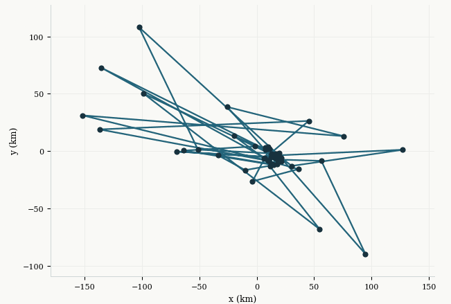
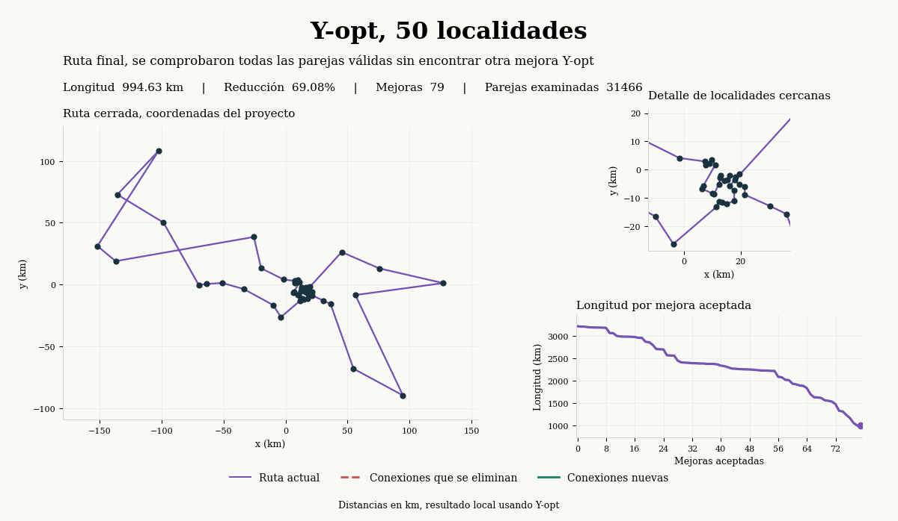

## Introducción: De qué trata el proyecto

\begin{block}{}
\begin{itemize}
  \item Comparar el desempeño de los algoritmos X-opt, Y-opt y 2-opt en un conjunto delimitado de localidades de Costa Rica. \vspace{0.3cm}
  \item Estudiar el efecto de aplicar repetidamente un mismo algoritmo y de combinar los tres métodos en distintos órdenes. \vspace{0.3cm}
  \item Se utiliza un conjunto de 50 localidades extraídas de la base de datos \texttt{GeoNames}. \vspace{0.3cm}
  \item Comparar los algoritmos con el algoritmo de búsqueda exhaustiva. \vspace{0.3cm}
  \item Implementación en Python y realización de gráficos en MATLAB. \vspace{0.3cm}
\end{itemize}
\end{block}

## Metodología: Introducción 
###
- **Punto de partida**: no se conoce un algoritmo que encuentre una solución óptima para el problema del viajero en un tiempo razonable. \vspace{0.35cm}

- Debido a esto, se plantea una combinación de métodos indagatorios, descriptivos y comparativos. \vspace{0.35cm}

- Con lo anterior se busca:  \vspace{0.3cm}
\begin{enumerate}
\item Definir una base de datos adecuada. \vspace{0.1cm}
\item Disponer de la información requerida para desarrollar el proyecto. \vspace{0.1cm}
\item Analizar y comparar los resultados. \vspace{0.1cm}
\end{enumerate}


## Datos: selección y ubicación de las 50 localidades

\begin{block}{Filtrado (GeoNames \texttt{CR.txt}, 7 de 19 variables)}
\centering
21 426 registros $\rightarrow$ 5 900 clase \texttt{P} $\rightarrow$ 128 válidos ($\text{pob} > 0$, sin históricos) $\rightarrow$ 50 más pobladas (ID \texttt{0}–\texttt{49})
\end{block}

:::: {.columns align=center}

::: {.column width="45%"}

\small

- Clase \texttt{P}, sin poblados abandonados, destruidos o históricos.
- Población mayor que cero.
- Coordenadas únicas a 3 decimales: X-opt supone posiciones distintas para detectar cruces.
- 24 de las 50 en la provincia de San José; 30 a $\le 20\text{ km}$ del centro de la capital.

:::

::: {.column width="55%"}

```{=latex}
\includegraphics[width=\linewidth,height=0.5\textheight,keepaspectratio]{../figuras/localidades.png}
```

:::

::::

## Datos: distancias y limitaciones

Proyección equirectangular ($R = 6371$ km, origen en el promedio de las 50 localidades):
$$x = R\cos(\varphi_1)(\lambda - \lambda_0), \qquad y = R(\varphi - \varphi_0)$$
Con esas coordenadas se construyó la matriz de distancias euclidianas de $50 \times 50$.

\begin{block}{Limitaciones}
\begin{itemize}
  \item Población: 97,8 \% de los lugares de GeoNames con valor cero; cifras sin censo oficial.
  \item Concentración en San José: difiere de la distribución uniforme de Manthey y van Rhijn (2025).
  \item Distancias en línea recta, sin red vial.
\end{itemize}
\end{block}

## Metodología: Formulación de los métodos

El problema del viajante es NP-hard; por ello, el proyecto se organizó en cuatro métodos complementarios.^[Manthey, B., & van Rhijn, J. (2025). *Performance of efficient variants of the 2-Opt heuristic for the traveling salesperson problem*. *Discrete Applied Mathematics, 375*, 7–16.]

:::: {.columns}

::: {.column width="48%"}

### Métodos

1. Construcción de la fundamentación teórica.
2. Definición de métricas de análisis.
3. Implementación de los algoritmos en Python.
4. Evaluación y comparación de resultados.

:::

::: {.column width="48%"}

### Objetivo

**Preparar los datos y la información necesaria para implementar 2-opt, X-opt y Y-opt, y comparar su desempeño.**

:::

::::

## Metodología: Problema del viajante

:::: {.columns}

::: {.column width="68%"}

### El problema

- Consiste en encontrar un recorrido de longitud mínima que visite un conjunto de localidades exactamente una vez y regrese al punto de partida.
- El número total de posibles recorridos aumenta factorialmente conforme aumenta el número de ciudades.
- Se utilizan algoritmos que aproximan la solución global.
 
:::

::: {.column width="30%"}

### Aplicaciones 

- Logística y transporte
- Almacenes y Manufactura 
- Electrónica y semiconductores

:::

::::

## Metodología: Algoritmo 2-opt

:::: {.columns}

::: {.column width="55%"}

### Funcionamiento y condición de aceptación
\small
- Se eliminan dos aristas no adyacentes: $(a,b)$ y $(c,d)$.
- Se conectan $(a,c)$ y $(b,d)$, invirtiendo el segmento entre $b$ y $c$.
- El cambio se acepta si

$$
d(a,c)+d(b,d)<d(a,b)+d(c,d).
$$

:::

::: {.column width="43%"}

### Terminación y esfuerzo
\small
- Termina en un **óptimo local**.
- Una pasada completa examina

$$
\frac{n(n-3)}{2}
$$

parejas de aristas, es decir, $O(n^2)$ evaluaciones.^[Manthey, B., & van Rhijn, J. (2025). *Performance of efficient variants of the 2-Opt heuristic for the traveling salesperson problem*. *Discrete Applied Mathematics, 375*, 7–16.]

:::

::::

## Metodología: Algoritmo X-opt 
:::: {.columns}

::: {.column width="55%"}

### Funcionamiento y condición de aceptación
\small
- Se eliminan dos aristas no adyacentes: $(a,b)$ y $(c,d)$. \vspace{0.2cm}
- Se verifica si las aristas se cruzan entre sí.  \vspace{0.2cm}
- En el caso afirmativo, se conectan $(a,c)$ y $(b,d)$, invirtiendo el segmento entre $b$ y $c$ y eliminando así el cruce. \vspace{0.2cm}
- El cambio se acepta si 
$$
d(a,c)+d(b,d)<d(a,b)+d(c,d).
$$

:::

::: {.column width="43%"}

### Terminación y esfuerzo
\small
- Termina en un **óptimo local** respecto a los intercambios X-opt. \vspace{0.2cm}
- El número de iteraciones está acotado por $O(n^3)$: un orden cúbico respecto al tamaño de la instancia. \vspace{0.2cm}
- **Criterio de terminación**: obtener un recorrido libre de cruces entre sus aristas no adyacentes. \vspace{0.2cm}
:::

::::


## Metodología: Algoritmo Y-opt

:::: {.columns}

::: {.column width="55%"}

### Funcionamiento y condición de aceptación
\small
- Se eliminan dos aristas no adyacentes: $(a,b)$ y $(c,d)$.
- Se conectan $(a,c)$ y $(b,d)$, invirtiendo el segmento entre $b$ y $c$.
- El cambio se acepta si

$$ 
\max\{d(a,c), d(b,d)\} < \max\{d(a,b), d(c,d)\} 
$$
$$
\wedge \min\{d(a,c), d(b,d)\} < \min\{d(a,b), d(c,d)\}
$$

:::

::: {.column width="43%"}

### Terminación y esfuerzo
\small
- Termina en un **óptimo local** respecto a los intercambios Y-opt.
- El número de iteraciones está acotado por

$$
(m-1)n
$$

resultando en un tiempo de ejecución polinomial.
:::

::::

## Metodología: Métricas de interés 
###
\small
- **Longitud de la ruta optimizada** \vspace{0.2cm}

- **Tiempo de ejecución** \vspace{0.2cm}

- **Número de iteraciones totales** \vspace{0.2cm}

- **Ruta final obtenida** \vspace{0.2cm}

- **Porcentaje de mejora con respecto a la ruta inicial**

## Implementación: pseudocódigo de 2-opt

:::: {.columns align=top}

::: {.column width="58%"}

```{=latex}
\begin{block}{Algoritmo 2-opt}
\setlength{\parskip}{0pt}
\footnotesize
\begin{algorithmic}[1]
\Require Ruta inicial $R$ y matriz de distancias $D$
\Ensure Ruta optimizada $R'$
\State $R' \gets R$;\quad $mejorar \gets \text{Verdadero}$
\While{$mejorar$}
  \State $mejorar \gets \text{Falso}$
  \ForAll{parejas no adyacentes $(a,b)$, $(c,d)$ de $R'$}
    \If{$D[a,c]+D[b,d] < D[a,b]+D[c,d]$}
      \State Invertir el segmento entre $b$ y $c$
      \State $mejorar \gets \text{Verdadero}$;\quad reiniciar
    \EndIf
  \EndFor
\EndWhile
\State \Return $R'$
\end{algorithmic}
\end{block}
```

:::

::: {.column width="40%"}

### Explicación

\small

- Revisa las parejas de aristas no adyacentes.
- Si el cambio acorta la ruta, invierte el segmento entre $b$ y $c$ y reinicia.
- Termina cuando ninguna pareja mejora: óptimo local.

:::

::::

## Implementación: pseudocódigo de X-opt

:::: {.columns align=top}

::: {.column width="58%"}

```{=latex}
\begin{block}{Algoritmo X-opt}
\setlength{\parskip}{0pt}
\footnotesize
\begin{algorithmic}[1]
\Require $R$, matriz de distancias $D$, coordenadas $C$
\Ensure Ruta optimizada $R'$
\State $R' \gets R$;\quad $mejorar \gets \text{Verdadero}$
\While{$mejorar$}
  \State $mejorar \gets \text{Falso}$
  \ForAll{parejas no adyacentes $(a,b)$, $(c,d)$ de $R'$}
    \If{las aristas se cruzan (según $C$)}
      \If{$D[a,c]+D[b,d] < D[a,b]+D[c,d]$}
        \State Invertir el segmento entre $b$ y $c$
        \State $mejorar \gets \text{Verdadero}$;\quad reiniciar
      \EndIf
    \EndIf
  \EndFor
\EndWhile
\State \Return $R'$
\end{algorithmic}
\end{block}
```

:::

::: {.column width="40%"}

### Explicación

\small

- Es 2-opt, pero solo con parejas de aristas que se cruzan.
- Por eso necesita las coordenadas $C$, además de $D$.
- Termina cuando la ruta no tiene cruces.

:::

::::

## Implementación: pseudocódigo de Y-opt

:::: {.columns align=top}

::: {.column width="62%"}

```{=latex}
\begin{block}{Algoritmo Y-opt}
\setlength{\parskip}{0pt}
\scriptsize
\begin{algorithmic}[1]
\Require Ruta inicial $R$ y matriz de distancias $D$
\Ensure Ruta mejorada $R'$ y parejas examinadas $iter$
\State $R' \gets R$;\quad $iter \gets 0$;\quad $n \gets |R|$
\State $mejorada \gets \text{Verdadero}$
\While{$mejorada$}
  \State $mejorada \gets \text{Falso}$
  \For{$i \gets 0$ hasta $n-2$}
    \For{$j \gets i+2$ hasta $n-1$}
      \State Si $(i,j)=(0,n-1)$, pasar a la siguiente pareja
      \State Identificar $(a,b)$, $(c,d)$;\quad $iter \gets iter+1$
      \State $V \gets (D[a,b],D[c,d])$;\quad $N \gets (D[a,c],D[b,d])$
      \If{$\max(N)<\max(V)$ y $\min(N)<\min(V)$}
        \State Invertir el segmento entre $b$ y $c$ en $R'$
        \State $mejorada \gets \text{Verdadero}$;\quad reiniciar
      \EndIf
    \EndFor
  \EndFor
\EndWhile
\State \Return $R'$, $iter$
\end{algorithmic}
\end{block}
```

:::

::: {.column width="36%"}

### Explicación

\small

- Cuenta cada pareja examinada ($iter$).
- Omite $(0,n-1)$: en una ruta cerrada son aristas adyacentes.
- Acepta solo si la arista nueva más larga y la más corta son menores que las viejas.
- Al aceptar, invierte el segmento y reinicia.

:::

::::

## Metodología: Visualización de los algoritmos

:::: {.columns}

::: {.column width="43%"}

### Ruta inicial de referencia

- Se utilizaron **50 localidades de Costa Rica** y distancias euclidianas en kilómetros.
- Se seleccionó `rutas_iniciales[2]`, la tercera de las rutas iniciales generadas.
- **2-opt, X-opt y Y-opt partieron de esa misma ruta**, para visualizar cómo cada algoritmo la modifica.

:::

::: {.column width="55%"}

\vspace{0.85cm}

{width=100%}

:::

::::

## Visualización del algoritmo 2-opt

:::: {.columns align=center}

::: {.column width="62%"}

\vspace{0.75cm}

{width=100%}

:::

::: {.column width="36%"}

### Resultado final

- **Longitud:** 902,16 km.
- **Reducción:** 71,95 %.
- **Mejoras aceptadas:** 145.

Fue la **ruta más corta de los tres algoritmos** en esta visualización. Se observa una conexión más ordenada entre localidades cercanas.

:::

::::

## Visualización del algoritmo Y-opt

:::: {.columns align=center}

::: {.column width="62%"}

\vspace{0.75cm}

{width=100%}

:::

::: {.column width="36%"}

### Resultado final

- **Longitud:** 994,63 km.
- **Reducción:** 69,08 %.
- **Mejoras aceptadas:** 79.

Y-opt produjo una ruta más corta que X-opt, pero **92,47 km más larga que 2-opt**. 

:::

::::

## Visualización del algoritmo X-opt

:::: {.columns align=center}

::: {.column width="62%"}

\vspace{0.75cm}

{width=100%}

:::

::: {.column width="36%"}

### Resultado final

- **Longitud:** 1 641,88 km.
- **Reducción:** 48,95 %.
- **Mejoras aceptadas:** 74.

X-opt dejó de encontrar **cruces cuya eliminación acortara la ruta**. Obtuvo la mayor longitud final de los tres.

:::

::::

## Resultados: Desempeño de 2-opt

**100 rutas iniciales de 50 localidades**

:::: {.columns align=center}

::: {.column width="44%"}

\begin{center}
{\fontsize{40}{46}\selectfont\bfseries 71,285\%}

\vspace{0.3cm}

Reducción media de la longitud

\end{center}

:::

::: {.column width="52%"}

### Resultados finales

| Métrica | Valor |
|:--|--:|
| Longitud media | **898,311 km** |
| Longitud mediana | **897,133 km** |
| Tiempo medio | **0,064491 s** |

:::

::::

**Alcance del resultado:** se desconoce la ruta óptima para las 50 localidades, por lo que la reducción no indica la cercanía al óptimo global.

## Resultados: Desempeño de X-opt 
**100 rutas iniciales de 50 localidades**

:::: {.columns align=center}

::: {.column width="44%"}

\begin{center}
{\fontsize{40}{46}\selectfont\bfseries 51,321\%}

\vspace{0.3cm}

Reducción media de la longitud

\end{center}

:::

::: {.column width="52%"}

### Resultados finales

| Métrica | Valor |
|:--|--:|
| Longitud media | **1523,920 km** |
| Longitud mediana | **1497,804 km** |
| Tiempo medio | **0,580721 s** |

:::

::::

**Alcance del resultado:** la ausencia de cruces no garantiza cercanía al óptimo global. 

## Resultados: Desempeño de Y-opt

**100 rutas iniciales de 50 localidades**

:::: {.columns align=center}

::: {.column width="44%"}

\begin{center}
{\fontsize{40}{46}\selectfont\bfseries 67,991\%}

\vspace{0.3cm}

Reducción media de la longitud

\end{center}

:::

::: {.column width="52%"}

### Resultados finales

| Métrica | Valor |
|:--|--:|
| Longitud media | **1001,643 km** |
| Longitud mediana | **999,794 km** |
| Tiempo medio | **0,96091 s** |

:::

::::

## Resultados: comparación de los tres algoritmos

Sobre las mismas 100 rutas iniciales de 50 localidades:

| Medida | 2-opt | X-opt | Y-opt |
|:-------|------:|------:|------:|
| Longitud media (km) | 898,311 | 1523,920 | 1001,643 |
| Reducción media (%) | 71,285 | 51,321 | 67,991 |
| Tiempo medio (s) | 0,064491 | 0,580721 | 0,96091 |

\small

- 2-opt obtuvo la menor longitud final en **98** de las 100 rutas; Y-opt en las **2** restantes.
- Rutas finales de Y-opt: en promedio **11,503 %** más largas que las de 2-opt; las de X-opt, **69,643 %** más largas.
- X-opt tardó más que 2-opt pese a lograr una menor reducción; Y-opt fue el más lento.
- Los tres algoritmos redujeron la longitud de las 100 rutas.

## Resultados: comparación de longitudes finales

```{=latex}
\begin{center}
\makebox[\textwidth][c]{%
  \includegraphics[width=0.53\linewidth,height=0.58\textheight,keepaspectratio]{../figuras/longitudes_finales.png}%
  \hspace{12pt}%
  \includegraphics[width=0.53\linewidth,height=0.58\textheight,keepaspectratio]{../figuras/longitud_media_por_n.png}%
}
\end{center}
```

\small
Izquierda: longitud final en cada una de las 100 rutas iniciales. Derecha: longitud final media según el número de localidades $n$.

## Resultados: tiempo de ejecución e iteraciones

```{=latex}
\begin{center}
\makebox[\textwidth][c]{%
  \includegraphics[width=0.53\linewidth,height=0.60\textheight,keepaspectratio]{../figuras/iteraciones_vs_tiempo.png}%
  \hspace{12pt}%
  \includegraphics[width=0.53\linewidth,height=0.60\textheight,keepaspectratio]{../figuras/tiempo_por_iteracion.png}%
}
\end{center}
```

- Iteración: pareja de aristas examinada por el algoritmo.
- El costo por iteración de 2-opt es mucho menor que el de X-opt y Y-opt, lo que contribuye a que haya sido el más rápido.

## Estabilidad: aplicar un algoritmo sobre su propia solución

Primera ruta inicial de 50 localidades, segunda ejecución sobre la solución de la primera:

| Algoritmo | Longitud tras 1.ª ejecución (km) | Longitud tras 2.ª ejecución (km) |
|:----------|------:|------:|
| 2-opt | 899,555 | 899,555 |
| X-opt | 1517,873 | 1517,873 |
| Y-opt | 986,319 | 986,319 |

- El orden de las localidades tampoco cambió.
- Cada segunda ejecución evaluó las $\frac{50(50-3)}{2} = 1175$ parejas de aristas no adyacentes.
- Repetir un algoritmo solo añade el costo de comprobar una ruta que ya es un óptimo local para ese método.

## Estabilidad: rutas finales desde la ruta inicial 1

```{=latex}
\begin{center}
\includegraphics[width=\linewidth,height=0.72\textheight,keepaspectratio]{../figuras/mapa_rutas_finales.png}
\end{center}
```

## Resultados: Estabilidad al combinar algoritmos

Se evaluó si cambiar de algoritmo permitía obtener rutas más cortas que con **2-opt directo**.

:::: {.columns align=top}

::: {.column width="48%"}

### Exploración: una ruta

Se probaron las aplicaciones individuales y las secuencias de dos y tres algoritmos.

- **Mejor secuencia:** 

  X-opt → Y-opt → 2-opt.

- **Secuencia:** 896,280 km.
- **2-opt directo:** 899,555 km.

**Mejora en esta ruta:** 3,275 km.

:::

::: {.column width="48%"}

### Comparación: 100 rutas

**2-opt directo**  

- Longitud media: **898,311 km**  
- Tiempo medio: **0,064 s**

\vspace{0.4cm}

**X-opt → Y-opt → 2-opt**  

- Longitud media: **902,788 km**  
- Tiempo medio: **0,304 s**

La secuencia fue mejor en **38 rutas** y peor en **62**.

:::

::::

## Resultados: Óptimo global, búsqueda exhaustiva 

Comparación entre búsqueda exhaustiva y  2-opt, X-opt y Y-opt para 11 ciudades

| Algoritmo | Longitud final (km) | Tiempo de ejecución (s) | Número de iteraciones |
|:--|--:|--:|--:|
| Búsqueda exhaustiva | 673,374 | 256,367 | 39916800 |
| 2-opt | 686,199 | 0,001 | 451 |
| X-opt | 790,132 | 0,003 | 193 |
| Y-opt | 694,766 | 0,004 | 214 |
- Búsqueda exhaustiva tardó 4 minutos y 16,367 segundos y 39 916 800 iteraciones.
- Se obtuvo un mínimo global de 673,374 km.

## Resultados: efecto de fijar localidades 

- Con la ruta óptima conocida (**673,374 km**), se examinó si fijar una parte de ella ayudaba a los algoritmos a encontrarla. Se conservó progresivamente hasta un máximo de las primeras tres localidades. \vspace{0.3cm}


\begin{table}[H]
\centering
\begin{tabular}{cccc}
\hline
\textbf{Algoritmo} & \textbf{Primera fijación} & 
\textbf{Segunda fijación} & \textbf{Tercera fijación} \\
\hline
2-opt & 687,756 km & 673,374 km & 673,374 km \\
X-opt & 802,066 km & 885,210 km & 826,066 km \\
Y-opt & 692,489 km & 716,504 km & 673,374 km \\
\hline
\end{tabular}
\end{table}

## Conclusiones: desempeño de los algoritmos

\small

- 2-opt: desempeño favorable. Redujo todos los recorridos, obtuvo la menor longitud en 98 de las 100 rutas y una reducción media de 71,285 %, aunque eso no permite determinar su cercanía al óptimo global. \vspace{0.2cm}
- X-opt: redujo las 100 rutas, pero con el menor porcentaje de mejora (51,321 %), lo que podría relacionarse con que solo intercambia aristas que se cruzan. Su tiempo medio fue mayor que el de 2-opt y menor que el de Y-opt. \vspace{0.2cm}
- Y-opt: punto medio entre 2-opt y X-opt en longitud y reducción, pero el de mayor tiempo, lo que podría relacionarse con su condición de aceptación más estricta. \vspace{0.2cm}
- Los tres algoritmos mejoraron la longitud de cada una de las 100 rutas de 50 localidades.

## Conclusiones: estabilidad y orden de aplicación

\small

- Aplicación repetida: correr de nuevo un algoritmo sobre su propia solución no produjo modificaciones, lo que concuerda con la condición de terminación. \vspace{0.2cm}
- Orden de aplicación: influyó en las soluciones. En la prueba exploratoria, X-opt $\rightarrow$ Y-opt $\rightarrow$ 2-opt alcanzó 896,280 km frente a 899,555 km de 2-opt directo. \vspace{0.2cm}
- Sobre las 100 rutas esa ventaja no se mantuvo: la secuencia fue más corta en 38 casos, pero con mayor longitud media y mayor tiempo medio. \vspace{0.2cm}
- Añadir etapas de búsqueda no garantizó una mejora que compensara su costo computacional.

## Conclusiones

- Distancias euclidianas las cuales no consideran carreteras. \vspace{0.3cm}
- Localidades muy cercanas y concentradas en San José. \vspace{0.3cm}
- La distribución geográfica difiere de la utilizada por Manthey & van Rhijn (2025). \vspace{0.3cm}
- Los tiempos de ejecución dependen de las características del equipo utilizado.

## Referencias

\scriptsize

Flood, M. M. (1956). The traveling-salesman problem. *Operations Research, 4*(1), 61–75. https://doi.org/10.1287/opre.4.1.61

\vspace{0.2cm}

GeoNames. (s. f.). *GeoNames Gazetteer: extracto de Costa Rica (CR.txt) y admin1CodesASCII.txt* [Conjunto de datos]. Recuperado el 21 de octubre de 2026, de https://www.geonames.org

\vspace{0.2cm}

Manthey, B., & van Rhijn, J. (2025). Performance of efficient variants of the 2-Opt heuristic for the traveling salesperson problem. *Discrete Applied Mathematics, 375*, 7–16. https://doi.org/10.1016/j.dam.2025.05.034

\vspace{0.2cm}

Snyder, J. P. (1987). *Map projections: A working manual* (Professional Paper 1395). U.S. Geological Survey. https://doi.org/10.3133/pp1395
