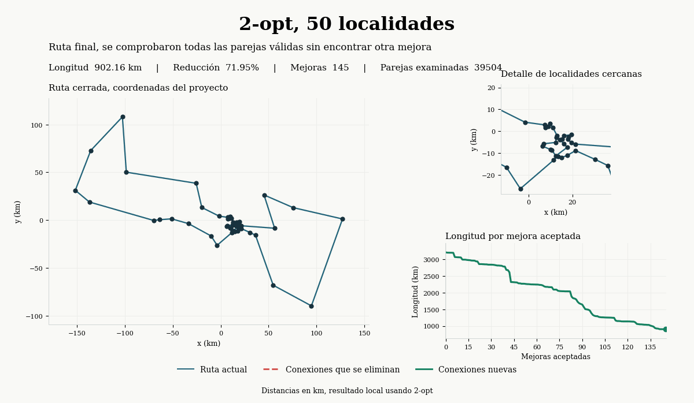

## Introducción: De qué trata el proyecto (José)

## Metodología: Introducción (Ale)

## Datos: fuente y selección de localidades

\begin{block}{Filtrado (GeoNames \texttt{CR.txt}, 7 de 19 variables)}
\centering
21 426 registros $\rightarrow$ 5 900 clase \texttt{P} $\rightarrow$ 128 válidos ($\text{pob} > 0$, sin históricos) $\rightarrow$ 50 más pobladas (ID \texttt{0}–\texttt{49})
\end{block}

\vspace{0.3cm}

:::: {.columns}

::: {.column width="48%"}
\begin{block}{Distribución poblacional}
\begin{itemize}
  \item \textbf{Rango:} 11 680 – 335 007 hab.
  \item \textbf{Mediana / Media:} 25 198 / 31 050 hab.
  \item \textbf{Máximo:} San José
\end{itemize}
\end{block}
:::

::: {.column width="4%"}
:::

::: {.column width="48%"}
\begin{block}{Concentración espacial}
\begin{itemize}
  \item \textbf{24} en la provincia de San José
  \item \textbf{30} a $\le 20\text{ km}$ de la capital
  \item Coordenadas únicas (3 decimales)
\end{itemize}
\end{block}
:::

::::

## Datos: ubicación de las 50 localidades

```{=latex}
\begin{center}
\includegraphics[width=\linewidth,height=0.72\textheight,keepaspectratio]{../figuras/localidades.png}
\end{center}
```

## Datos: coordenadas planas y matriz de distancias

Proyección equirectangular (Snyder, 1987), con $R = 6371$ km y paralelo estándar $\varphi_1 = \varphi_0$:
$$x = R\cos(\varphi_1)(\lambda - \lambda_0), \qquad y = R(\varphi - \varphi_0)$$

- Origen $(\varphi_0, \lambda_0)$: promedio de latitudes y longitudes de las 50 localidades.
- Matriz de distancias euclidianas de $50 \times 50$, simétrica y con ceros en la diagonal.
- X-opt necesita coordenadas planas para determinar si dos aristas se cruzan.

\begin{block}{Limitaciones de los datos}
Población de GeoNames (no es un censo oficial), seis localidades PPLX que son secciones de un lugar poblado, dos localidades llamadas «San José» (índices 0 y 10) y distancias en línea recta, sin red vial.
\end{block}

## Metodología: Formulación de los métodos (Estef)

## Metodología: Problema del viajante (José)

## Metodología: Algoritmo 2-opt (Estef)

## Metodología: Algoritmo X-opt (Ale)

## Metodología: Algoritmo Y-opt (José)

## Metodología: Métricas de interés (Ale)

## Implementación de los algoritmos en Python (FALTAN LOS ALGORITMOS COMPLEOTS)

- Los tres algoritmos (2-opt, X-opt y Y-opt), la preparación de datos y las pruebas se implementaron en Python.
- Estrategia de **primera mejora**: tras cada intercambio aceptado se reinicia la exploración; termina cuando no hay mejoras.
- Pruebas preliminares con 15 localidades; luego **100 rutas iniciales aleatorias** de 50 localidades, con semilla fija 2026.
- Los tres métodos reciben las mismas rutas y la misma matriz de distancias.
- Métricas registradas: longitud final, porcentaje de mejora, parejas examinadas y tiempo de ejecución.

## Metodología: Visualización de los algoritmos (por definir)

## Visualización del algoritmo 2-opt

{width=70%}

## Visualización del algoritmo Y-opt

{width=70%}

## Visualización del algoritmo X-opt

{width=70%}

## Metodología: Valoración del desempeño (Estef)

## Resultados: Desempeño de 2-opt (Estef)

## Resultados: Desempeño de X-opt (Ale)

## Resultados: Desempeño de Y-opt (José)

## Resultados: comparación de los tres algoritmos

Sobre las mismas 100 rutas iniciales de 50 localidades:

| Medida | 2-opt | X-opt | Y-opt |
|:-------|------:|------:|------:|
| Reducción media (%) | 71,285 | 51,321 | 67,991 |
| Tiempo medio (s) | 0,064491 | 0,580721 | 0,96091 |

Los tres algoritmos redujeron la longitud de las 100 rutas.

## Resultados: comparación de longitudes finales

```{=latex}
\begin{center}
\makebox[\textwidth][c]{%
  \includegraphics[width=0.53\linewidth,height=0.72\textheight,keepaspectratio]{../figuras/longitudes_finales.png}%
  \hspace{12pt}%
  \includegraphics[width=0.53\linewidth,height=0.72\textheight,keepaspectratio]{../figuras/longitud_media_por_n.png}%
}
\end{center}
```

## Resultados: ¿cuál obtuvo mejores rutas?

- 2-opt obtuvo la menor longitud final en **98** de las 100 rutas; Y-opt en las **2** restantes.
- Rutas finales de Y-opt: en promedio **11,503 %** más largas que las de 2-opt; las de X-opt, **69,643 %** más largas.
- 2-opt fue el más rápido; X-opt tardó más que 2-opt pese a lograr una menor reducción, y Y-opt fue el más lento.

## Resultados: tiempo de ejecución e iteraciones

```{=latex}
\begin{center}
\makebox[\textwidth][c]{%
  \includegraphics[width=0.53\linewidth,height=0.60\textheight,keepaspectratio]{../figuras/iteraciones_vs_tiempo.png}%
  \hspace{12pt}%
  \includegraphics[width=0.53\linewidth,height=0.60\textheight,keepaspectratio]{../figuras/tiempo_por_iteracion.png}%
}
\end{center}
```

- 2-opt examinó más parejas que X-opt y Y-opt, pero tardó menos: su costo por iteración es mucho menor.

## Estabilidad: aplicar un algoritmo sobre su propia solución

Primera ruta inicial de 50 localidades, segunda ejecución sobre la solución de la primera:

| Algoritmo | Longitud tras 1.ª ejecución (km) | Longitud tras 2.ª ejecución (km) |
|:----------|------:|------:|
| 2-opt | 899,555 | 899,555 |
| X-opt | 1517,873 | 1517,873 |
| Y-opt | 986,319 | 986,319 |

- El orden de las localidades tampoco cambió.
- Cada segunda ejecución examinó las $\frac{50(50-3)}{2} = 1175$ parejas de aristas no adyacentes.
- Repetir un algoritmo solo añade el costo de comprobar una ruta que ya es un óptimo local para ese método.

## Estabilidad: rutas finales desde la ruta inicial 1

```{=latex}
\begin{center}
\includegraphics[width=\linewidth,height=0.72\textheight,keepaspectratio]{../figuras/mapa_rutas_finales.png}
\end{center}
```

## Resultados: Estabilidad, secuencias (Estef)

## Resultados: Óptimo global, búsqueda exhaustiva (José)

## Resultados: Óptimo global, fijar localidades (Ale)

## Conclusiones

- **2-opt:** redujo todos los recorridos, obtuvo la menor longitud entre los tres algoritmos en 98 comparaciones y una reducción media de 71,285 %; no permite determinar su cercanía al óptimo global.
- **X-opt:** redujo las 100 rutas (51,321 %), pero tuvo la menor mejora y un tiempo medio de 0,580721 s; esto podría relacionarse con que solo intercambia aristas que se cruzan.
- **Y-opt:** punto medio entre 2-opt y X-opt en longitud final y reducción, pero con el mayor tiempo medio, por tener la condición de aceptación más estricta.
- Los tres algoritmos mejoraron la longitud de cada una de las 100 rutas de 50 localidades.

## Conclusiones: Párrafo 3 (sin asignar)

## Conclusiones: Último párrafo (José)