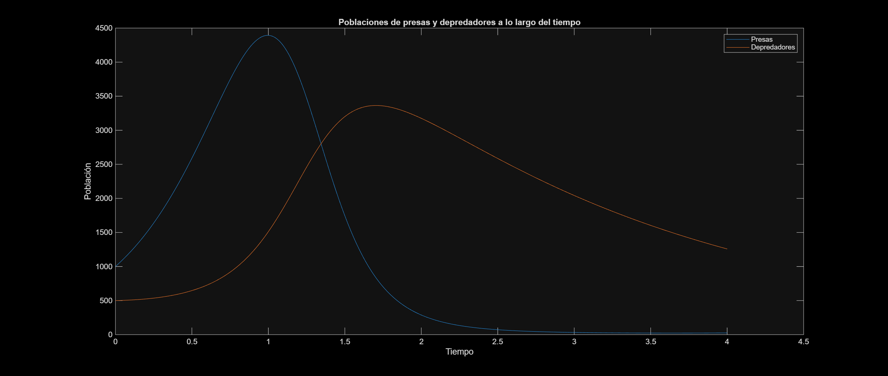
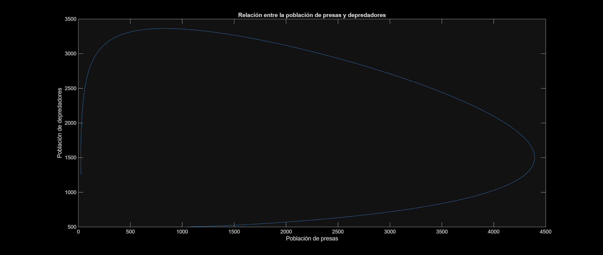
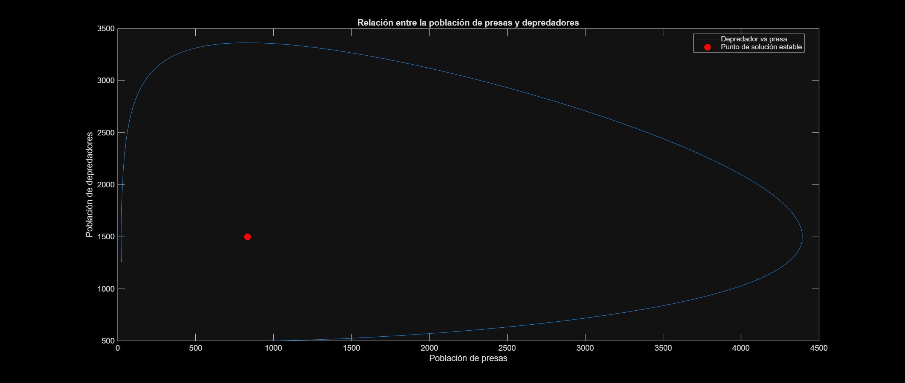

# Interporlación

## Ejercicio 1

Tenemos $f(x) := \frac{1}{2} + \frac{2}{1 + \left|1 - \tan\left(\frac{x}{2}\right)\right|}$ para $0 \le x \le 2$.

### a) Aproxime $f(0)$, $f(1)$ y $f(2)$ y $f'(0)$, $f'(1)$ y $f'(2)$

Vea que

$$f(0) = \frac{1}{2} + \frac{2}{1 + \left|1 - \tan\left(\frac{0}{2}\right)\right|} = \frac{3}{2} = 1.5000 $$

$$f(1) = \frac{1}{2} + \frac{2}{1 + \left|1 - \tan\left(\frac{1}{2}\right)\right|} \approx 1.8758$$

$$f(2) = \frac{1}{2} + \frac{2}{1 + \left|1 - \tan\left(\frac{2}{2}\right)\right|} \approx 1.7842$$

Ahora:
$$1 - \tan\left(\frac{x}{2}\right) < 0 \Rightarrow \tan\left(\frac{x}{2}\right) > 1 \Rightarrow x > 2 \cdot \tan^{-1}(1) \Rightarrow x > \frac{\pi}{2}$$

$$\Rightarrow \left|1 - \tan\left(\frac{x}{2}\right)\right| = \begin{cases} 1 - \tan\left(\frac{x}{2}\right) & \text{si } x \in \left[0, \frac{\pi}{2}\right] \\ \tan\left(\frac{x}{2}\right) - 1 & \text{si } x \in \left]\frac{\pi}{2}, 2\right] \end{cases}$$

Por lo que

$$ f(x) = \begin{cases} \frac{1}{2} + \frac{2}{2 - \tan\left(\frac{x}{2}\right)} & \text{si } x \in \left[0, \frac{\pi}{2}\right[ \\ \frac{1}{2} + \frac{2}{\tan\left(\frac{x}{2}\right)} & \text{si } x \in \left]\frac{\pi}{2}, 2\right] \end{cases}$$

Ahora, calculemos la derivada para cada intervalo:
$$\left(\frac{1}{2} + \frac{2}{2 - \tan\left(\frac{x}{2}\right)}\right)' = 0 + \frac{2 \cdot \sec^2\left(\frac{x}{2}\right) \cdot \frac{1}{2}}{\left(2 - \tan\left(\frac{x}{2}\right)\right)^2} = \frac{\sec^2\left(\frac{x}{2}\right)}{\left(2 - \tan\left(\frac{x}{2}\right)\right)^2}$$

$$\left(\frac{1}{2} + \frac{2}{\tan\left(\frac{x}{2}\right)}\right)' = 0 - \frac{2 \sec^2\left(\frac{x}{2}\right) \cdot \frac{1}{2}}{\tan^2\left(\frac{x}{2}\right)} = -\frac{\sec^2\left(\frac{x}{2}\right)}{\tan^2\left(\frac{x}{2}\right)} = -\csc^2\left(\frac{x}{2}\right)$$

Pero, vea que:
$$\lim_{x \to \frac{\pi}{2}^-} f'(x) = \lim_{x \to \frac{\pi}{2}^-} \frac{\sec^2\left(\frac{x}{2}\right)}{\left(2 - \tan\left(\frac{x}{2}\right)\right)^2} = 2$$
$$\lim_{x \to \frac{\pi}{2}^+} f'(x) = \lim_{x \to \frac{\pi}{2}^+} -\csc^2\left(\frac{x}{2}\right) = -2$$

Como los límites laterales de $f'(x)$ cuando $x \to \frac{\pi}{2}$ no son iguales, entonces $f'(x)$ posee una discontinuidad en $x = \frac{\pi}{2}$.

$$\Rightarrow f'(x) = \begin{cases} 
\frac{\sec^2\left(\frac{x}{2}\right)}{\left(2 - \tan\left(\frac{x}{2}\right)\right)^2} & \text{si } x \in \left[0, \frac{\pi}{2}\right[ \\ 
-\csc^2\left(\frac{x}{2}\right) & \text{si } x \in \left]\frac{\pi}{2}, 2\right] 
\end{cases}$$

$$\Rightarrow f'(0) = \frac{\sec^2(0)}{(2 - \tan(0))^2} = \frac{1}{4} = 0.2500$$

$$\Rightarrow f'(1) = \frac{\sec^2\left(\frac{1}{2}\right)}{\left(2 - \tan\left(\frac{1}{2}\right)\right)^2} \approx 0.6144$$

$$\Rightarrow f'(2) = -\csc^2(2/2) = -\csc^2(1) \approx -1.4123$$

### b) Para $f′$, construya el polinomio interpolante de Lagrange: $p_2(y)$ para $x$ como función de $y$.

Necesitamos el polinomio interpolante de Lagrange en:
$$(y_0, x_0) = \left(\frac{1}{4}, 0\right), \quad (y_1, x_1) = (0.6144, 1), \quad (y_2, x_2) = (-1.4123, 2)$$

El polinomio interpolante de Lagrange sería:
$$p_2(y) = x_0 L_0(y) + x_1 L_1(y) + x_2 L_2(y)$$
 ya que tenemos que $y$ es la variable independiente. Donde
$$L_k(y) = \prod_{i=0, i \neq k}^n \frac{y - y_i}{y_k - y_i}$$

$$\Rightarrow L_0(y) = \frac{(y - y_1)(y - y_2)}{(y_0 - y_1)(y_0 - y_2)} = \frac{(y - 0.6144)(y + 1.4123)}{(0.25 - 0.6144)(0.25 + 1.4123)} = \frac{(y - 0.6144)(y + 1.4123)}{-0.6057}$$

$$\Rightarrow L_1(y) = \frac{(y - y_0)(y - y_2)}{(y_1 - y_0)(y_1 - y_2)} = \frac{(y - 0.25)(y + 1.4123)}{(0.6144 - 0.25)(0.6144 + 1.4123)} = \frac{(y - 0.25)(y + 1.4123)}{0.7385}$$

$$\Rightarrow L_2(y) = \frac{(y - y_0)(y - y_1)}{(y_2 - y_0)(y_2 - y_1)} = \frac{(y - 0.25)(y - 0.6144)}{(-1.4123 - 0.25)(-1.4123 - 0.6144)} = \frac{(y - 0.25)(y - 0.6144)}{3.3690}$$

Como $p_2(y) = x_0 L_0(y) + x_1 L_1(y) + x_2 L_2(y)$:
$$\Rightarrow p_2(y) = 0 \cdot L_0(y) + 1 \cdot L_1(y) + 2 \cdot L_2(y)$$
$$\Rightarrow p_2(y) = \frac{(y - 0.25)(y + 1.4123)}{0.7385} + \frac{2(y - 0.25)(y - 0.6144)}{3.3690}$$

### c) Evalúe $p_2$ en un valor apropiado de $y$ para encontrar una aproximación a un extremo relativo de $f$.

Sabemos que un extremo relativo se alcanza cuando $f'(x) = 0$. Por lo que, podemos usar $y = 0$ para aproximar dicho valor extremo ya que $x \approx p_2(y)$.

Vea que:
$$p_2(0) = \frac{(0 - 0.25)(0 + 1.4123)}{0.7385} + \frac{2(0 - 0.25)(0 - 0.6144)}{3.3690} \approx -0.3869$$

Se puede ver que, comparada con la solución exacta $\xi = \frac{\pi}{2} \approx 1.5708$, la aproximación encontrada tendría:
$$\frac{|1.5708 - (-0.3869)|}{|1.5708|} < 5 \times 10^{-t}$$
$$\Rightarrow 0.2493 < 10^{-t}$$
$$\Rightarrow \log_{10}(0.2493) < -t \log_{10}(10)$$
$$\Rightarrow -\log_{10}(0.2493) > t$$
$$\Rightarrow 0.6033 > t$$

Como $t$ debe ser entero no negativo, $t = 0$. 

Por lo que la aproximación tiene 0 dígitos de significancia. Esta mala aproximación puede deberse a que la derivada de $f$ posee una discontinuidad en $x = \frac{\pi}{2}$.

## Ejercicio 2

Considere el trazador cúbico $S(x)$ definido como

$$
S(x):=
\begin{cases}
-\dfrac{19}{20}x^3+\alpha x^2-\dfrac{38}{5}x+12,
& -2\leq x<0,\\[6pt]
\beta x^3-\dfrac{57}{10}x^2-\dfrac{38}{5}x+12,
& 0\leq x<2,\\[6pt]
-\dfrac{31}{20}x^3-\dfrac{62}{19}\alpha x^2-\dfrac{562}{25}\beta x+\dfrac{222}{5},
& 2\leq x\leq4,
\end{cases}
$$

donde $\alpha$ y $\beta$ son parámetros por determinar.

### a) Encuentre los valores de $\alpha$ y $\beta$ para que $S$ sea, en efecto, un trazador cúbico.

Sean $S_0$, $S_1$ y $S_2$ los polinomios que definen a $S$ en los intervalos $[-2,0]$, $[0,2]$ y $[2,4]$, respectivamente. Como son de grado 3, para que $S$ sea un trazador cúbico basta verificar que la función y sus dos primeras derivadas sean continuas en los nodos interiores $x=0$ y $x=2$.

Calculando las primeras derivadas

$$
\begin{aligned}
S_0'(x)&=-\frac{57}{20}x^2+2\alpha x-\frac{38}{5},\\
S_1'(x)&=3\beta x^2-\frac{57}{5}x-\frac{38}{5},\\
S_2'(x)&=-\frac{93}{20}x^2-\frac{124}{19}\alpha x-\frac{562}{25}\beta.
\end{aligned}
$$

Las segundas derivadas son

$$
\begin{aligned}
S_0''(x)&=-\frac{57}{10}x+2\alpha,\\
S_1''(x)&=6\beta x-\frac{57}{5},\\
S_2''(x)&=-\frac{93}{10}x-\frac{124}{19}\alpha.
\end{aligned}
$$

En $x=0$, la continuidad de la función y de su primera derivada se cumplen para cualquier valor de los parámetros, esto pues

$$
S_0(0)=S_1(0)=12,
\qquad
S_0'(0)=S_1'(0)=-\frac{38}{5}.
$$

Para que la segunda derivada sea continua, se debe cumplir que 

$$
S_0''(0)=S_1''(0)
\quad\Longleftrightarrow\quad
2\alpha=-\frac{57}{5}\quad
\Longrightarrow\alpha=-\frac{57}{10}.
$$

Por otro lado, en $x=2$, la continuidad de la segunda derivada requiere

$$
12\beta-\frac{57}{5}
=-\frac{93}{5}-\frac{124}{19}\alpha.
$$

Al sustituir el valor de $\alpha$, resulta

$$
12\beta-\frac{57}{5}
=-\frac{93}{5}+\frac{186}{5}
=\frac{93}{5}
\\
12\beta=30
\quad\Longrightarrow\quad
\beta=\frac{5}{2}.
$$

Ahora, basta comprobar que estos valores también garantizan la continuidad de la función y de su primera derivada en $x=2$. Al sustituir los parámetros obtenidos tenemos que 

$$
\begin{aligned}
S_1(2)
&=20-\frac{114}{5}-\frac{76}{5}+12=-6,\\[4pt]
S_2(2)
&=-\frac{62}{5}+\frac{372}{5}-\frac{562}{5}+\frac{222}{5}
=-6.
\end{aligned}
$$

Asimismo, evualuando en la primera derivada

$$
\begin{aligned}
S_1'(2)
&=30-\frac{114}{5}-\frac{38}{5}
=-\frac{2}{5},\\[4pt]
S_2'(2)
&=-\frac{93}{5}+\frac{372}{5}-\frac{281}{5}
=-\frac{2}{5}.
\end{aligned}
$$

Además, evaluando en la segunda derivada

$$
S_1''(2)=S_2''(2)=\frac{93}{5}.
$$

En consecuencia, la función y sus dos primeras derivadas son continuas en ambos nodos interiores. Por tanto, se concluye que los únicos valores para los cuales $S$ es un trazador cúbico son

$$
\alpha=-\frac{57}{10},\qquad \beta=\frac{5}{2}.
$$

### b) ¿Es $S$ un trazador cúbico con frontera natural? Justifique su respuesta.

Sabemos que un trazador cúbico tiene frontera natural si su segunda derivada se anula en los extremos del intervalo. En este caso, debemos verificar que

$$
S''(-2)=0
\qquad\text{y}\qquad
S''(4)=0.
$$

Con $\alpha=-57/10$, en el extremo izquierdo se obtiene

$$
S''(-2)=S_0''(-2)
=-\frac{57}{10}(-2)+2\left(-\frac{57}{10}\right)
=\frac{57}{5}-\frac{57}{5}=0.
$$

En el extremo derecho,

$$
S''(4)=S_2''(4)
=-\frac{93}{10}(4)-\frac{124}{19}\left(-\frac{57}{10}\right)
=-\frac{186}{5}+\frac{186}{5}=0.
$$

Por tanto, se concluye que $S$ sí es un trazador cúbico con frontera natural.

## Ejercicio 3

Sea $f$ definida en $[a,b]$ y considere los puntos dados $a = x_0 < x_1 < x_2 = b$. El trazador cuadrático $S$ que interpola $f$ está dado por

$$
S(x)=
\begin{cases}
S_0(x)=a_0+b_0(x-x_0)+c_0(x-x_0)^2, & \text{en } [x_0,x_1],\\[6pt]
S_1(x)=a_1+b_1(x-x_1)+c_1(x-x_1)^2, & \text{en } [x_1,x_2],
\end{cases}
$$

tal que cumple las condiciones:

(i) $S(x_i)=f(x_i)$ para $i=0,1,2$.

(ii) $S\in C^1[x_0,x_2]$.

### a) Muestre que las condiciones (i) y (ii) generan cinco ecuaciones con las seis incógnitas: $a_0, b_0, c_0, a_1, b_1$ y $c_1$. Determine esas condiciones.

Sean $h_0 = x_1 - x_0$ y $h_1 = x_2 - x_1$. Vea que las derivadas de cada polinomio son

$$
S_0'(x)=b_0+2c_0(x-x_0), \qquad S_1'(x)=b_1+2c_1(x-x_1).
$$

Para la condición (i) se debe cumplir que $S(x_i)=f(x_i)$ para $i=0,1,2$. En $x_1$ ambos polinomios deben valer $f(x_1)$, con lo cual $S$ es continua en $x_1$. Así, se obtienen cuatro ecuaciones:

$$
\begin{aligned}
S_0(x_0)&=a_0=f(x_0), &&(1)\\
S_0(x_1)&=a_0+b_0h_0+c_0h_0^2=f(x_1), &&(2)\\
S_1(x_1)&=a_1=f(x_1), &&(3)\\
S_1(x_2)&=a_1+b_1h_1+c_1h_1^2=f(x_2). &&(4)
\end{aligned}
$$

Y para la condición (ii), como $S$ ya es continua por (2) y (3), para que $S \in C^1[x_0,x_2]$ solo falta que $S_0'(x_1)=S_1'(x_1)$. Vea que $S_0'(x_1)=b_0+2c_0h_0$ y $S_1'(x_1)=b_1$, por lo que se obtiene la ecuación

$$
b_0+2c_0h_0=b_1. \qquad (5)
$$

De esta forma, las condiciones (i) y (ii) generan cinco ecuaciones, (1) a (5), para seis incógnitas ($a_0, b_0, c_0, a_1, b_1$ y $c_1$).

### b) ¿Por qué es necesaria la condición $S \in C^2[x_0,x_2]$ para el problema? ¿Esta condición hace que el trazador sea único? Justifique su respuesta.

Es necesaria porque se tienen 5 ecuaciones y 6 incógnitas, es decir, hay menos ecuaciones que incógnitas, por lo que es necesario encontrar una ecuación adicional. Esta se obtiene al pedir que $S \in C^2[x_0,x_2]$: como $S_0''(x)=2c_0$ y $S_1''(x)=2c_1$, la continuidad de la segunda derivada en $x_1$ implica

$$
S_0''(x_1)=S_1''(x_1) \quad \Longrightarrow \quad 2c_0=2c_1 \quad \Longrightarrow \quad c_0=c_1. \qquad (6)
$$

De (1) y (3) ya se conocen $a_0=f(x_0)$ y $a_1=f(x_1)$, por lo que las incógnitas que faltan por encontrar son $b_0, c_0, b_1$ y $c_1$. Con las ecuaciones (2), (4), (5) y (6) se plantea el sistema $Ax=b$:

$$
\begin{pmatrix}
h_0 & h_0^2 & 0 & 0\\
0 & 0 & h_1 & h_1^2\\
1 & 2h_0 & -1 & 0\\
0 & 1 & 0 & -1
\end{pmatrix}
\begin{pmatrix}b_0\\c_0\\b_1\\c_1\end{pmatrix}
=
\begin{pmatrix}f(x_1)-f(x_0)\\f(x_2)-f(x_1)\\0\\0\end{pmatrix}
$$

Para hallar la solución única se resuelve el sistema despejando cada incógnita. De la cuarta ecuación, $c_1=c_0$. De la primera y la segunda ecuación, como $h_0>0$ y $h_1>0$:

$$
b_0=\frac{f(x_1)-f(x_0)}{h_0}-h_0c_0, \qquad b_1=\frac{f(x_2)-f(x_1)}{h_1}-h_1c_0.
$$

Al sustituir en la tercera ecuación, $b_0+2h_0c_0-b_1=0$, se obtiene

$$
\frac{f(x_1)-f(x_0)}{h_0}+h_0c_0-\frac{f(x_2)-f(x_1)}{h_1}+h_1c_0=0
\quad\Longrightarrow\quad
c_0=\frac{\dfrac{f(x_2)-f(x_1)}{h_1}-\dfrac{f(x_1)-f(x_0)}{h_0}}{h_0+h_1}.
$$

Como $h_0+h_1=x_2-x_0>0$, el valor de $c_0$ existe y es único. Luego, $c_1$, $b_0$ y $b_1$ quedan determinados de forma única por las expresiones anteriores. Por lo tanto, el sistema $Ax=b$ tiene solución única.

Ahora, como $a_0$ y $a_1$ están determinados por (1) y (3), y $b_0, c_0, b_1, c_1$ son la solución única del sistema anterior, los seis coeficientes quedan determinados de forma única. Por lo tanto, sí, la condición $S \in C^2[x_0,x_2]$ hace que el trazador sea único.

# Integración 

## Ejercicio 4

Considere la integral: 

$$ \int_{e}^{e+2} \frac{1}{xln(x)} dx \approx 0.43919$$
Realice lo siguiente usando redondeo a 5 dígitos decimales.

### a) Utilice la regla Compuesta de Simpson para aproximar la integral anterior con 6 subintervalos.

Para aproximar la integral utilizando la regla Compuesta de Simpson y 6 subintervalos, se parte de la siguiente fórmula: 

$$
\int_a^b f(x)\,dx \approx
\frac{h}{3}
\left[
f(a)
+ 2\sum_{j=1}^{\frac{n}{2}-1} f(x_{2j})
+ 4\sum_{j=1}^{\frac{n}{2}} f(x_{2j-1})
+ f(b)
\right],
$$
donde $h=\frac{b-a}{n}$, $x_{j} = a + jh \quad \text{con} \quad j=0,1,...,n \quad$ y $\quad \mu \in (a,b)$. 

Dada la integral del ejercicio y los datos brindados, se tiene que $a=e$, $b=e+2$, $f(x)=\frac{1}{xln(x)}$ y $n=6$. Se procede a calcular cada componente para aproximar la integral. 

$$h =\frac{e+2-e}{6} = \frac{2}{6} = \frac{1}{3} \approx 0.33333$$
Se sabe que $x_{0} = a = e \approx 2.71828$ y $x_{6} = b = e+2 \approx 4.71828$. Averigüando los demás puntos que conforman los límites de los subintervalos:

$$x_{1} = e + \frac{1}{3} \approx 3.05162,$$
$$x_{2} = e + 2*\frac{1}{3} = e + \frac{2}{3} \approx 3.38495, $$
$$x_{3} = e + 3*\frac{1}{3} = e + 1 \approx 3.71828, $$
$$x_{4} = e + 4*\frac{1}{3} = e + \frac{4}{3} \approx 4.05162, $$
$$x_{5} = e + 5*\frac{1}{3} = e + \frac{5}{3} \approx 4.38495. $$
Evaluando la función en cada punto, usando el redondeo a cinco dígitos decimales: 

$$f(x_{0}) = f(2.71828) = \frac{1}{2.71828*ln(2.71828)} \approx  0.36788 ,$$
$$f(x_{1}) = f(3.05162) = \frac{1}{3.05162*ln(3.05162)} \approx 0.29372,$$
$$f(x_{2}) = f(3.38495) = \frac{1}{3.38495*ln(3.38495)} \approx 0.24228,$$
$$f(x_{3}) = f(3.71828) = \frac{1}{3.71828*ln(3.71828)} \approx 0.20479,$$
$$f(x_{4}) = f(4.05162) = \frac{1}{4.05162*ln(4.05162)} \approx 0.17641,$$
$$f(x_{5}) = f(4.38495) = \frac{1}{4.38495*ln(4.38495)} \approx 0.15428,$$
$$f(x_{6}) = f(4.71828) = \frac{1}{4.71828*ln(4.71828)} \approx 0.13661.$$

Finalmente, construyendo la aproximación: 

$$ \int_{e}^{e+2} \frac{1}{xln(x)} dx \approx \frac{0.33333}{3}
\left[
f(x_{0})
+ 2\sum_{j=1}^{2} f(x_{2j})
+ 4\sum_{j=1}^{3} f(x_{2j-1})
+ f(x_{6})
\right] $$

$$ \int_{e}^{e+2} \frac{1}{xln(x)} dx \approx 0.11111
\left[
0.36788
+ 2(0.24228+0.17641)+ 4(0.29372+0.20479+0.15428)+0.13661)
\right] $$

$$ \int_{e}^{e+2} \frac{1}{xln(x)} dx \approx 0.11111 * 3.95303 \approx 0.43922 $$
Así, se ha encontrado: 

$$ \int_{e}^{e+2} \frac{1}{xln(x)} dx  \approx 0.43922. $$

### b) Determine la cantidad de dígitos significativos de la aproximación encontrada en (a).

Para encontrar la cantidad de dígitos significativos se parte de la siguiente definición: se dice que $\tilde{x}$ aproxima a $x \neq 0$ con t dígitos significativos si t es el mayor entero no negativo para el cual
$$\frac{|x − \tilde{x}|}{|x|} < 5 × 10^{−t}$$
Calculando: 

$$\frac{|x − \tilde{x}|}{|x|} = \frac{|0.43919 − 0.43922|}{|0.43919|} \approx 0.00006831$$

Ahora, evaluando la expresión dada para cada t: 

Para $t=1$: 
$$5 × 10^{−1} = 0.5$$
Para $t=2$: 
$$5 × 10^{−2} = 0.05$$
Para $t=3$: 
$$5 × 10^{−3} = 0.005$$
Para $t=4$: 
$$5 × 10^{−4} = 0.0005$$
Para $t=5$: 
$$5 × 10^{−5} = 0.00005$$

Note que $0.00005 < 0.00006831$, por lo que la aproximación encontrada en el inciso a posee **4 dígitos significativos**. 

### c) Usando la regla del trapecio compuesta, determine la cantidad de subintervalos necesaria para que la regla del trapecio compuesta alcance el error obtenido en b).

Se tiene que el error en la regla del trapecio compuesta está dado por: 

$$ \frac{b − a}{12} * h^{2} * f′′(\mu), \quad con \quad \mu \in (a,b)\quad \text{y} \quad h = \frac{b-a}{n}.$$
Se retoma: $a=e$ y $b=e+2$. Calculando la segunda derivada de la función: 

$$f(x) = \frac{1}{xln(x)}$$

**Primera derivada**

$$f'(x) = \frac{0*xln(x) - 1*[1*ln(x)+x*\frac{1}{x}]}{(xln(x))^{2}} = \frac{-ln(x) - 1}{(xln(x))^{2}}$$

**Segunda derivada**

$$f''(x) = \frac{\frac{-1}{x}*(xln(x))^{2} - (-ln(x)-1)*2xln(x)*[1*ln(x)+x*\frac{1}{x}]}{(xln(x))^{4}} $$
$$f''(x) = \frac{-xln(x)^{2} + 2xln(x)^{3} + 2xln(x)^{2}+ 2xln(x)^{2} + 2xln(x)}{(xln(x))^{4}} $$
$$f''(x) = \frac{2xln(x) + 3xln(x)^{2} + 2xln(x)^{3}}{(xln(x))^{4}} = \frac{xln(x)[2 + 3ln(x) + 2ln(x)^{2}]}{(xln(x))^{4}} $$

$$f''(x) = \frac{2 + 3ln(x) + 2ln(x)^{2}}{(xln(x))^{3}} $$

Ahora, se precisa encontrar el valor $\mu \in (e,e+2)$ en el cual $f''(x)$ alcanza su máximo dentro de dicho intervalo. Para ello, se analiza el comportamiento de la función $f''(x)$ en el intervalo $(e, e+2)$. 

**Tercera derivada**

$$f'''(x) = \frac{[\frac{3}{x} + \frac{4ln(x)}{x}]*(xln(x))^{3} - [2 + 3ln(x) + 2ln(x)^{2}] *3(xln(x))^{2} * [1*ln(x)+x*\frac{1}{x}] }{(xln(x))^{6}}$$

$$f'''(x) = \frac{3x^{2}ln(x)^{3} + 4x^{2}ln(x)^{4} -6x^{2}ln(x)^{3} - 9x^{2}ln(x)^{4}-6x^{2}ln(x)^{5} - 6x^{2}ln(x)^{2} - 9x^{2}ln(x)^{3}-6x^{2}ln(x)^{4}}{(xln(x))^{6}}$$
$$f'''(x) = \frac{- 6x^{2}ln(x)^{2} -12x^{2}ln(x)^{3} -11x^{2}ln(x)^{4} -6x^{2}ln(x)^{5}}{(xln(x))^{6}}$$
$$f'''(x) = \frac{x^{2}ln(x)^{2}[-6 -12ln(x) -11ln(x)^{2} -6ln(x)^{3}]}{x^{6}ln(x)^{6}}$$
$$f'''(x) = \frac{-6 -12ln(x) -11ln(x)^{2} -6ln(x)^{3}}{x^{4}ln(x)^{4}}$$
$$f'''(x) = -\frac{6 + 12ln(x) + 11ln(x)^{2} + 6ln(x)^{3}}{x^{4}ln(x)^{4}}$$

Note que para todo $x \in (e, e+2)$ se tiene que $f'''(x) <0$, pues $ln(x) > 0$ para todo $x \in (e, e+2)$. En consecuencia,  $f''(x)$ es decreciente en el intervalo $(e, e+2)$, de manera que su máximo dentro de él se sitúa en el menor punto del mismo: en este caso $a=e \approx 2.71828$. Evaluando: 

$$f''( 2.71828) = \frac{2 + 3ln( 2.71828) + 2ln( 2.71828)^{2}}{( 2.71828*ln( 2.71828))^{3}} \approx 0.34851  $$

Ahora, partiendo del hecho de que el valor de la segunda derivada en $(e, e+2)$ está acotado superiormente por 0.34851, con el objetivo de averiguar la cantidad de subintervalos necesaria
para que la regla del trapecio compuesta alcance el error obtenido en el inciso b, se plantea: 

$$ \Rightarrow\frac{4.71828 − 2.71828}{12} * \frac{(4.71828 − 2.71828)^{2}}{n^{2}} * 0.34851 \leq 0.00006831  $$
$$ \Rightarrow \frac{2.78808}{12n^{2}} * \leq 0.00006831  $$
$$ \Rightarrow \frac{2.78808}{12*0.00006831} * \leq n^{2}$$
$$ \Rightarrow \sqrt{\frac{2.78808}{0.0008120}} * \leq n$$

$$ \Rightarrow 58.59689  \leq n$$
Del resultado anterior concluya que **se requieren al menos 59 subintervalos para que la regla del trapecio compuesta alcance el error obtenido en inciso b**: 0.00006831, es decir, se necesitan al menos 59 subintervalos para que la regla del trapecio compuesta tenga un error igual o menor a 0.00006831.

## Ejercicio 5

### a) Usando la ecuación (1), reescriba la integral $N(1)$.

Sea $\varphi(t)=\dfrac{1}{\sqrt{2\pi}}e^{-t^2/2}$ la densidad normal estándar. Como su integral sobre toda la recta real es igual a uno,

$$
N(1)=\int_{-\infty}^{1}\varphi(t)\,dt
=1-\int_1^{+\infty}\varphi(t)\,dt.
$$

En la integral de la derecha, los límites son positivos. Por tanto, podemos aplicar el cambio de variable indicado en la ecuación (1). Tomando

$$
u=\frac{1}{t},\qquad t=\frac{1}{u},\qquad dt=-\frac{1}{u^2}\,du,
$$

se tiene que $t=1$ corresponde a $u=1$ y que $t\to+\infty$ corresponde a $u\to0^+$. Así,

$$
\int_1^{+\infty}\varphi(t)\,dt
=\int_0^1\frac{1}{u^2}\varphi\!\left(\frac{1}{u}\right)\,du
=\int_0^1\frac{1}{\sqrt{2\pi}\,u^2}e^{-1/(2u^2)}\,du.
$$

En consecuencia,

$$
\boxed{N(1)=1-\int_0^1\frac{1}{\sqrt{2\pi}\,u^2}e^{-1/(2u^2)}\,du}.
$$

### b) A partir de a), explique por qué las reglas del trapecio y de Simpson no permiten aproximar directamente la integral $N(1)$.

Las reglas del trapecio y de Simpson requieren evaluar el integrando en los extremos del intervalo. Sin embargo, la expresión

$$
g(u)=\frac{1}{\sqrt{2\pi}\,u^2}e^{-1/(2u^2)},\qquad 0<u\leq1,
$$

no está definida en $u=0$. Por ello, estas reglas no pueden aplicarse directamente a la integral transformada.

No obstante, la singularidad es removible, pues

$$
\lim_{u\to0^+}g(u)
=\frac{1}{\sqrt{2\pi}}\lim_{v\to+\infty}v^2e^{-v^2/2}
=0.
$$

Por tanto, si se define $g(0)=0$, se obtiene una extensión continua y sí es posible aplicar las reglas del trapecio y de Simpson. La dificultad corresponde a su aplicación directa a la expresión original de $g$.

### c) Usando la regla compuesta (2) con $m=6$, aproxime el valor de $N(1)$.

Por el inciso a), basta aproximar la integral de $g$ en $[0,1]$ y restar el resultado de uno. La regla indicada utiliza solamente puntos interiores, por lo que no requiere evaluar $g(0)$.

Con $m=6$, el tamaño de paso y los nodos son

$$
h=\frac{1-0}{6}=\frac16,
\qquad u_i=\frac{i}{6},\qquad i=0,\ldots,6.
$$

Las evaluaciones necesarias son

| $i$ | $u_i$ | $g(u_i)$ |
|:---:|:---:|---:|
| 1 | $1/6$ | 0.000000218732 |
| 2 | $1/3$ | 0.039886635707 |
| 3 | $1/2$ | 0.215963866053 |
| 4 | $2/3$ | 0.291414590248 |
| 5 | $5/6$ | 0.279627919176 |

Al aplicar la regla dada,

$$
\int_0^1g(u)\,du
=\frac{h}{2}
\left[
3g(u_1)+2\sum_{i=2}^{4}g(u_i)+3g(u_5)
\right].
$$

Sustituyendo el tamaño de paso y las evaluaciones anteriores,

$$
\begin{aligned}
\int_0^1g(u)\,du
&=\frac1{12}\Big[
3(0.000000218732)\\
&\qquad+2(0.039886635707+0.215963866053
+0.291414590248)\\
&\qquad+3(0.279627919176)
\Big]\\
&=0.161117883145.
\end{aligned}
$$

Por tanto,

$$
N(1)=1-0.161117883145
=0.838882116855.
$$

### d) [MATLAB] Cree en MATLAB una función que aproxime integrales impropias utilizando los puntos anteriores de este ejercicio.

Ver programación en el archivo `Tarea_2_MA0501_Grupo_03.m`, en la sección `Solucion de incisos: creacion de funciones`, en el apartado `Ejercicio 5`.

## Ejercicio 6

Suponga que al calentar una placa rectangular plana $R$, su temperatura (en grados Celsius) se describe mediante la función

$$T_R(x,y) = 10 - 8x^2 - 2y^2.$$

Además, $R$ tiene $1\,m$ de largo (dimensión $x$) y $2\,m$ de ancho (dimensión $y$), y se desea aproximar la temperatura media de la placa, la cual viene dada por la fórmula

$$T_{\text{media}} = \iint_R T(x,y)\,dA.$$

### a) Utilice dos veces la Regla del Trapecio Compuesta, para mostrar que una fórmula para aproximar integrales dobles sobre un rectángulo corresponde a la fórmula (3).

Se parte de la fórmula de la regla Compuesta del Trapecio para una variable, sin el término del error:

$$\int_a^b g(x)\,dx \approx \frac{h}{2}\left[g(a) + 2\sum_{i=1}^{n-1} g(x_i) + g(b)\right],$$

donde $h=\frac{b-a}{n}$ y $x_i = a + ih$ para $i=0,1,\dots,n$.

Primero, para un $x$ fijo, se aplica la regla a la integral interna. Con $k=\frac{d-c}{m}$ y $y_j=c+jk$ para $j=0,1,\dots,m$, se tiene que

$$\int_c^d f(x,y)\,dy \approx \frac{k}{2}\left[f(x,y_0) + 2\sum_{j=1}^{m-1} f(x,y_j) + f(x,y_m)\right] =: g(x).$$

Por lo que

$$\int_a^b \left(\int_c^d f(x,y)\,dy\right)dx \approx \int_a^b g(x)\,dx.$$

Ahora, se aplica por segunda vez la regla del trapecio compuesta, esta vez a $g(x)$ sobre $[a,b]$:

$$\int_a^b g(x)\,dx \approx \frac{h}{2}\left[g(x_0) + 2\sum_{i=1}^{n-1} g(x_i) + g(x_n)\right].$$

Al sustituir $g(x_0)$, $g(x_i)$ y $g(x_n)$, y factorizando $\frac{k}{2}$ de cada uno, se obtiene

$$
\begin{aligned}
\int_a^b \left(\int_c^d f(x,y)\,dy\right)dx \approx\ & \frac{kh}{4}\Bigg\{ \left[f(x_0,y_0) + 2\sum_{j=1}^{m-1} f(x_0,y_j) + f(x_0,y_m)\right]\\
&\quad + 2\sum_{i=1}^{n-1}\left[f(x_i,y_0) + 2\sum_{j=1}^{m-1} f(x_i,y_j) + f(x_i,y_m)\right]\\
&\quad + \left[f(x_n,y_0) + 2\sum_{j=1}^{m-1} f(x_n,y_j) + f(x_n,y_m)\right]\Bigg\}.
\end{aligned}
$$

Vea que, al distribuir el $2$ de la suma central, los nodos interiores quedan con peso $2\cdot 2 = 4$. Agrupando los términos según su posición en la malla (esquinas, bordes e interior), se tiene que

$$
\begin{aligned}
\int_a^b \left(\int_c^d f(x,y)\,dy\right)dx \approx\ & \frac{kh}{4}\Bigg\{ f(x_0,y_0) + 2\sum_{i=1}^{n-1} f(x_i,y_0) + f(x_n,y_0)\\
&\quad + 2\sum_{j=1}^{m-1} f(x_0,y_j) + 4\sum_{j=1}^{m-1}\sum_{i=1}^{n-1} f(x_i,y_j)\\
&\quad + 2\sum_{j=1}^{m-1} f(x_n,y_j)\\
&\quad + f(x_0,y_m) + 2\sum_{i=1}^{n-1} f(x_i,y_m) + f(x_n,y_m)\Bigg\},
\end{aligned}
$$

que es justamente la fórmula (3).

### b) Usando $n=m=2$ subintervalos y la fórmula encontrada en a) aproxime la temperatura media de la placa.

Se tiene que $a=0$, $b=1$, $c=0$, $d=2$ y $f(x,y)=T_R(x,y)=10-8x^2-2y^2$. Además, $n=m=2$, por lo que

$$h = \frac{1-0}{2} = 0.5, \qquad k = \frac{2-0}{2} = 1, \qquad \frac{kh}{4} = \frac{0.5 \cdot 1}{4} = 0.125.$$

Los nodos son $x_0=0$, $x_1=0.5$, $x_2=1$ y $y_0=0$, $y_1=1$, $y_2=2$. Evaluando la función en cada nodo:

$$f(x_0,y_0) = 10, \quad f(x_0,y_1) = 8, \quad f(x_0,y_2) = 2,$$
$$f(x_1,y_0) = 8, \quad f(x_1,y_1) = 6, \quad f(x_1,y_2) = 0,$$
$$f(x_2,y_0) = 2, \quad f(x_2,y_1) = 0, \quad f(x_2,y_2) = -6.$$

Como $n-1 = m-1 = 1$, cada suma tiene un único término. Sustituyendo en la fórmula (3):

$$
\begin{aligned}
T_{\text{media}} \approx 0.125\Big\{ & f(x_0,y_0) + 2f(x_1,y_0) + f(x_2,y_0)+ 2f(x_0,y_1) + 4f(x_1,y_1)\\
&+ 2f(x_2,y_1) + f(x_0,y_2) + 2f(x_1,y_2) + f(x_2,y_2)\Big\}
\end{aligned}
$$

$$
\begin{aligned}
T_{\text{media}} \approx 0.125\Big\{ & 10 + 2(8) + 2 + 2(8) + 4(6) + 2(0) + 2 + 2(0) + (-6)\Big\}
\end{aligned}
$$

$$T_{\text{media}} \approx 0.125 \cdot 64 = 8.$$

Así, se ha encontrado que la temperatura media aproximada de la placa es $T_{\text{media}} \approx 8$.

# Valores y vectores propios

## Ejercicio 7

Considere $A \in \mathbb{C}^{m \times m}$ no necesariamente hermética. Muestre que un número $z \in \mathbb{C}$ es un cociente de Rayleigh de $A$ si y solo si es una entrada diagonal de la matriz $Q^*AQ$ para una matriz unitaria $Q$.

($\Rightarrow$) Asumamos que $z \in \mathbb{C}$ es un cociente de Rayleigh de $A$. Hay que mostrar que $z$ es una entrada diagonal de la matriz $Q^*AQ$ para alguna matriz unitaria $Q$.

Como $z$ es cociente de Rayleigh, podemos definirlo como:
$$z = R(x) = \frac{x^*Ax}{x^*x}$$
para un vector $x \neq 0$.

Si se define $v = \frac{x}{\|x\|}$ como un vector unitario:
$$\Rightarrow x = v \|x\|$$
$$\Rightarrow x^* = \|x\| v^*$$
$$\Rightarrow z = \frac{\|x\| v^* A v \|x\|}{\|x\| v^* v \|x\|} = \frac{\|x\|^2 v^* A v}{\|x\|^2 v^* v}$$

Como $v$ es unitario, $v^*v = 1$:
$$\Rightarrow z = \frac{v^* A v}{1} = v^* A v$$

Ahora, sean $q_2, q_3, \dots, q_m$ los $m-1$ vectores tales que $\{v, q_2, q_3, \dots, q_m\}$ sea una base ortonormal de $\mathbb{C}^m$. Definimos $Q \in \mathbb{C}^{m \times m}$ de la siguiente forma:
$$Q = \begin{pmatrix} | & | & | & & | \\ v & q_2 & q_3 & \dots & q_m \\ | & | & | & & | \end{pmatrix}$$

Donde se cumple que $\|v\| = \|q_2\| = \dots = \|q_m\| = 1$ y $v^*q_j = 0$ y $q_i^*q_j = 0$ $\forall i \neq j$, ya que el conjunto $\{v, q_2, q_3, \dots, q_m\}$ es una base ortonormal de $\mathbb{C}^m$.
$$\Rightarrow Q \text{ es unitaria}$$

Ahora, sabemos que por definición del producto matricial:
$$(Q^*AQ)_{ij} = Q^*_{i,\cdot} A Q_{\cdot,j}$$

En particular, para la entrada $(1,1)$, es decir, $i = 1 = j$:
$$\Rightarrow (Q^*AQ)_{11} = Q^*_{1,\cdot} A Q_{\cdot,1}$$

Note que $Q_{\cdot,1} = v$ y además $Q^*_{1,\cdot} = v^*$, ya que es la primer fila de $Q^*$ conjugada y transpuesta:
$$\Rightarrow (Q^*AQ)_{11} = v^* A v = z$$

Así, si $z \in \mathbb{C}$ es cociente de Rayleigh, entonces es una entrada diagonal de la matriz $Q^*AQ$ con $Q$ una matriz unitaria.

($\Leftarrow$) Ahora, asumamos que $z \in \mathbb{C}$ es una entrada diagonal de la matriz $Q^*AQ$ para una matriz unitaria $Q$. Hay que mostrar que $z$ es un cociente de Rayleigh de $A$.

Sea $q_i$ la $i$-ésima columna de la matriz $Q$. La entrada $(i,i)$ de la matriz $Q^*AQ$ sería:
$$(Q^*AQ)_{ii} = q_i^* A q_i$$

Defina $z = q_i^* A q_i$.

Como $Q$ es unitaria por hipótesis, entonces el conjunto $\{q_1, \dots, q_m\}$ forma una base ortonormal. Entonces cada vector $q_i$ es unitario:
$$\Rightarrow q_i^* q_i = 1$$

El cociente de Rayleigh para el vector $q_i$ sería:
$$R(q_i) = \frac{q_i^* A q_i}{q_i^* q_i} = \frac{z}{1} = z$$

Por lo que, $z$ es el cociente de Rayleigh del vector $q_i$.

De esta forma, $z \in \mathbb{C}$ es un cociente de Rayleigh de $A \in \mathbb{C}^{m \times m}$ si y solo si es una entrada diagonal de la matriz $Q^*AQ$ para $Q$ una matriz unitaria. $\blacksquare$

## Ejercicio 8

Considere el vector $x_{0} = [0, −2, 1]^{t}$ y la matriz:

$$A = \begin{pmatrix}
1 & 2 & 3 \\
1 & 2 & 1 \\
3 & 2 & 1
\end{pmatrix} $$

### a) Realice 3 iteraciones del método de potencias para aproximar el valor propio de mayor magnitud de A.

El método de potencias establece que, dada A una matriz diagonalizable y vector inicial $x_{0}$ distinto de cero, el valor propio dominante de la matriz A se puede aproximar mediante las iteraciones: 

$$v_{k} =  \frac{A*v_{k-1}}{\left\|A * v_{k-1}\right\|}  \quad  \text{y}  \quad  \lambda_{k} = (v_{k})^{T} * A * v_{k}, $$
donde $v_{k}$ corresponde a la k-ésima aproximación del vector propio dominante de la matriz y $\lambda_{k}$ representa la k-ésima aproximación del valor propio dominante de la matriz. 

Aplicando el método con el vector inicial $x_{0} = [0, −2, 1]^{t}$, la matriz A dada y bajo la norma euclidiana: 

**Primera iteración**

$$A * x_{0} = \begin{pmatrix} 1 & 2 & 3 \\ 1 & 2 & 1 \\ 3 & 2 & 1 \end{pmatrix} * \begin{pmatrix} 0  \\ -2 \\ 1 \end{pmatrix} = \begin{pmatrix} 1* 0 + 2*-2+3*1 \\ 1*0+2* -2+1*1 \\ 3*0+2*-2+1*1 \end{pmatrix} = \begin{pmatrix} -1  \\ -3 \\ -3 \end{pmatrix}$$
$$\left\|A * x_{0}\right\|_{2}= \sqrt{(-1)^{2} + (-3)^{2} + (-3)^{2}} = \sqrt{19} $$
Así, 

$$x_{1} = \frac{1}{\sqrt{19}} * \begin{pmatrix} -1  \\ -3 \\ -3 \end{pmatrix} = \begin{pmatrix} \frac{-1}{\sqrt{19}}  \\ \frac{-3}{\sqrt{19}} \\ \frac{-3}{\sqrt{19}} \end{pmatrix} $$
$$\lambda_{1}= \begin{pmatrix} \frac{-1}{\sqrt{19}} & \frac{-3}{\sqrt{19}} & \frac{-3}{\sqrt{19}} \end{pmatrix} * \begin{pmatrix} 1 & 2 & 3 \\ 1 & 2 & 1 \\ 3 & 2 & 1 \end{pmatrix} * \begin{pmatrix} \frac{-1}{\sqrt{19}}  \\ \frac{-3}{\sqrt{19}} \\ \frac{-3}{\sqrt{19}} \end{pmatrix} =  \begin{pmatrix} \frac{-13}{\sqrt{19}} & \frac{-14}{\sqrt{19}} & \frac{-9}{\sqrt{19}} \end{pmatrix} * \begin{pmatrix} \frac{-1}{\sqrt{19}}  \\ \frac{-3}{\sqrt{19}} \\ \frac{-3}{\sqrt{19}} \end{pmatrix} = \frac{82}{19} $$

**Segunda iteración**
$$A * x_{1} = \begin{pmatrix} 1 & 2 & 3 \\ 1 & 2 & 1 \\ 3 & 2 & 1 \end{pmatrix} * \begin{pmatrix} \frac{-1}{\sqrt{19}}  \\ \frac{-3}{\sqrt{19}} \\ \frac{-3}{\sqrt{19}} \end{pmatrix} = \begin{pmatrix} 1* \frac{-1}{\sqrt{19}} + 2*\frac{-3}{\sqrt{19}}+3*\frac{-3}{\sqrt{19}} \\ 1*\frac{-1}{\sqrt{19}}+2* \frac{-3}{\sqrt{19}}+1*\frac{-3}{\sqrt{19}} \\ 3*\frac{-1}{\sqrt{19}}+2*\frac{-3}{\sqrt{19}}+1*\frac{-3}{\sqrt{19}} \end{pmatrix} = \begin{pmatrix} \frac{-16}{\sqrt{19}}  \\ \frac{-10}{\sqrt{19}} \\ \frac{-12}{\sqrt{19}} \end{pmatrix}$$
$$\left\|A * x_{1}\right\|_{2}= \sqrt{(\frac{-16}{\sqrt{19}})^{2} + (\frac{-10}{\sqrt{19}})^{2} + (\frac{-12}{\sqrt{19}})^{2}} = \frac{10\sqrt{95}}{19} $$
Así, 

$$x_{2} = \frac{1}{\frac{10\sqrt{95}}{19}} * \begin{pmatrix} \frac{-16}{\sqrt{19}}  \\ \frac{-10}{\sqrt{19}} \\ \frac{-12}{\sqrt{19}} \end{pmatrix} = \begin{pmatrix} \frac{-8}{5\sqrt{5}}  \\ \frac{-1}{\sqrt{5}} \\ \frac{-6}{5\sqrt{5}} \end{pmatrix} $$

$$\lambda_{2}= \begin{pmatrix} \frac{-8}{5\sqrt{5}} & \frac{-1}{\sqrt{5}} & \frac{-6}{5\sqrt{5}} \end{pmatrix} * \begin{pmatrix} 1 & 2 & 3 \\ 1 & 2 & 1 \\ 3 & 2 & 1 \end{pmatrix} * \begin{pmatrix} \frac{-8}{5\sqrt{5}}  \\ \frac{-1}{\sqrt{5}} \\ \frac{-6}{5\sqrt{5}} \end{pmatrix} =  \begin{pmatrix} \frac{-31}{5\sqrt{5}} & \frac{-38}{5\sqrt{5}} & \frac{-7}{\sqrt{5}} \end{pmatrix} * \begin{pmatrix} \frac{-8}{5\sqrt{5}}  \\ \frac{-1}{\sqrt{5}} \\ \frac{-6}{5\sqrt{5}} \end{pmatrix} = \frac{648}{125}$$

**Tercera iteración**

$$A * x_{2} = \begin{pmatrix} 1 & 2 & 3 \\ 1 & 2 & 1 \\ 3 & 2 & 1 \end{pmatrix} * \begin{pmatrix} \frac{-8}{5\sqrt{5}}  \\ \frac{-1}{\sqrt{5}} \\ \frac{-6}{5\sqrt{5}} \end{pmatrix}  = \begin{pmatrix} 1* \frac{-8}{5\sqrt{5}} + 2*\frac{-1}{\sqrt{5}}+3*\frac{-6}{5\sqrt{5}} \\ 1*\frac{-8}{5\sqrt{5}}+2* \frac{-1}{\sqrt{5}}+1*\frac{-6}{5\sqrt{5}} \\ 3*\frac{-8}{5\sqrt{5}}+2*\frac{-1}{\sqrt{5}}+1*\frac{-6}{5\sqrt{5}} \end{pmatrix} = \begin{pmatrix} \frac{-36}{5\sqrt{5}}  \\ \frac{-24}{5\sqrt{5}} \\ \frac{-40}{5\sqrt{5}} \end{pmatrix}$$

$$\left\|A * x_{2}\right\|_{2}= \sqrt{(\frac{-36}{5\sqrt{5}})^{2} + (\frac{-24}{5\sqrt{5}})^{2} + (\frac{-40}{5\sqrt{5}})^{2}} = \sqrt{\frac{3472}{125}} = \frac{\sqrt{3472}}{\sqrt{125}} = \frac{4\sqrt{217}}{5\sqrt{5}} = \frac{4\sqrt{1085}}{25}$$
Así, 

$$x_{3} = \frac{1}{\frac{4\sqrt{1085}}{25}} * \begin{pmatrix} \frac{-36}{5\sqrt{5}}  \\ \frac{-24}{5\sqrt{5}} \\ \frac{-40}{5\sqrt{5}} \end{pmatrix}  = \begin{pmatrix} \frac{25}{4\sqrt{1085}}* \frac{-36}{5\sqrt{5}}  \\ \frac{25}{4\sqrt{1085}}*\frac{-24}{5\sqrt{5}} \\ \frac{25}{4\sqrt{1085}}*\frac{-40}{5\sqrt{5}} \end{pmatrix} = \begin{pmatrix} \frac{-45}{\sqrt{5425}}  \\ \frac{-30}{\sqrt{5425}} \\ \frac{-50}{\sqrt{5425}} \end{pmatrix} = \begin{pmatrix} \frac{-9}{\sqrt{217}}  \\ \frac{-6}{\sqrt{217}} \\ \frac{-10}{\sqrt{217}}\end{pmatrix}$$
$$\lambda_{3}= \begin{pmatrix} \frac{-9}{\sqrt{217}}  & \frac{-6}{\sqrt{217}} & \frac{-10}{\sqrt{217}}\end{pmatrix} * \begin{pmatrix} 1 & 2 & 3 \\ 1 & 2 & 1 \\ 3 & 2 & 1 \end{pmatrix} * \begin{pmatrix} \frac{-9}{\sqrt{217}}  \\ \frac{-6}{\sqrt{217}} \\ \frac{-10}{\sqrt{217}}\end{pmatrix} =  \begin{pmatrix} \frac{-45}{\sqrt{217}} & \frac{-50}{\sqrt{217}} & \frac{-43}{\sqrt{217}} \end{pmatrix} * \begin{pmatrix} \frac{-9}{\sqrt{217}}  \\ \frac{-6}{\sqrt{217}} \\ \frac{-10}{\sqrt{217}}\end{pmatrix} = \frac{1135}{217} \approx 5.230415$$
La aproximación del valor propio de mayor magnitud de A mediante el método de potencias, a partir de la realización de tres iteraciones corresponde a $\lambda_{3}= 5.230415.$

### b) Realice 3 iteraciones del método del cociente de Rayleigh para aproximar un valor propio de A.

El método del cociente de Rayleigh establece que para una matriz A dada y un vector $x_{0}$ que representa una aproximación inicial al vector propio tal que $\left\|x_{0}\right\| = 1$ , es posible aproximar un valor propio de A a partir de las iteraciones:

$$ (A - \lambda_{k-1}*I)w = v_{k-1}; \quad v_{k} = \frac{w}{\left\|w\right\|} \quad \text{y} \quad \lambda_{k}= (v_{k})^{T}*A*v_{k},$$
donde además se tiene que $\lambda_{0} = x_{0}^{T}*A*x_{0}$.

**Primera iteración**

Primero, se normaliza el vector inicial:

$$\left\|x_{0}\right\| = \sqrt{(0)^{2} + (-2)^{2} + (1)^{2}}= \sqrt{5}$$
$$v_{0} = \frac{1}{\sqrt{5}} * \begin{pmatrix} 0  \\ -2 \\ 1 \end{pmatrix} = \begin{pmatrix} 0  \\ \frac{-2}{\sqrt{5}} \\ \frac{1}{\sqrt{5}} \end{pmatrix}$$
Ahora: 

$$\lambda_{0} = \begin{pmatrix} 0  & \frac{-2}{\sqrt{5}} & \frac{1}{\sqrt{5}} \end{pmatrix}*\begin{pmatrix} 1 & 2 & 3 \\ 1 & 2 & 1 \\ 3 & 2 & 1 \end{pmatrix} * \begin{pmatrix} 0  \\ \frac{-2}{\sqrt{5}} \\ \frac{1}{\sqrt{5}} \end{pmatrix}= \begin{pmatrix} \frac{1}{\sqrt{5}}  & \frac{-2}{\sqrt{5}} & \frac{-1}{\sqrt{5}} \end{pmatrix} * \begin{pmatrix} 0  \\ \frac{-2}{\sqrt{5}} \\ \frac{1}{\sqrt{5}} \end{pmatrix} = \frac{3}{5} $$

Resolviendo el sistema: 

$$(\begin{pmatrix} 1 & 2 & 3 \\ 1 & 2 & 1 \\ 3 & 2 & 1 \end{pmatrix} - \frac{3}{5}* \begin{pmatrix} 1 & 0 & 0 \\ 0 & 1 & 0 \\ 0 & 0 & 1 \end{pmatrix})\begin{pmatrix} w_{1}  \\ w_{2}\\ w_{3} \end{pmatrix}= \begin{pmatrix} 0  \\ \frac{-2}{\sqrt{5}} \\ \frac{1}{\sqrt{5}} \end{pmatrix}$$
$$\begin{pmatrix} \frac{2}{5} & 2 & 3 \\ 1 & \frac{7}{5} & 1 \\ 3 & 2 & \frac{2}{5} \end{pmatrix}\begin{pmatrix} w_{1}  \\ w_{2}\\ w_{3} \end{pmatrix}= \begin{pmatrix} 0  \\ \frac{-2}{\sqrt{5}} \\ \frac{1}{\sqrt{5}} \end{pmatrix}$$

Planteando el sistema de ecuaciones: 

$$\frac{2}{5}w_{1} + 2w_{2}+3w_{3} = 0$$
$$w_{1} + \frac{7}{5}w_{2}+w_{3} = \frac{-2}{\sqrt{5}}$$
$$3w_{1} + 2w_{2}+\frac{2}{5}w_{3} = \frac{1}{\sqrt{5}}$$
Ingresando el sistema en la calculadora, se obtiene que: 

$$w_{1}= 2,85167; \quad w_{2}=-4,58982 ; \quad w_{3}= 2,67966.$$

Seguidamente: 

$$\left\|w\right\| = \sqrt{(2,85167)^{2}+ (-4,58982)^{2}+(2,67966)^{2}} \approx 6,03150$$

$$v_{1} = \frac{1}{6,03150} * \begin{pmatrix} 2,85167  \\ -4,58982 \\ 2,67966 \end{pmatrix} = \begin{pmatrix} 0,47280  \\ -0,76097 \\ 0,44428 \end{pmatrix}$$
Se ingresa a la calculadora la multiplicación de matrices: 

$$\lambda_{1}= \begin{pmatrix} 0,47280 & -0,76097 &  0,44428  \end{pmatrix} * \begin{pmatrix} 1 & 2 & 3 \\ 1 & 2 & 1 \\ 3 & 2 & 1 \end{pmatrix} * \begin{pmatrix} 0,47280  \\ -0,76097 \\ 0,44428 \end{pmatrix} \approx 0,74580  $$
**Segunda iteración**

Considere
$$v_{1} =\begin{pmatrix} 0,47280  \\ -0,76097 \\ 0,44428 \end{pmatrix} \quad \text{y} \quad \lambda_{1} = 0,74580$$

Resolviendo el sistema: 

$$(\begin{pmatrix} 1 & 2 & 3 \\ 1 & 2 & 1 \\ 3 & 2 & 1 \end{pmatrix} - 0,74580* \begin{pmatrix} 1 & 0 & 0 \\ 0 & 1 & 0 \\ 0 & 0 & 1 \end{pmatrix})\begin{pmatrix} w_{1}  \\ w_{2}\\ w_{3} \end{pmatrix}= \begin{pmatrix} 0,47280  \\ -0,76097 \\ 0,44428 \end{pmatrix} $$
$$\begin{pmatrix} 0,2542 & 2 & 3 \\ 1 & 1,2542 & 1 \\ 3 & 2 & 0,2542 \end{pmatrix} \begin{pmatrix} w_{1}  \\ w_{2}\\ w_{3} \end{pmatrix}= \begin{pmatrix} 0,47280  \\ -0,76097 \\ 0,44428 \end{pmatrix}$$

Planteando el sistema de ecuaciones: 

$$0,2542w_{1} + 2w_{2}+3w_{3} = 0,47280$$

$$w_{1} + 1,2542w_{2}+w_{3} = -0,76097$$

$$3w_{1} + 2w_{2}+0,2542w_{3} = 0,44428$$

Ingresando el sistema en la calculadora, se obtiene que: 

$$w_{1}= 25,75140; \quad w_{2}= -41,67928; \quad w_{3}=25,76178.$$
Seguidamente: 

$$\left\|w\right\| = \sqrt{(25,75140)^{2}+ (-41,67928)^{2}+(25,76178)^{2}} \approx 55,35311$$

$$v_{2} = \frac{1}{55,35311} * \begin{pmatrix} 25,75140  \\ -41,67928  \\ 25,76178 \end{pmatrix} = \begin{pmatrix} 0,46522  \\ -0,75297 \\ 0,46541 \end{pmatrix}$$
Se ingresa a la calculadora la multiplicación de matrices: 

$$\lambda_{2}= \begin{pmatrix} 0,46522  & -0,75297 & 0,46541  \end{pmatrix} * \begin{pmatrix} 1 & 2 & 3 \\ 1 & 2 & 1 \\ 3 & 2 & 1 \end{pmatrix} *  \begin{pmatrix} 0,46522  \\ -0,75297 \\ 0,46541 \end{pmatrix} \approx 0,76386  $$

**Tercera iteración**

Considere
$$v_{2} = \begin{pmatrix} 0,46522  \\ -0,75297 \\ 0,46541 \end{pmatrix} \quad \text{y} \quad \lambda_{2} = 0,76386$$
Resolviendo el sistema: 

$$(\begin{pmatrix} 1 & 2 & 3 \\ 1 & 2 & 1 \\ 3 & 2 & 1 \end{pmatrix} - 0,76386* \begin{pmatrix} 1 & 0 & 0 \\ 0 & 1 & 0 \\ 0 & 0 & 1 \end{pmatrix})\begin{pmatrix} w_{1}  \\ w_{2}\\ w_{3} \end{pmatrix}= \begin{pmatrix} 0,46522  \\ -0,75297 \\ 0,46541 \end{pmatrix} $$

$$\begin{pmatrix} 0,23614 & 2 & 3 \\ 1 & 1,23614 & 1 \\ 3 & 2 & 0,23614 \end{pmatrix} \begin{pmatrix} w_{1}  \\ w_{2}\\ w_{3} \end{pmatrix}= \begin{pmatrix} 0,46522  \\ -0,75297 \\ 0,46541 \end{pmatrix}$$

Planteando el sistema de ecuaciones: 

$$0,23614w_{1} + 2w_{2}+3w_{3} =  0,46522$$

$$w_{1} + 1,23614w_{2}+w_{3} = -0,75297$$

$$3w_{1} + 2w_{2}+0,23614w_{3} = 0,46541$$

Ingresando el sistema en la calculadora, se obtiene que: 

$$w_{1}= 6461,15206; \quad w_{2}= -10454,36361; \quad w_{3}=6461,15199.$$
Seguidamente: 

$$\left\|w\right\| = \sqrt{(6461,15206)^{2}+ (-10454,36361)^{2}+(6461,15199)^{2}} \approx 13884,76465$$

$$v_{3} = \frac{1}{13884,76465} * \begin{pmatrix} 6461,15206 \\ -10454,36361 \\ 6461,15199 \end{pmatrix} = \begin{pmatrix} 0,46534  \\ -0,75294 \\ 0,46534\end{pmatrix}$$

Se ingresa a la calculadora la multiplicación de matrices: 

$$\lambda_{3}= \begin{pmatrix} 0,46534  & -0,75294 & 0,46534\end{pmatrix}* \begin{pmatrix} 1 & 2 & 3 \\ 1 & 2 & 1 \\ 3 & 2 & 1 \end{pmatrix} *  \begin{pmatrix} 0,46534  \\ -0,75294 \\ 0,46534\end{pmatrix} \approx 0,76393 $$
La aproximación de un valor propio de A mediante el método del cociente de Rayleigh, a partir de la realización de tres iteraciones corresponde a $\lambda_{3}= 0,76393.$

## Ejercicio 10

Sea A una matriz cuadrada con valores propios $\lambda_{1}, \lambda_{2}, . . . , \lambda_{n}$ y vectores propios asociados $v_1, v_2, . . . , v_n$, con $v_i \neq 0$, respectivamente. La idea de este ejercicio es
mostrar cómo se puede modificar la matriz A para trasladar un valor propio hacia cero, dejando el
resto de los valores propios exactamente igual.

### a) Pruebe el siguiente resultado: Sea A una matriz $n×n$ con valores propios $\lambda_{1}, \lambda_{2}, . . . , \lambda_{n}$ y vectores propios asociados $v_1, v_2, . . . , v_n$ y sea $x$ cualquier vector de dimensión $n$ tal que $x^{t}v_1 = 1$. Entonces la matriz $B = A - \lambda_{1}v_1x^{t}$ tiene los valores propios: $0, \lambda_{2}, . . . , \lambda_{n}$ y vectores propios asociados $v_1, u_2, . . . , u_n$, donde para $i = 2, 3, 4, . . . , n$: $v_i = (\lambda_{i} − \lambda_{1})u_i + \lambda_{1}(x^{t}u_i)v_1.$

Primero, de la definición de vector y valor propio se tiene que: Sea $A \in C^{m×m}$ una matriz cuadrada. Un vector distinto de cero $v \in C^{m}$ es un vector propio de A y $\lambda$ es el valor propio correspondiente si: 
$$Av = \lambda v$$
En vista de lo anterior, para los valores propios $\lambda_{1}, \lambda_{2}, . . . , \lambda_{n}$ y los vectores propios asociados $v_1, v_2, . . . , v_n$, se cumple que
$$Av_i = \lambda_i v_i \quad \text{para} \quad  i = 1, 2, 3, 4, . . . , n.$$
Ahora, se define $B = A - \lambda_{1}v_1x^{t}$. Se precisa demostrar que el valor propio asociado al vector propio $v_1$ corresponde a $0$, se procede como sigue.

Se parte de:

$$ \implies B = A - \lambda_{1}v_1x^{t}$$

Multiplicando cada lado por $v_1$:

$$ \implies Bv_1 = (A - \lambda_{1}v_1x^{t})v_1 $$
$$ \implies Bv_1 = Av_1 - \lambda_{1}v_1x^{t}v_1 $$
Del enunciado se tiene que $x^{t}v_1 = 1$, así: 

$$ \implies Bv_1 = Av_1 - \lambda_{1}v_1$$
Como se cumple que  $\lambda_{1}$ es un valor propio de A, cuyo vector propio asociado corresponde a $v_1$, por la definición de valor y vector propio se tiene que:

$$Av_1 = \lambda_1 v_1$$
De esta manera:

$$ \implies Bv_1 = \lambda_{1}v_1 - \lambda_{1}v_1$$
$$ \implies Bv_1 = (\lambda_{1} - \lambda_{1})v_1 $$
$$ \implies Bv_1 = 0v_1 $$
Concluya así que $v_1$ es un vector propio de $B$, no obstante, ahora está asociado al valor propio $0$. 

Seguidamente, se procede a probar lo solicitado para $i= 2, ..., n.$ Se parte de la igualdad propuesta en el enunciado: 

$$v_i = (\lambda_{i} − \lambda_{1})u_i + \lambda_{1}(x^{t}u_i)v_1$$
Despejando $u_i$ se obtiene: 

$$u_i =  \frac{v_i - \lambda_{1}(x^{t}u_i)v_1 }{\lambda_{i} − \lambda_{1}}$$
Note que se busca demostrar que $Bu_i = \lambda_{i}u_i.$ Se procede como sigue. 

Partiendo de: 

$$ \implies B = A - \lambda_{1}v_1x^{t}$$
Multiplicado por $u_i$ a ambos lados: 

$$ \implies Bu_i = (A - \lambda_{1}v_1x^{t})u_i$$
$$ \implies Bu_i = Au_i - \lambda_{1}v_1x^{t}u_i$$
Ahora, visualice que: 

$$ \implies Au_i = A*\frac{v_i - \lambda_{1}(x^{t}u_i)v_1 }{\lambda_{i} − \lambda_{1}} $$
$$ \implies Au_i = \frac{Av_i - A[\lambda_{1}(x^{t}u_i)v_1]}{\lambda_{i} − \lambda_{1}} $$
Como $\lambda_{1}$ y $(x^{t}u_i)$ corresponden a escalares, se pueden sacar de la multiplicación en el numerador: 

$$ \implies Au_i = \frac{Av_i - \lambda_{1}(x^{t}u_i)Av_1}{\lambda_{i} − \lambda_{1}} $$
Por la definición de valor y vector propio: $Av_i = \lambda_i v_i$ para $i= 1,...,n.$ Así:

$$ \implies Au_i = \frac{\lambda_i v_i - \lambda_{1}(x^{t}u_i)\lambda_1 v_1}{\lambda_{i} − \lambda_{1}} $$
$$ \implies Au_i = \frac{\lambda_i v_i - \lambda_{1}^{2}(x^{t}u_i)v_1}{\lambda_{i} − \lambda_{1}} $$
Reemplazando $v_i = (\lambda_{i} − \lambda_{1})u_i + \lambda_{1}(x^{t}u_i)v_1$:

$$ \implies Au_i = \frac{\lambda_i[(\lambda_{i} − \lambda_{1})u_i + \lambda_{1}(x^{t}u_i)v_1] - \lambda_{1}^{2}(x^{t}u_i)v_1}{\lambda_{i} − \lambda_{1}} $$
$$ \implies Au_i = \frac{\lambda_i(\lambda_{i} − \lambda_{1})u_i + \lambda_i\lambda_{1}(x^{t}u_i)v_1 - \lambda_{1}^{2}(x^{t}u_i)v_1}{\lambda_{i} − \lambda_{1}} $$
Agrupando los dos últimos términos del numerador: 

$$ \implies Au_i = \frac{\lambda_i(\lambda_{i} − \lambda_{1})u_i + \lambda_{1}(x^{t}u_i)v_1(\lambda_{i} - \lambda_{1})}{\lambda_{i} − \lambda_{1}} $$
$$ \implies Au_i = \frac{[\lambda_{i} − \lambda_{1}][\lambda_iu_i + \lambda_{1}(x^{t}u_i)v_1]}{\lambda_{i} − \lambda_{1}} $$

$$ \implies Au_i = \lambda_iu_i + \lambda_{1}(x^{t}u_i)v_1$$
Retomando el último resultado obtenido y reemplazando $Au_i$:

$$ \implies Bu_i = Au_i - \lambda_{1}v_1x^{t}u_i$$
$$ \implies Bu_i = \lambda_iu_i + \lambda_{1}(x^{t}u_i)v_1 - \lambda_{1}v_1x^{t}u_i$$
Reordenando los factores escalares del tercer término:

$$ \implies Bu_i = \lambda_iu_i + \lambda_{1}(x^{t}u_i)v_1 - \lambda_{1}(x^{t}u_i)v_1$$
Finalmente: 

$$ \implies Bu_i = \lambda_iu_i,$$
que es precisamente la definición de valor y vector propio. 

Concluya que para $i= 2, ..., n;$ $\lambda_i$ corresponde a un valor propio de B, cuyo vector propio asociado es $u_i$. De esta forma, se ha demostrado lo requerido. 

### b) Escriba un programa de MATLAB que reciba una matriz $n × n$, A, cuyos valores propios son todos distintos y mayores que cero. Use el método de potencias para aproximar el valor/vector propio de mayor magnitud y utilice el método de deflación de Wielandt para trasladarlo. Una vez hecho esto, se utiliza la nueva matriz con el valor propio trasladado y se vuleve a aplicar el proceso. Su programa debe devolver aproximaciones a todos los valores/vectores propios de la matriz original A.

Ver programación en el archivo `Tarea_2_MA0501_Grupo_03.m`, en la sección `Solucion de incisos: creacion de funciones`, en el apartado `Ejercicio 10`.

## Ejercicio 11

Dado un polinomio mónico

$$
p(x)=x^n+p_{n-1}x^{n-1}+\cdots+p_1x+p_0,
$$

su matriz compañera de Frobenius está definida por

$$
C=
\begin{pmatrix}
0 & 1 & 0 & \cdots & 0\\
0 & 0 & 1 & \cdots & 0\\
\vdots & \vdots & \vdots & \ddots & \vdots\\
0 & 0 & 0 & \cdots & 1\\
-p_0 & -p_1 & -p_2 & \cdots & -p_{n-1}
\end{pmatrix}.
$$

### a) Muestre que $p(x)$ es el polinomio característico de $C$.

Procedemos por inducción sobre $n$. Queremos probar que

$$
\det(xI_n-C)=p(x).
$$

**Caso base.** Para $n=1$, se tiene $C=[-p_0]$, por lo que

$$
\det(xI_1-C)=x+p_0=p(x).
$$

**Hipótesis inductiva.** Suponga que el resultado se cumple para toda matriz compañera de tamaño $n-1$. 

**Paso inductivo.** Para una matriz compañera de tamaño $n$, tenemos

$$
xI_n-C=
\begin{pmatrix}
x & -1 & 0 & \cdots & 0\\
0 & x & -1 & \cdots & 0\\
\vdots & \vdots & \ddots & \ddots & \vdots\\
0 & 0 & \cdots & x & -1\\
p_0 & p_1 & \cdots & p_{n-2} & x+p_{n-1}
\end{pmatrix}.
$$

Al desarrollar el determinante por la primera columna, obtenemos

$$
\det(xI_n-C)
=
x\det(M_{11})+(-1)^{n+1}p_0\det(M_{n1}),
$$

donde $M_{ij}$ denota la matriz obtenida al eliminar la fila $i$ y la columna $j$ de $xI_n-C$.

La matriz $M_{n1}$ es triangular inferior y todos sus elementos diagonales son iguales a $-1$. Por tanto,

$$
\det(M_{n1})=(-1)^{n-1}.
$$

Por otra parte, $M_{11}=xI_{n-1}-\widetilde C$, donde $\widetilde C$ es la matriz compañera del polinomio mónico

$$
q(x)=x^{n-1}+p_{n-1}x^{n-2}+\cdots+p_2x+p_1.
$$

Por la hipótesis inductiva,

$$
\det(M_{11})=q(x).
$$

En consecuencia,

$$
\begin{aligned}
\det(xI_n-C)
&=xq(x)+(-1)^{n+1}p_0(-1)^{n-1}\\
&=xq(x)+p_0\\
&=x^n+p_{n-1}x^{n-1}+\cdots+p_1x+p_0\\
&=p(x).
\end{aligned}
$$

Finalmente, por el principio de inducción matemática, el resultado se cumple para todo $n\geq 1$. Así, $p(x)$ es el polinomio característico de $C$ y, por consiguiente, las raíces de $p(x)$ son precisamente los valores propios de $C$.

### b) [MATLAB] Escriba un programa de MATLAB que, dados los coeficientes de un polinomio mónico, calcule la matriz compañera de Frobenius.

### c) [MATLAB] Considere el polinomio de Wilkinson definido por $p(x)=\prod_{i=1}^{n}(x-i).$ Escriba un programa de MATLAB que, dado $n$, calcule los coeficientes del polinomio de Wilkinson de grado $n$.

### d) [MATLAB] Escriba líneas de código de MATLAB que aproximen todas las raíces del polinomio de Wilkinson de grado $5$, usando el método de potencias sobre la matriz compañera de Frobenius asociada y la deflación de Wielandt del ejercicio anterior. Comente los resultados.

### e) [MATLAB] ¿Qué pasa al repetir el ejercicio anterior para el polinomio de Wilkinson de grado $10$? Comente los resultados.

# Ecuaciones Diferenciales

## Ejercicio 12
Considere el problema de valor inicial:

$$
\begin{cases}
y'(t)-3\displaystyle\int_0^t e^{-2(t-u)}y(u)\,du
=4e^{-2t}, & 0\leq t\leq 1,\\[8pt]
y(0)=4
\end{cases}
$$

### a) Utilizando la Regla del Trapecio, aproxime la integral en la ecuación anterior.

En primer lugar, la integral que se pretende aproximar corresponde a:

$$I(t) = \int_0^t e^{-2(t-u)}y(u)\,du.$$
En segundo lugar, se tiene que la Regla del trapecio establece lo siguiente: 

$$\int_{a}^{b} f(u, y(u))\,du \approx \frac{1}{2}(b-a)\left[f(a,y(a)) + f(b,y(b))\right].$$

A partir de la integral que se desea aproximar se define $f(u, y(u)) = e^{-2(t-u)}y(u)$, $a=0$ y $b=t$. 

Sustituyendo tales valores en la fórmula detallada, se obtiene: 

$$\int_0^t e^{-2(t-u)}y(u)\,du \approx \frac{1}{2}(t-0) \left[e^{-2(t-0)}y(0) +e^{-2(t-t)}y(t)\right] \approx \frac{t}{2}\left[e^{-2t}y(0) + y(t)\right]$$

Ahora, se tiene que $y(0) = 4$, finalmente de esta forma: 

$$\int_0^t e^{-2(t-u)}y(u)\,du \approx \frac{t}{2}\left[4e^{-2t} + y(t)\right]$$

### b) Usando la aproximación encontrada en el inciso a, reescriba el problema de valor inicial.

Partiendo de:

$$\int_0^t e^{-2(t-u)}y(u)\,du \approx \frac{t}{2}\left[4e^{-2t} + y(t)\right] $$
Se busca reescribir el problema de valor inicial, el cual inicialmente está dado por: 

$$
\begin{cases}
y'(t)-3\displaystyle\int_0^t e^{-2(t-u)}y(u)\,du
=4e^{-2t}, & 0\leq t\leq 1,\\[8pt]
y(0)=4
\end{cases}
$$
Sustituyendo la aproximación encontrada en el problema anterior: 

$$\implies y'(t)-3(\frac{t}{2}\left[4e^{-2t} + y(t)\right] ) =4e^{-2t}$$
$$\implies y'(t)= 4e^{-2t} + 3(\frac{t}{2}\left[4e^{-2t} + y(t)\right] )$$
$$\implies y'(t)= 4e^{-2t} + 6te^{-2t} + \frac{3t}{2}y(t)$$
Reescribiendo el problema completo:

$$
\begin{cases}
y'(t)= 4e^{-2t} + 6te^{-2t} + \frac{3t}{2}y(t), & 0\leq t\leq 1,\\[8pt]
y(0)=4
\end{cases}
$$

### c) Empleando el método de Euler, con $h = 0,25$, encuentre una aproximación para y(0,5).

La fórmula de aproximación del método de Euler está dada por:

$$\begin{cases} \omega_0 &= \alpha,\\
\omega_{i+1} &= \omega_i + h f(t_i,\omega_i),
\quad i=0,1,\ldots,N-1.
\end{cases}$$

Donde $h$ representa el tamaño de cada paso, $\omega_0$ corresponde al valor inicial y $\omega_{i+1}$ es la aproximación de la solución en el siguiente punto. El método de Euler construye $\omega_{i}\approx y(t_i)$, para $i = 1, 2, . . . , N$;
eliminado el término del error.

Del enunciado se tiene que $h=0,25$, $\omega_0 = y(0) = 4$ y $f(t_i,\omega_i) = 4e^{-2t_i} + 6t_ie^{-2t_i} + \frac{3t_i}{2}y(t_i)$. Calculando:

1. $\omega_1 \approx y(0,25)$

Partiendo de $t_0=0 \quad$ y $\quad \omega_0 = y(0)= 4$:

$$\implies\omega_{1} = 4 + 0,25(4e^{-2*0} + 6*0*e^{-2*0} + \frac{3*0}{2}*4) = 4 + 0,25 * (4 + 0 + 0) = 5 $$

2. $\omega_2 \approx y(0,5)$

Partiendo de $t_1=0,25 \quad$ y $\quad \omega_1 \approx y(0,25) = 5$:

$$\implies\omega_{2} = 5 + 0,25(4e^{-2*0,25} + 6*0,25*e^{-2*0,25} + \frac{3*0,25}{2}*5) \approx 5 +1,30273  = 6,30273 $$

Así, se ha encontrado que bajo el método de Euler $\omega_2 \approx y(0,5) \approx 6,30273.$

## Ejercicio 13 Modelo de Lotka-Volterra implementando el método de Runge-Kutta de orden 4 para poblaciones de presas y depredadores

### a) Creación del programa que implemente RK4

Ver programación en el archivo `Tarea_2_MA0501_Grupo_03.m`, en la sección `Solucion de incisos: creacion de funciones`, en el apartado `Ejercicio 13`.

### b) Ejecución del programa con los valores brindados

Ver ejecución en el archivo `Tarea_2_MA0501_Grupo_03.m`, en la sección `Solucion de incisos: calculos a partir de las funciones creadas`, en el apartado `Ejercicio 13`.

### c) Gráficos de las poblaciones de presas y depredadores vs tiempo y de depredadores vs presas

Ver realización de los gráficos en el archivo `Tarea_2_MA0501_Grupo_03.m`, en la sección `Solucion de incisos: calculos a partir de las funciones creadas`, en el apartado `Ejercicio 13`.

{#fig-presas-depredadores-tiempo width="60%"} 

En la @fig-presas-depredadores-tiempo se puede apreciar que ambas poblaciones tienen un intervalo de tiempo en el que aumentan su población y otro en el que la disminuyen, sin embargo, la población de las presas sube antes y más rápido que la población de los depredadores. Además, la población de los depredadores aumenta luego de que haya aumentado la población de las presas, y conforme aumenta el número de depredadores, disminuye el número de las presas, hasta llegar a un punto en que la población de las presas se acerca mucho a cero, donde se llega a una población aproximada de 25 y entonces empieza a disminuir la población de los depredadores, debido a que la disponibilidad de presas es muy baja con respecto al número de depredadores.

{#fig-presas-depredadores width="60%"} 

El modelo demográfico sí posee una solución estable, la cual se encuentra en el centro del óvalo que se muestra en la @fig-presas-depredadores el cual muestra la relación entre el número de depredadores y de presas. 

Para que el modelo demográfico tenga solución estable, las poblaciones no deben cambiar a lo largo del tiempo. Asumiendo que las poblaciones iniciales no son cero:

$$x_1'(t) = 0$$

$$\implies k_1 x_1(t) - k_2 x_1(t) x_2(t) = 0$$

$$\implies x_1(t) (k_1 - k_2 x_2(t)) = 0$$

$$\implies k_1 - k_2 x_2(t) = 0$$

$$\implies x_2(t) = \frac{k_1}{k_2} = \frac{3}{0.002} = 1500$$

Por otro lado:

$$x_2'(t) = 0$$

$$\implies k_3 x_1(t) x_2(t) - k_4 x_2(t) = 0$$

$$\implies x_2(t)(k_3 x_1(t) - k_4) = 0$$

$$\implies k_3 x_1(t) - k_4 = 0$$

$$\implies x_1(t) = \frac{k_4}{k_3} = \frac{0.5}{0.0006} \approx 833.3333$$

Por lo que, para que este modelo tenga solución estable, el número de presas debe ser de aproximadamente 833.33 y el número de depredadores debe ser de 1500. Esta solución estable puede verse en la @fig-presas-depredadores-punto, donde puede apreciarse que el punto rojo, ubicado en $(833.3333, 1500)$, se encuentra en el centro del óvalo que representa depredadores vs presas.

{#fig-presas-depredadores-punto width="60%"} 

# Ejercicios de Investigación

